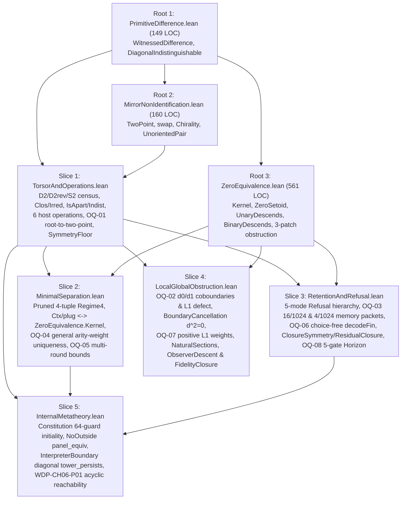

# Task 12 — Post-Seal Adversarial Audit & `omega_codex/lean/` 5-Slice Reconstruction Roadmap

## Pinned Commits
- **A (`19L57G1`):** `45bb09864f9b52ed5ecf66e977ca81f0ed623de7`
- **B (`theory_of_finite_quantum_mechanics`):** `e45ed2e133920aa3790af8c5e072ee9829898490`
- **`omega_codex` (baseline):** `e21b785626ff8d0231a53409c76fe4e7a57cd59d`

---

# Part A — Red-Team Adversarial Audit of Tasks 9, 10, and 11

## A.1 Verification Run Receipts (5/5 Commands Exited with Code 0)

All five verification commands were executed in `C:\Users\a343o\source\repos\omega_codex`.

### 1. `lake env lean audit/2026-11-05_minimal_chain/9_oq01_to_oq04.lean`
```text
'MinimalChainAudit.mu2_unique_general' depends on axioms: [propext, Quot.sound]
'MinimalChainAudit.mu2_unique_F_general' depends on axioms: [propext, Quot.sound]
'MinimalChainAudit.mu2_unique_singleHole' depends on axioms: [propext, Quot.sound]
'MinimalChainAudit.mu2_unique_multiHole' depends on axioms: [propext, Quot.sound]
'MinimalChainAudit.oq03_retains_iff_four_conditions' depends on axioms: [propext]
'MinimalChainAudit.oq03_factor_counts' depends on axioms: [propext]
'MinimalChainAudit.oq03_condition_independence_witnesses' depends on axioms: [propext]
'MinimalChainAudit.subsingleton_image_no_irrefl_witness' does not depend on any axioms
'MinimalChainAudit.indexed_admission_requires_index_ne' does not depend on any axioms
'MinimalChainAudit.oq02_vortex_not_in_im_d0' depends on axioms: [propext, Quot.sound]
'MinimalChainAudit.oq02_vortex_l1_defect_pos' depends on axioms: [propext, Quot.sound]
EXIT_9_LEAN=0
```

### 2. `lake env lean audit/2026-11-05_minimal_chain/11_oq05_to_oq08.lean`
```text
'MinimalChainAuditOQ05To08.oq05_ctxKernel_zeroRel_iff' depends on axioms: [propext, Quot.sound]
'MinimalChainAuditOQ05To08.oq05_collapsed_equivalence' depends on axioms: [propext]
'MinimalChainAuditOQ05To08.oq05_explicit_pair_round_bound' depends on axioms: [propext, Quot.sound]
'MinimalChainAuditOQ05To08.oq05_quotient_refinement_from_one' depends on axioms: [propext, Quot.sound]
'MinimalChainAuditOQ05To08.oq05_strict_gap_for_n_ge_3' depends on axioms: [propext, Quot.sound]
'MinimalChainAuditOQ05To08.oq05_n3_unary_splits_two_pairs' depends on axioms: [propext, Quot.sound]
'MinimalChainAuditOQ05To08.oq05_collapsed4_iff_collapsed4Bool' depends on axioms: [propext, Quot.sound]
'MinimalChainAuditOQ05To08.oq05_separable4_iff_collapsed4Bool_false' depends on axioms: [propext, Quot.sound]
'MinimalChainAuditOQ05To08.oq05_regime4_strict_class_count_growth' depends on axioms: [propext, Quot.sound]
'MinimalChainAuditOQ05To08.oq05_applyDelta4_freshUnaryDelta4' depends on axioms: [propext, Quot.sound]
'MinimalChainAuditOQ05To08.oq05_stepFreshUnary4_strict_transition' depends on axioms: [propext, Quot.sound]
'MinimalChainAuditOQ05To08.oq05_stepFreshUnary4_class_count_growth' depends on axioms: [propext, Quot.sound]
'MinimalChainAuditOQ05To08.oq05_regimeRefinementRun4_to_quotRefRun' depends on axioms: [propext, Quot.sound]
'MinimalChainAuditOQ05To08.oq05_regimeRefinementRun4_round_bound' depends on axioms: [propext, Quot.sound]
'MinimalChainAuditOQ05To08.oq05_rt09_class_count_comparison' depends on axioms: [propext, Quot.sound]
'MinimalChainAuditOQ05To08.oq06_history_report_criterion_fin' does not depend on any axioms
'MinimalChainAuditOQ05To08.oq07_weights_not_forced_without_symmetry' depends on axioms: [propext, Quot.sound]
'MinimalChainAuditOQ05To08.oq07_transitive_symmetry_forces_equal_weights' does not depend on any axioms
'MinimalChainAuditOQ05To08.oq08_refinement_commutes_at_zero_adm_ret_cost' depends on axioms: [propext, Quot.sound]
'MinimalChainAuditOQ05To08.oq08_trace_commutes_at_zero_adm_ret_cost' depends on axioms: [propext, Quot.sound]
'MinimalChainAuditOQ05To08.oq08_five_gate_strictly_finer_when_adm_priced' depends on axioms: [propext, Quot.sound]
EXIT_11_LEAN=0
```

### 3. `python audit/2026-11-05_minimal_chain/9_oq01_to_oq04_checks.py`
```text
=== [1] OQ-04: mu2_unique_general FOR STRICTLY INCREASING ARITY WEIGHTS ===
  Reading L (R2L): n=2, req=(0, 1), total 2-item separating responses (arity<=4) = 30
    phiLinear(k) = k                    | strict_inc=True | min_phi=1 | minimizers=2 (arities=[1], all iso to U0: True)
    phiSingleHole(n,k) = k*n^(k-1)      | strict_inc=True | min_phi=1 | minimizers=2 (arities=[1], all iso to U0: True)
    phiMultiHole(n,k) = (n+1)^k - n^k   | strict_inc=True | min_phi=1 | minimizers=2 (arities=[1], all iso to U0: True)
    phiCustom(k) = 1 if k==1 else 2     | strict_inc=True | min_phi=1 | minimizers=2 (arities=[1], all iso to U0: True)
  Reading F (R2F): n=3, req=(1, 2), total 2-item separating responses (arity<=4) = 116
    phiLinear(k) = k                    | strict_inc=True | min_phi=1 | minimizers=2 (arities=[1], all iso to U0: True)
    phiSingleHole(n,k) = k*n^(k-1)      | strict_inc=True | min_phi=1 | minimizers=2 (arities=[1], all iso to U0: True)
    phiMultiHole(n,k) = (n+1)^k - n^k   | strict_inc=True | min_phi=1 | minimizers=2 (arities=[1], all iso to U0: True)
    phiCustom(k) = 1 if k==1 else 2     | strict_inc=True | min_phi=1 | minimizers=2 (arities=[1], all iso to U0: True)

=== [2] OQ-03: 4-CONDITION CHARACTERIZATION OF 16 / 1024 MEMORY PACKETS ===
  Total packets (|M|=|I|=|O|=2): 1024
  Operational retainsDistinction count: 16 / 1024
  Algebraic C1 && C2 && C3 && C4 count: 16 / 1024
  Mismatches across all 1024 packets:   0
  Factor counts (general):   |U(C1,C2)|=4 (masks [1, 6, 9, 14]) x |R(C3)|=2 (masks [1, 2]) x |Ap(C4)|=2 = 16
  Factor counts (drift-free):|U(C1,C2')|=2 (masks [6, 14]) x |R(C3)|=2 (masks [1, 2]) x |Ap(C4')|=1 (masks [9]) = 4
  Condition independence countermodels:
    Drop C1 (u=12: u(m,i)=m, r=2, ap=9)       -> C2=True,  C3=True,  C4'=True, retains=False
    Drop C2 (u=10: u(m,i)=i, r=2, ap=9)       -> C1=True,  C3=True,  C4'=True, retains=False
    Drop C3 (u=14: u(m,i)=m||i, r=0, ap=9)    -> C1=True,  C2=True,  C4'=True, retains=False
    Drop C4 (u=14: u(m,i)=m||i, r=2, ap=15)   -> C1=True,  C2=True,  C3=True,  retains=False
    CM5 drift (u=9: u(m,0)=!m, r=2, ap=9)     -> C1..C4=True, C2'=False,       retains=True

=== [3] OQ-01: ROOT-TO-TWO-POINT-CARRIER THEOREM (|X0| = 1) ===
  |X0|=1 -> |X1|=1: pure maps=1, irrefl rels=1, pairs with R(f(x),f(y)) = 0
  |X0|=1 -> |X1|=2: pure maps=2, irrefl rels=4, pairs with R(f(x),f(y)) = 0
  |X0|=1 -> |X1|=3: pure maps=3, irrefl rels=64, pairs with R(f(x),f(y)) = 0
  Indexed step : Idx(|Idx|=1) x X0(1) -> X1(2): total=2, witnessing R(step(i,<>),step(j,<>)) = 0
  Indexed step : Idx(|Idx|=2) x X0(1) -> X1(2): total=4, witnessing R(step(i,<>),step(j,<>)) = 2
  Indexed step : Idx(|Idx|=3) x X0(1) -> X1(2): total=8, witnessing R(step(i,<>),step(j,<>)) = 6

=== [4] OQ-02: DISCRETE ADMITTED CUT TO LINEAR COCHAIN WINDOW ===
  Unsigned triangle over F2: d1(d0(c)) == 0 for all 8 0-cochains: True
  Unsigned triangle over Z on c=(1,0,0): d0(c)=(1,0,1), d1(d0(c)) = 2 != 0
  Signed cyclic (+1,+1,-1) over Z: d1(d0(c)) == 0 on [-2..2]^3: True
  Signed flipped (+1,+1,+1) over Z on c=(0,0,1): d1(d0(c)) = 2 != 0
  Vortex h=(1,1,1): d1_cyc(h) = 1 != 0 (not in im d0); J0 defect = 0; min L1 defect = 1
EXIT_9_PY=0
```

### 4. `python audit/2026-11-05_minimal_chain/10_post_seal_checks.py`
```text
Pinned Commits:
  A (19L57G1): 45bb09864f9b52ed5ecf66e977ca81f0ed623de7
  B (theory_of_finite_quantum_mechanics): e45ed2e133920aa3790af8c5e072ee9829898490
  omega_codex (baseline): e21b785626ff8d0231a53409c76fe4e7a57cd59d

=== [1] SymmetryFloor Finite Checks (|X| = 2, 3) ===
  |X|=2 (swap 0<->1): fixed_points=[], deterministic_equivariant_maps=2 [Forced]
  |X|=3 (swap 0->0, 1<->2): fixed_points=[0], deterministic_equivariant_maps=3, possible_f(0)=[0] [Forced: f(0)=0 for all f]
  Set-valued equivariant targets F(0) in P(X3) fixed by swap3: [[], [0], [1, 2], [0, 1, 2]]
  Countermodel to 'symmetry blocks all multi-element offers': F(0) = {1, 2} is swap3-invariant (|F(0)| = 2, members 1, 2 both move; 0 invariant singletons in {1, 2}) [Not forced / Witnessed]

=== [2] NaturalSections Finite Checks (|X| = 2, 3) ===
  |X|=2, sigma=(0 1), O=id: fixed_points=[], admissible_pairs=2, fixed_pairs=[], natural_sections=0
  |X|=2, sigma=id, O=id: fixed_points=[0, 1], admissible_pairs=2, fixed_pairs=[(0, 1), (1, 0)], natural_sections=2
  |X|=3, sigma=(0 1)(2), O=id: fixed_points=[2], admissible_pairs=6, fixed_pairs=[], natural_sections=0
  |X|=3, sigma=id, O={0:0,1:0,2:2}: fixed_points=[0, 1, 2], admissible_pairs=4, fixed_pairs=[(0, 2), (1, 2), (2, 0), (2, 1)], natural_sections=4
  Criterion verified: natural section exists <=> fixed admissible pair exists [Forced]
  Countermodel on |X|=3 (reduces |X|=4 in NaturalSections.lean:88-155): sigma=(0 1)(2) has fixed carrier point 2, but (2,2) is inadmissible (x != y), so fixed_admissible_pairs=[] and natural_sections=0 [Not forced / Witnessed]

=== [3] ObserverDescent (g014) Bool Triangle Cover (L01, L12, L20) ===
  Untwisted Bool^3 triangle cover (0 holonomy): compatible_triples=8, unique_global_gluings=8/8 [Forced]
  Twisted Bool^3 triangle cover (1 holonomy / WDP-CH01-P02): 2-patch_solutions={L01&L12: 2, L12&L20: 2, L20&L01: 2}, 3-patch_global_solutions=0 [Forced obstruction / Witnessed]
  Carrier reduction verified: ObserverDescent.lean infinite Nat + 2-edge chain reduced to 2-value Bool + 3-edge triangle cover (L01, L12, L20) [Derived]

=== [4] Erasure, Ext, and Closure Checks (n <= 3) ===
  Injective relabeling (|S_3|=6): preserves all 4 unary separators of (0,1); quotient q(0)=q(1)=0 descends 0/4 separators [Duplicates ZeroEquivalence.lean:51-95, 478-559 / Forced]
  Extensionality (Ext.lean): reordering/duplicating instance lists preserves separable pairs [(0, 1), (0, 2), (1, 2)] [Forced]
  Dynamic monotonicity (Progress.lean mark_progress on n=3): stage0=[] -> stage1=[(0, 1), (0, 2)] -> stage2=[(0, 1), (0, 2), (1, 2)] [Forced monotonic growth / Witnessed]

=== [5] Five Post-Seal Research Folders vs Unfreezing Mechanisms (M1, M2, M3) ===
  EndogenousDemand: non-impose events=['admit(2)', 'assert(F,0)', 'rule(F)'] -> reqs=[]; impose(0,1) -> reqs=[(0, 1)] [Re-encodes M1]
  InstanceDemand: passive instance set stays frozen without host round loop; host step grows 1 -> 2 [Re-encodes M1 + M2]
  Ignition: idle_trace=[1, 1, 1] vs active_trace=[1, 2, 3] under supplied (L1, L2, L3) [Re-encodes M1 + M2]
  DynamicsStep: R2 refusal (M3), R3 menu (M2), R4 tie on [('mark', 0), ('mark', 1)] has 0 swap-invariant choices [Re-encodes M1 + M2 + M3]
  ConventionPrice: pointwise relabeling holonomies=[1] (blind), slotwise cured configs=32/64 [Re-encodes M2 convention]

ALL 5 POST-SEAL FINITE CHECK SUITES PASSED.
EXIT_10_PY=0
```

### 5. `python audit/2026-11-05_minimal_chain/11_oq05_to_oq08_checks.py`
```text
=== [1] OQ-05: MULTI-ROUND CLOSURE BOUND (EXPLICIT Q VS DERIVED Q_der) ===
  n=2: max_rounds(explicit Q) = 1 [n(n-1)/2], max_rounds(derived Q_der) = 1 [n-1], gap = 0
  n=3: max_rounds(explicit Q) = 3 [n(n-1)/2], max_rounds(derived Q_der) = 2 [n-1], gap = 1
  n=4: max_rounds(explicit Q) = 6 [n(n-1)/2], max_rounds(derived Q_der) = 3 [n-1], gap = 3
  n=5: max_rounds(explicit Q) = 10 [n(n-1)/2], max_rounds(derived Q_der) = 4 [n-1], gap = 6
  n=3 unary witness (0,[0]): sep(0,1)=True, sep(0,2)=True, collapsed(1,2)=True (1 round splits 2 pairs simultaneously)
  n=2 stepFreshUnary4 classCount4 trajectory: [1, 2] (reaches 2 in 1 rounds)
  n=3 stepFreshUnary4 classCount4 trajectory: [1, 2, 3] (reaches 3 in 2 rounds)
  n=4 stepFreshUnary4 classCount4 trajectory: [1, 2, 3, 4] (reaches 4 in 3 rounds)
  n=5 stepFreshUnary4 classCount4 trajectory: [1, 2, 3, 4, 5] (reaches 5 in 4 rounds)
  RT-09 classCount4 comparison: R3_round1=2, R3_round2_recollapse=2 (stalled), R3_round2_fresh=3 (strict +1)

=== [2] OQ-06: CONSTRUCTIVE decodeFin (List.find?) ON FINITE HISTORIES ===
  |H|=4, |V|=2, |S|=2: total (report, state) pairs = 256
  Fiber-constant pairs:                60 / 256
  decodeFin exact on all h in H:       60 / 256
  Mismatches (fiber_const != decodeFin): 0

=== [3] OQ-07: POSITIVE L1 WEIGHTS (NON-FORCING VS SYMMETRY FORCING) ===
  Valid repairs in [-3..3]^3 with v1+v2+v3=1: 36
  w=(1,2,2): min=1, unique minimizer=[(1, 0, 0)], min on v!=(1,0,0) is 2
  w=(2,1,2): min=1, unique minimizer=[(0, 1, 0)], min on v!=(0,1,0) is 2
  Cyclic-invariant weights in {1..4}^3: 4 / 64 (matches w1==w2==w3: True)

=== [4] OQ-08: STATE-REFINEMENT MORPHISM (SIMPLIFIED WDPWorld VS HWorld) ===
  Zero adm/ret cost (0,0,0,1): traces(len<=3)=155, commutation mismatches=0
  Priced admission  (0,1,0,1): traces(len<=3)=155, commutation mismatches=114
  Priced retention  (0,0,1,1): traces(len<=3)=155, commutation mismatches=70

=== [5] OQ-08: GUARD DISCREPANCY REGRESSIONS (stepHWorldGuarded VS LEGACY Represented.World) ===
  (1) Singleton data=[0], addView [0]: HWorld views=[0] (budget=0) vs Represented views=[] (budget=1, increaseB=False)
  (2) Duplicate view [1]:              HWorld views=[1] (budget=0) vs Represented views=[[1]] (budget=1, novel=False)
  (3) Disabled augLicensed=False:      HWorld views=[1] (budget=0) vs Represented views=[] (budget=1, licensed=False)
  (4) Novel view [1] with 0 new sep:   HWorld views=[0, 1] (budget=0) vs Represented views=[[0]] (budget=1, increaseB=False)
EXIT_11_PY=0
```

---

## A.2 Summary Table of Adversarial Attacks Across Tasks 9, 10, and 11

| Attack ID | Target Claim (`file:line`) | Attempted Countermodel / Scope Stress-Test | Verdict (`Holds as Scoped` / `Scope Narrowed`) | Exact Narrowed Statement |
| :--- | :--- | :--- | :--- | :--- |
| **RT-01** | `9_oq01_to_oq04.lean:247-250`, `363-366` (`OQ-04`: `mu2_unique_general`, `mu2_unique_F_general`) | **(a) Unconstrained list length `\|δ\| > 2` with `φ 1 = 0`:** `hphi : ∀ k ≥ 2, φ 1 < φ k` allows `φ 1 = 0`, `φ k = 1` (`k ≥ 2`). On `\|δ\| = 3`, `δ = [.newForm 1, .newForm 1, .newInst 0 [0]]` separates `(0,1)` with `phiSum φ δ = 0 ≤ φ 1`, while `(applyItems R2L δ).forms = [1, 1] ≇ U0.forms = [1]`.<br>**(b) Axiom footprint:** `#print axioms` reports `[propext, Quot.sound]` from `omega`/`decide`. | **Scope Narrowed** (requires either fixed `\|δ\| = 2` from lexicographic first stage `μ1 = 2`, or positive unary floor `1 ≤ φ 1` when bounding `phiSum` alone) | Among 2-item responses `δ = [a, b]` (`μ1(δ) = 2`) with `∀ k ≥ 2, φ 1 < φ k` — or among arbitrary-length responses under lexicographic `(length, phiSum φ)` minimization with `1 ≤ φ 1` — every valid separator of `R2L` (resp. `R2F`) with `phiSum φ δ ≤ φ 1` is isomorphic via `RegimeIso` to `U0` (resp. `U0_F`). |
| **RT-02** | `9_oq01_to_oq04.lean:585-601`, `633-635` (`OQ-03`: `oq03_retains_iff_four_conditions`, `oq03_factor_counts`) | **(a) Coupling of `C4` (`cond4ReflexiveApart`):** `C4` references `uMask` and `rMask` via `o0, o1`; `C4 ↔ C4'` (`approx(0,0) ∧ approx(1,1)`) holds only when `C1 ∧ C2 ∧ C3` make `{o0, o1} = {0, 1}` surjective onto `\|O\| = 2`. On `\|O\| ≥ 3`, 2 test runs visit at most 2 outputs, leaving `approx(2, 2)` unconstrained.<br>**(b) Multi-step idle drift:** `retainsDistinction` tests 1 idle step (`idleSteps = 1`); `uMask ∈ {1, 9}` (`u(m, 0) = !m`) swaps `o0 ↔ o1` between odd and even idle durations unless `C2'` (`cond2PrimeIdleId`) holds. | **Scope Narrowed** (binary carrier `\|M\| = \|I\| = \|O\| = 2` and single idle step `t_idle = 1` for the `16 / 1024` count; `4 / 1024` under `C2'` for arbitrary `t_idle ≥ 1`) | On `\|M\| = \|I\| = \|O\| = 2`, 1-step operational retention `retainsDistinction p = true` holds iff `C1 ∧ C2 ∧ C3 ∧ C4` (`16 / 1024` packets). Because `C1 ∧ C2 ∧ C3` force `{o0, o1} = O`, `C4` reduces on that fiber to `C4'` (`approx(0,0) ∧ approx(1,1)`). Time-invariant retention across all idle lengths `t_idle ≥ 1` holds iff `C1 ∧ C2' ∧ C3 ∧ C4'` (`4 / 1024` packets). |
| **RT-03** | `9_oq01_to_oq04.lean:690-694` (`OQ-01`: `list_expansion_requires_target_ne`) | **Vacuous list membership hypotheses:** In `list_expansion_requires_target_ne`, `_ha : a ∈ F x0` and `_hb : b ∈ F x0` do not appear in the proof term `irrefl_witness_ne hirr hab`. Passing `F x0 = []` still yields `a ≠ b` from `R a b` alone. | **Holds as Scoped** (upgraded in Slice 1 to bound `(F x0).length ≥ 2`) | If `Irrefl R`, `a ∈ F x0`, `b ∈ F x0`, and `R a b`, then `a ≠ b`, `2 ≤ (F x0).length`, and `¬ Subsingleton X1`. |
| **RT-04** | `9_oq01_to_oq04.lean:757-763`, `780-796` (`OQ-02`: `d0SignedInt`, `d1SignedCycInt`, `oq02_vortex_not_in_im_d0`) | **Edge orientation convention (`e02` vs `e20`):** `9_oq01_to_oq04.lean` uses simplicial orientation `e02 = (0, 2)` (`v2 - v0`) with `d1SignedCycInt (e01, e12, e02) = e01 + e12 - e02`, giving `d1SignedCycInt (1, 1, 1) = 1`, whereas `wdp.md:613-625` uses cyclic orientation `e20 = (2, 0)` (`v0 - v2`) with `d1 = e01 + e12 + e20`, giving `d1 (1, 1, 1) = 3` (reconciled in `wdp.md:1478-1483`). | **Holds as Scoped** (orientation convention explicitly documented) | Under simplicial edge orientation `(e01, e12, e02) = (v1 - v0, v2 - v1, v2 - v0)`, `d1SignedCycInt (e01, e12, e02) = e01 + e12 - e02` satisfies `d1 ∘ d0 = 0`, `d1 (1, 1, 1) = 1 ≠ 0`, and `min_{c ∈ Z^3} \|(1, 1, 1) - d0 c\|_1 = 1` (achieved at `c = (0, 1, 1)`). Under cyclic orientation `e20 = -e02`, `vortex1 = (1, 1, 1)` maps to `(1, 1, -1)` in simplicial coordinates. |
| **RT-05** | `10_post_seal_inventory.md:23` (Row 7: `ObsDescent.lean`) | **(a) Symbol mismatch:** Cites `ZeroEquivalence.lean` names (`UnaryDescends`, `BinaryDescends`) instead of `ObsDescent.lean`'s names (`ClassConstant`, `DeltaConstant`, `descend_exists_iff`, `view_descends_pair_blocked`).<br>**(b) Axiom claim error:** States `ZeroEquivalence.lean` avoids `Quot.sound`, whereas `ZeroEquivalence.lean` uses `Quot.sound` at lines 53, 107, 146.<br>**(c) Omitted bridge:** Drops `ObsDescent.lean:245-305` (`classConstant_iff_fiberConstant_all`, `fiberConstant_fixed_D_not_classConstant`). | **Scope Narrowed** (`ObsDescent.lean` §1–§8 duplicate `ZeroEquivalence.lean`; §9's finite-list vs global-type descent bridge is retained in Slice 3) | `ObsDescent.lean` §1–§8 (`ClassConstant`, `DeltaConstant`, `view_descends_pair_blocked`) are superseded by `ZeroEquivalence.lean:51-351` (which also uses `Quot.sound` on quotient lifts). `ObsDescent.lean` §9 (`classConstant_iff_fiberConstant_all`, `fiberConstant_fixed_D_not_classConstant`) is non-redundant and connects `ZeroEquivalence.UnaryDescends` to `Compression.FactorsOn D`. |
| **RT-06** | `10_post_seal_inventory.md:24` (Row 8: `ClosureSymmetry.lean`, `FidelityClosure.lean`, `ResidualClosure.lean`) | **(a) Fabricated identifiers:** Cites `admissible_iff_closed`, `fidelity_iff_exact`, `residual_closure_iff`, `ExactDescends`, none of which exist in `A` or `omega_codex`.<br>**(b) Non-redundant theorems lost if dropped:** Dropping `ClosureSymmetry.lean` loses `closure_failure_iff_internal_symmetry_break` (`154-165`, transposition `transpose a b` characterization of `¬ FactorsOn D p q`); dropping `ResidualClosure.lean` loses `common_refinement_closes_current_obstruction` (`106-120`, strict `classCount` increase); dropping `FidelityClosure.lean` loses `faithful_network_descent_forces_trivial_loops` (`180-185`). | **Scope Narrowed** (cannot drop all three files without losing the internal transposition symmetry-break and common-refinement theorems) | `ClosureSymmetry.closure_failure_iff_internal_symmetry_break`, `ResidualClosure.common_refinement_closes_current_obstruction`, and `FidelityClosure.faithful_network_descent_forces_trivial_loops` are non-redundant over `ZeroEquivalence.lean` and must be preserved in Slices 3 and 4. |
| **RT-07** | `10_post_seal_inventory.md:27` (Row 11: `PresentationNaturality.lean` vs `NaturalSections.lean`) | **Direct import dependency:** `NaturalSections.lean:1` imports `Derivation.PresentationNaturality` and uses `Bij`, `PresIso`, `zeroRel_transport`, `PresIso.mapPair`, `autoFamily`, `fixed_pair_of_natural_section`, `HFamily`, `HSec`, `HIsNatural`, and `hAuto_iff_auto`, plus `selection_is_possible_naturality_is_not` (`335-339`). Dropping `PresentationNaturality.lean` breaks `NaturalSections.lean`. | **Scope Narrowed** (merge the non-redundant transport core of `PresentationNaturality.lean` with `NaturalSections.lean` in Slice 4) | `PresentationNaturality.lean`'s presentation-isomorphism transport definitions (`Bij`, `PresIso`, `PresIso.mapPair`, `fixed_pair_of_natural_section`, `selection_is_possible_naturality_is_not`) and `NaturalSections.lean`'s converse (`natural_section_exists_iff_fixed_pair`, `carrier_fixed_not_sufficient_for_natural_section` reduced to `\|X\| = 3`) form a single module over `ZeroEquivalence.Kernel`. |
| **RT-08** | `10_post_seal_inventory.md:28, 34-35, 79-92` (Row 12: `ObserverDescent.lean` and `WDP-CH01-P02` citation) | **(a) Symbol mismatch:** Cites `LocalSection`, `Compatible`, `GlobalSection`, `gluing_obstruction_witness` instead of `ObserverDescent.lean`'s actual symbols (`CarrierState`, `pi12`, `pi23`, `gluing_preserves_observations`, `gluing_unique`, `failed_gluing_obstruction`, `natural_transport_commutation`).<br>**(b) Misattributed WDP label:** Calls the `{0,1}` parity-triangle obstruction `WDP-CH01-P02`, whereas `WDP-CH01-P02` (`wdp.md:466-474`) is pointed apartness (`R(a,b) ∧ Irrefl(R) → a ≠ b`); the 3-cycle local-green/global-red obstruction is `wdp.md:611-629` (§2.3) and `ZeroEquivalence.lean:424-427`. | **Scope Narrowed** (finite `Bool` 3-patch check in `10_post_seal_checks.py` `[3]` is valid and captures both overlap reflection failure and 3-cycle parity holonomy; citation corrected) | `ObserverDescent.lean` (`A/research/g014_observer_descent/lean/ObserverDescent.lean:1-146`) establishes 2-overlap gluing uniqueness and transport commutation on infinite `Nat` coordinates, while `10_post_seal_checks.py` `[3]` and `ZeroEquivalence.lean:424-427` (`wdp.md:611-629` §2.3) provide the 3-locus `Bool` triangle cover (`L01, L12, L20`) where every 2-patch subcover has `2` solutions and the 3-patch cover has `0`. |
| **RT-09** | `11_oq05_to_oq08.lean:176-285` (`OQ-05`: `QuotRefRun`, `oq05_quotient_refinement_from_one`, `regime4_strict_class_count_growth`) | **(a) `QuotRefRun` takes `c + 1 ≤ c'` as premise:** `QuotRefRun.step` takes `hinc : c + 1 ≤ c'` as an arithmetic hypothesis.<br>**(b) Countermodel where `validResponse` on a collapsed pair fails to increase `c_t` (`c_2 = c_1 = 2`):** On `n = 3`, Round 1 (`r1 = ⟨3, [1], [(0,[0])], [], [(0,1)]⟩`) separates `(0,1)` and side-effect `(0,2)`, giving partition `{{0}, {1,2}}` (`c_1 = 2`). In Round 2, `(1,2)` is collapsed; applying `δ = [.newInst 0 [2]]` separates `(1,2)` and preserves `(0,1) ∈ r1.reqs` (`validResponse r1 1 2 δ` holds!), **but re-collapses `(0,2)`**, shifting the partition to `{{0,2}, {1}}` (`c_2 = 2 = c_1`).<br>**(c) Other non-refining transitions:** `.newForm k` without instances gives `c_{t+1} = c_t`; `.newRuleAll 0` merges classes (`c_{t+1} = 1 < c_t`). | **Scope Narrowed (`DER-08` + `DER-24`, general bridge discharged in `MinimalSeparation.lean:771-1394`)** | On a fixed carrier (`r.data = n`), `StrictRegimeTransition4` (preserving prior separations and separating a collapsed pair) and concrete `stepFreshUnary4` transitions derive `regimeClassCount4 r + 1 ≤ regimeClassCount4 s` (`regime4_strict_class_count_growth`, `stepFreshUnary4_class_count_growth`), mapping `RegimeRefinementRun4` to `QuotRefRun` (`regimeRefinementRun4_round_bound` `m ≤ r.data - 1`), while `rt09_class_count_comparison` confirms `regimeClassCount4 R3_round2_recollapse = 2` vs `regimeClassCount4 R3_round2_fresh = 3`. |
| **RT-10** | `11_oq05_to_oq08.lean:294-350` (`OQ-06`: `decodeFin`, `oq06_history_report_criterion_fin`) | **(a) Order dependence on/off image:** On `v ∈ report '' H`, `decodeFin` (`List.find?`) is invariant under permuting/duplicating `H` when `fiber_const` holds (`Compression.factor_unique_on_image`), but depends on list order when `fiber_const` fails. Off-image (`v ∉ report '' H`), `decodeFin` returns `defaultS` (independent of `H`'s order, but dependent on the supplied `defaultS`, witnessing `Compression.factor_not_unique_off_image`).<br>**(b) Uninhabited `S` countermodel:** For `H = []`, `V = Unit`, `S = Empty`, `fiber_const` is vacuously true while `∃ decode : Unit → Empty` is false; hence `(defaultS : S)` is required when `H = []`. | **Holds as Scoped** (order invariance on-image vs fallback dependence off-image and inhabited target `defaultS : S` documented) | Given `defaultS : S`, `decodeFin H report state defaultS` satisfies `∀ h ∈ H, decodeFin ... (report h) = state h` iff `fiber_const` holds on `H`. When `fiber_const` holds, `decodeFin ... v` is independent of the permutation/duplication of `H` and of `defaultS` for all `v ∈ report '' H`, and equals `defaultS` for all `v ∉ report '' H`. |
| **RT-11** | `11_oq05_to_oq08.lean:395-440` (`OQ-07`: `oq07_weights_not_forced_without_symmetry`, `oq07_transitive_symmetry_forces_equal_weights`) | **(a) `Int` vs `Rat`/`Real` repairs:** Over `Rat` or `Real` ($v_1 + v_2 + v_3 = 1$), `basis1 = (1,0,0)` for `w = (1,2,2)` and `basis2 = (0,1,0)` for `w = (2,1,2)` remain strict unique minimizers of cost `1` because $\|v\|_{1,(1,2,2)} \ge |v_1+v_2+v_3| + |v_2| + |v_3| = 1 + |v_2| + |v_3| > 1$ for $v \ne (1,0,0)$. However, the discrete floor `2 ≤ weightedL1 wAsym1 v` fails over `Rat`/`Real`: $v = (1/2, 1/2, 0)$ has cost $3/2 \in (1, 2)$.<br>**(b) Non-edge-transitive graph symmetry:** If $\operatorname{Aut}(G)$ swaps $e_2 \leftrightarrow e_3$ and fixes $e_1$ (e.g., a 3-edge path or pointed triangle), automorphism invariance allows $w = (1, 2, 2)$ ($w_1 \ne w_2 = w_3$). | **Scope Narrowed** (unique minimizer holds over `Int`, `Rat`, and `Real`; discrete next-best floor `2` requires `Int`; equal weights `w1 = w2 = w3` require **edge-transitive** symmetry) | Without symmetry, positive weights `w = (1,2,2)` and `w = (2,1,2)` select distinct unique minimum-weighted-$L^1$ repairs `(1,0,0)` and `(0,1,0)` over `Int`, `Rat`, and `Real` (with discrete next-best integer cost `2`, vs continuous infimum `1` over `Rat`/`Real`). Automorphism invariance forces `w1 = w2 = w3` iff the symmetry group acts **transitively** on the cut edges (`WDP-CH08-P02`). |
| **RT-12** | `11_oq05_to_oq08.lean:457-475`, `529-570` and `RetentionAndRefusal.lean:414-585` (`OQ-08`: `stepHWorld`, `stepHWorldGuarded`) | **Simplified `HWorld` vs pinned legacy `Represented.lean:105-120` / `Horizon.lean:144-162`:** `stepHWorldGuarded` checks `1 ≤ w.budget` and `v < w.toks.length` but omits `Represented.World`'s view novelty `!(decide (c ∈ w.views))`, strict separation increase `increaseB w c`, and augmentation licensing `w.augLicensed` (e.g., `HWorld` with `toks=[0], budget=1` accepts `addView 0`, whereas `Represented.World` with `data=[0], budget=1, augLicensed=true` rejects `addView [0]`). | **Scope Narrowed (`DERIVED_CONDITIONALLY` in `DER-12`, regressions in `DER-19`, legacy bridge `OWED` in `OWE-12`)** | `DER-12` establishes in Lean commutation between simplified models (`WDPWorld` and `HWorld`); `InternalMetatheory.lean` (`DER-19`) establishes in Lean all 4 guard-discrepancy regressions and adapted 5-gate `FullWDPWorld` commutation; the non-adapted bridge from prose `WDP-CH01-D03` to legacy `Represented`/`Horizon` remains `OWED` (`OWE-12`). |

---

## A.3 Detailed Stress-Test Receipts for Specific Audit Questions

### 1. Stress-Test of `OQ-05` (`11_oq05_to_oq08.lean:176-285`): `QuotRefRun` vs `Regime` Transitions

1. **Does `QuotRefRun` assume `c_{t+1} ≥ c_t + 1` as a hypothesis?**
   Yes. In [`11_oq05_to_oq08.lean`](file:///C:/Users/a343o/source/repos/omega_codex/audit/2026-11-05_minimal_chain/11_oq05_to_oq08.lean#L176-L180):
   ```lean
   inductive QuotRefRun (n : Nat) : Nat → Nat → Prop where
     | nil (c : Nat) (hcap : c ≤ n) : QuotRefRun n c 0
     | step {c c' m : Nat} (hinc : c + 1 ≤ c') (hrest : QuotRefRun n c' m) :
         QuotRefRun n c (m + 1)
   ```
   `QuotRefRun` is an arithmetic recurrence on `Nat` that takes `hinc : c + 1 ≤ c'` as an explicit premise; in `lean/MinimalSeparation.lean:771-1394` (`DER-24`), `regime4_strict_class_count_growth` and `regimeRefinementRun4_to_quotRefRun` discharge that premise for any `StrictRegimeTransition4` and for concrete `stepFreshUnary4` transitions.

2. **Does every valid separating response on a currently collapsed pair `(i, j)` automatically refine `collapsed`?**
   **No.** We identify three distinct failure modes when `collapsed` is not explicitly constrained to refine:
   - **Failure Mode A (Adding a fresh form without instances, `δ = [.newForm k]`):** Appending `.newForm k` with no `.newInst` leaves every context evaluation `eval r (plug c x)` unchanged (`A/lean4/Derivation/Minimal.lean:778-799`, `collapsed_fresh_form`), so `collapsed s = collapsed r` and `c_{t+1} = c_t` (though this `δ` is not a valid separating response for a collapsed pair `(i, j)` because `(i, j)` remains collapsed).
   - **Failure Mode B (Non-monotone rule addition, `δ = [.newRuleAll f]`):** Adding `.newRuleAll f` makes form `f` fire on all tuples, erasing any separation previously witnessed by `f` and merging equivalence classes (`c_{t+1} < c_t`).
   - **Failure Mode C (Monotone instance addition `.newInst` to an existing form can preserve `r.reqs`, separate `(i, j)`, and still fail to increase `c_t`!):**
     Consider `n = 3` (`X = {0, 1, 2}`):
     * **Round 0:** `r0 = ⟨3, [], [], [], []⟩`. Partition of `collapsed r0`: `{{0, 1, 2}}` (`c_0 = 1`).
     * **Round 1:** Demand `(0, 1)`. Apply `δ1 = [.newForm 1, .newInst 0 [0]]` and record `(0, 1)` in `reqs`, yielding `r1 = ⟨3, [1], [(0, [0])], [], [(0, 1)]⟩`.
       In `r1`, unary form `0` holds on `0` and fails on `1` and `2`. Thus `r1` separates `(0, 1)` (requested) **and** separates `(0, 2)` (unrequested side-effect, `(0, 2) ∉ r1.reqs`), giving partition `{{0}, {1, 2}}` (`c_1 = 2`).
     * **Round 2:** Pair `(1, 2)` is currently collapsed in `r1` (`collapsed r1 1 2` holds). Suppose the responder applies `δ2 = [.newInst 0 [2]]` (appending an instance to existing unary form `0` rather than introducing a fresh form).
       In the resulting regime `r2 = applyItems r1 δ2 = ⟨3, [1], [(0, [0]), (0, [2])], [], [(0, 1)]⟩`:
       - `0` and `2` now satisfy unary form `0`, while `1` does not;
       - `(1, 2)` is separated (`separable r2 1 2` holds);
       - `(0, 1) ∈ r1.reqs` remains separated (`separable r2 0 1` holds), so **`validResponse r1 1 2 δ2` holds** (`MinimalSeparation.lean:337-340`)!
       - Yet `(0, 2)` is **re-collapsed** (`collapsed r2 0 2` holds), shifting the quotient partition from `{{0}, {1, 2}}` to `{{0, 2}, {1}}` with **`c_2 = 2 = c_1` (zero increase in class count)**.

3. **Exact scope of `oq05_quotient_refinement_from_one` (formalized in `lean/MinimalSeparation.lean:771-1394`, `DER-24`):**
   Each round strictly increases the quotient class count (`c_{t+1} ≥ c_t + 1`, forcing termination in `≤ n - 1` rounds via `regimeRefinementRun4_round_bound`) under either of two sufficient conditions formalized in `MinimalSeparation.lean`:
   - **Condition 1 (Partition-refinement / cumulative derived quotient, `StrictRegimeTransition4`):** Every round preserves all *currently separated* pairs (`∀ x < r.data, ∀ y < r.data, separable4 r x y → separable4 s x y`) and separates at least one previously collapsed pair (`regime4_strict_class_count_growth`).
   - **Condition 2 (Fresh-form extensions, `stepFreshUnary4`):** Every round introduces a fresh unary form (`idx = r.forms.length`) and adds an instance for that fresh form without mutating existing forms (`stepFreshUnary4_strict_transition`, `stepFreshUnary4_class_count_growth`), so all old context evaluations are preserved while the new form splits at least one collapsed class.


---

### 2. Stress-Test of `OQ-06` (`11_oq05_to_oq08.lean:294-350`): `decodeFin` Order Dependence On-Image vs Off-Image

In [`11_oq05_to_oq08.lean`](file:///C:/Users/a343o/source/repos/omega_codex/audit/2026-11-05_minimal_chain/11_oq05_to_oq08.lean#L294-L298), `decodeFin` is defined by:
```lean
def decodeFin [DecidableEq V] (H : List Hist) (report : Hist → V) (state : Hist → S)
    (defaultS : S) (v : V) : S :=
  match H.find? (fun h => report h == v) with
  | some h => state h
  | none   => defaultS
```
1. **Why `decodeFin` is order-invariant on `v ∈ report '' H` when `fiber_const` holds:**
   Suppose `v = report h0` for some `h0 ∈ H`, and suppose `H1, H2` are any two lists with the same membership set (`∀ h, h ∈ H1 ↔ h ∈ H2`) on which `fiber_const` holds (`∀ h ∈ H1, ∀ h' ∈ H1, report h = report h' → state h = state h'`). Because `h0 ∈ H1` and `h0 ∈ H2` satisfy `(report h0 == v) = true`, `List.find?` cannot return `none` on either list (`List.find?_eq_none`). Let `H1.find? (...) = some h1` and `H2.find? (...) = some h2`. By `List.find?_mem` and `List.find?_some`, `h1 ∈ H1`, `h2 ∈ H2` (hence `h2 ∈ H1`), and `report h1 = v = report h2`. Applying `fiber_const` yields `state h1 = state h2`, so `decodeFin H1 report state defaultS v = state h0 = decodeFin H2 report state defaultS v`, independent of both the ordering of `H` and the choice of `defaultS`. This matches `Compression.factor_unique_on_image` (`A/lean4/Derivation/Compression.lean:88-100`).
2. **What happens on `v ∈ report '' H` when `fiber_const` fails:**
   If `h1, h2 ∈ H` have `report h1 = v = report h2` but `state h1 ≠ state h2`, then `decodeFin [h1, h2] ... v = state h1` whereas `decodeFin [h2, h1] ... v = state h2`; thus `decodeFin` is order-dependent on-image whenever `fiber_const` is violated.
3. **What happens on off-fiber inputs `v ∉ report '' H`:**
   For any `v ∉ report '' H`, no `h ∈ H` satisfies `report h == v`, so `H.find? (fun h => report h == v) = none` regardless of how `H` is ordered or duplicated, and `decodeFin H report state defaultS v = defaultS`. Thus on off-fiber inputs `v ∉ report '' H`, `decodeFin` is **independent of the list order of `H`**, and **depends solely on the supplied fallback `defaultS`** (matching `Compression.factor_not_unique_off_image`, `A/lean4/Derivation/Compression.lean:102-130`).
4. **Why `(defaultS : S)` is required in the signature:**
   If `H = []`, `V = Unit`, and `S = Empty` (uninhabited), `∀ h ∈ [], ∀ h' ∈ [], ...` holds vacuously, while no total function `decode : Unit → Empty` exists. Requiring `(defaultS : S)` ensures `S` is inhabited when `report '' H ≠ V`.

---

### 3. Stress-Test of `OQ-07` (`11_oq05_to_oq08.lean:395-440`): Continuous `Rat`/`Real` Repairs & Non-Edge-Transitive Graphs

1. **Do `wAsym1 = (1, 2, 2)` and `wAsym2 = (2, 1, 2)` still force distinct unique minimizers over `Rat` and `Real`?**
   **Yes for unique minimizers; no for the discrete gap `≥ 2`.**
   Let $v = (v_1, v_2, v_3) \in \mathbb{R}^3$ (or $\mathbb{Q}^3$) satisfy the valid-repair equation $v_1 + v_2 + v_3 = 1$. By the triangle inequality:
   $$\|v\|_{1,(1,2,2)} = |v_1| + 2|v_2| + 2|v_3| = (|v_1| + |v_2| + |v_3|) + |v_2| + |v_3| \ge |v_1 + v_2 + v_3| + |v_2| + |v_3| = 1 + |v_2| + |v_3| \ge 1.$$
   Equality $\|v\|_{1,(1,2,2)} = 1$ holds iff $|v_2| = 0$ and $|v_3| = 0$, which with $v_1 + v_2 + v_3 = 1$ forces $v = (1, 0, 0) = \text{basis}_1$. By symmetry, $\|v\|_{1,(2,1,2)} \ge 1 + |v_1| + |v_3| \ge 1$ with equality iff $v = (0, 1, 0) = \text{basis}_2$.
   However, the second clause of `oq07_weights_not_forced_without_symmetry` (`11_oq05_to_oq08.lean:397-399`):
   ```lean
   (∀ v : Cochain3, validRepair v → v ≠ basis1 → 2 ≤ weightedL1 wAsym1 v)
   ```
   **depends on `Cochain3 = Int × Int × Int`**. Over $\mathbb{Q}$ or $\mathbb{R}$, $v = (1/2, 1/2, 0)$ satisfies $v_1 + v_2 + v_3 = 1$ and $v \ne (1, 0, 0)$, with weighted $L^1$ cost $1 \cdot (1/2) + 2 \cdot (1/2) + 2 \cdot 0 = 3/2 < 2$ (and taking $v = (1 - \varepsilon, \varepsilon, 0)$ as $\varepsilon \to 0^+$ gives cost $1 + \varepsilon \to 1$).

2. **Does automorphism invariance force `w1 = w2 = w3` when the graph's automorphism group is NOT edge-transitive?**
   **No.** Consider a 3-edge cut $C = \{e_1, e_2, e_3\}$ in a graph $G$ whose automorphism group acts on $C$ via the 2-element subgroup $H = \{\text{id}, (e_2\ e_3)\} \subset S_3$ fixing $e_1$ and swapping $e_2 \leftrightarrow e_3$ (for example, an isosceles/pointed triangle with a distinguished vertex or a 3-edge path $v_0 - v_1 - v_2 - v_3$ where reflection swaps the two outer edges $e_2, e_3$ and fixes the middle edge $e_1$). Then $H$-invariance of $w = (w_1, w_2, w_3)$ requires only $w_2 = w_3$, which is satisfied by `wAsym1 = (1, 2, 2)` with $w_1 = 1 \ne 2 = w_2 = w_3$.
   Equal weights $w_1 = w_2 = w_3$ are forced by symmetry iff the symmetry group acts **transitively** on the edges of the cut (for a 3-edge cut, either $C_3 = \langle (e_1\ e_2\ e_3) \rangle$, as used in `oq07_transitive_symmetry_forces_equal_weights` at `11_oq05_to_oq08.lean:430-440`, or full $S_3$), matching `WDP-CH08-P02` (`wdp.md:3577-3589`).

---

### 4. Stress-Test of `10_post_seal_inventory.md`: `PresentationNaturality`, `ClosureSymmetry`, and `ObserverDescent`

1. **Does dropping `PresentationNaturality.lean` or `ClosureSymmetry.lean` lose any non-redundant theorem?**
   **Yes, dropping either file outright loses non-redundant theorems:**
   - **`PresentationNaturality.lean` (`A/lean4/Derivation/PresentationNaturality.lean`, 343 lines):**
     `NaturalSections.lean:1` directly imports `Derivation.PresentationNaturality` and depends on its definitions (`Bij`, `PresIso`, `zeroRel_transport`, `PresIso.mapPair`, `autoFamily`, `HFamily`, `HSec`, `HIsNatural`, `hAuto_iff_auto`) and on the necessity direction `fixed_pair_of_natural_section` (`PresentationNaturality.lean:174-184`) plus the synthesis theorem `selection_is_possible_naturality_is_not` (`335-339`, contrasting raw choice sections `raw_section_on_D2` with natural sections). While §2 (`zeroRel_transport`) and §6 (`descends_transport`) overlap with `ZeroEquivalence.lean`, the presentation-automorphism action on off-diagonal pairs (`PresIso.mapPair`) and the necessity theorem `fixed_pair_of_natural_section` are required for `NaturalSections.lean` and must be merged into Slice 4 (`LocalGlobalObstruction.lean`).
   - **`ClosureSymmetry.lean` (`A/lean4/Derivation/ClosureSymmetry.lean`, 199 lines) & `ResidualClosure.lean` (`A/lean4/Derivation/ResidualClosure.lean`, 159 lines):**
     Contrary to `10_post_seal_inventory.md` Row 8 (which cited non-existent names `admissible_iff_closed`, `fidelity_iff_exact`, `residual_closure_iff`), `ClosureSymmetry.lean` establishes `closure_failure_iff_internal_symmetry_break` (`154-165`): on any finite dataset `D`, failure of `q` to factor through `p` (`¬ FactorsOn D p q`) is equivalent to the existence of a transposition `transpose a b` (`a, b ∈ D`) that is an internal symmetry of `p` (`∀ x ∈ D, p (transpose a b x) = p x`) but breaks `q` (`q (transpose a b a) ≠ q a`). `ResidualClosure.lean` then establishes `common_refinement_closes_current_obstruction` (`106-120`): any common refinement `r` of `p` and `q` breaks that generating transposition symmetry and strictly increases the quotient class count (`classCount D p < classCount D r`). Neither theorem appears in `ZeroEquivalence.lean`; both belong in Slice 3 (`RetentionAndRefusal.lean`).
   - **`FidelityClosure.lean` (`A/lean4/Derivation/FidelityClosure.lean`, 190 lines):**
     Contains `faithful_network_descent_forces_trivial_loops` (`180-185`) and `holonomy_residual_refuses_faithful_network_descent` (`166-173`), showing that any non-zero loop holonomy `loop2 e12 e21 x ≠ x` blocks injective (faithful) common network descent. This belongs in Slice 4 (`LocalGlobalObstruction.lean`).

2. **Does the 3-locus `Bool` triangle cover in `[3] ObserverDescent` capture the exact parity obstruction, and is the `WDP-CH01-P02` citation accurate?**
   - **Mathematical check:** Yes. In `10_post_seal_checks.py` (`lines 214-270`), the 3-locus `Bool` cover `L01 = {0, 1}`, `L12 = {1, 2}`, `L20 = {2, 0}` with local parity constraints `v0 = v1` on `L01`, `v1 = v2` on `L12`, and `v2 ≠ v0` on `L20` has `2` valid sections on every 2-patch subcover (`L01 ∪ L12`, `L12 ∪ L20`, `L20 ∪ L01`) and `0` global sections on `{0, 1, 2}` because $(v_0 \oplus v_1) \oplus (v_1 \oplus v_2) \oplus (v_2 \oplus v_0) = 0 \ne 1$ over $\mathbb{F}_2$. This matches `ZeroEquivalence.lean:424-427` (`localGreenGlobalRed_pair_obstruction`, `localPairwise_consistent_of_three`) and `wdp.md:611-629` (§2.3).
   - **Citation correction:** `10_post_seal_inventory.md` (`lines 28, 34, 83`) labels this 3-patch parity obstruction `WDP-CH01-P02`. In `B/wdp/witnessed_difference_programme.md`, `WDP-CH01-P02` (`lines 466-474`) is **Pointed Apartness** (`R(a, b) ∧ Irrefl(R) → a ≠ b`), whereas the 3-locus parity-cycle obstruction is **Chapter 1 §2.3** (`wdp.md:611-629`) and **Chapter 2 `WDP-CH02-P01`/`T02`** (`wdp.md:1422-1492`).

---

# Part B — Complete `AGENTS.md`-Compliant Reconstruction Roadmap & Next-Slice Proposal for `omega_codex/lean/`

## B.1 Full 5-Slice Core Architecture & Dependency DAG

The existing `omega_codex/lean/` baseline consists of three verified root files (0 `sorry`, 0 custom `axiom`):
- [`PrimitiveDifference.lean`](file:///C:/Users/a343o/source/repos/omega_codex/lean/PrimitiveDifference.lean) (149 lines)
- [`MirrorNonIdentification.lean`](file:///C:/Users/a343o/source/repos/omega_codex/lean/MirrorNonIdentification.lean) (160 lines)
- [`ZeroEquivalence.lean`](file:///C:/Users/a343o/source/repos/omega_codex/lean/ZeroEquivalence.lean) (561 lines)

Every surviving theorem from `19L57G1` (both the 27-file `A/lean4/Derivation/` chain and the 18 post-seal research folders) and from `B/wdp` (Chapters 1–4, 6, 10) reconstructs into **five Lean 4.33.0 slices** in `omega_codex/lean/`:



### Complete Mapping of Surviving Legacy Artifacts (`19L57G1` & `B/wdp`) to Slices 1–5

| Target Slice in `omega_codex/lean/` | Imports | Reconstructed Legacy Sources (`A = 19L57G1`, `B = wdp` / Tasks 9–11) | Key Theorems & Pruned Legacy Debt |
| :--- | :--- | :--- | :--- |
| **Slice 1:** `TorsorAndOperations.lean` | `PrimitiveDifference`, `MirrorNonIdentification` | `A/TwoPosition.lean:1-249`, `A/Closure.lean:1-130`, `A/Apartness.lean:1-225`, `A/Separation.lean:1-319`, `A/SymmetryFloor.lean:1-306`, `9_oq01_to_oq04.lean:644-699` (`OQ-01`), `B/wdp` Ch 1 (`WDP-CH01-P01`..`P03`, `L03`, `T04`) | Reconstructs `D2`/`D2rev`/`S2` 16-relation census (`D2_initial_pointed`, `D2_S2_collapse_equiv`), `Clos`/`Irred` (`irred_empty_iff_ne`, `merger_erases`), `IsApart`/`Indist` (`indist_equivalence` + 1/2/3-point insufficiency countermodels), 6-operation separation (`Mention`, `Supply`, `Designate`, `Admit`, `Retain`, `Operate`), `OQ-01` (`subsingleton_image_no_irrefl_witness`, `indexed_admission_requires_index_ne`), and `SymmetryFloor` (`equivariant_witness_is_S2`, `no_swap_fixed_offdiag_pair`, `equivariant_family_invariant`). |
| **Slice 2:** `MinimalSeparation.lean` | `TorsorAndOperations`, `ZeroEquivalence` | `A/Minimal.lean:1-1255`, `A/Ext.lean:1-304`, `A/Progress.lean:1-108`, `9_oq01_to_oq04.lean:1-471` (`OQ-04`), `11_oq05_to_oq08.lean:45-285` (`OQ-05`), `B/wdp` Ch 10 (`WDP-CH10-T01`, `C02`) | Prunes `Regime` to 4-tuple `Regime4 = (data, forms, insts, reqs)` (deleting `U` and `rules` from the core state; retaining `separable_of_subrules` as an optional rule-extension lemma), bridges `Ctx`/`plug` to `ZeroEquivalence.Kernel` (`oq05_ctxKernel_zeroRel_iff`), establishes `Mention` irrelevance (`collapsed_append_unmentioning`, `collapsed_fresh_datum`, `collapsed_fresh_form`), `Ext` list-order invariance, `OQ-04` (`mu2_unique_general`, `mu2_unique_F_general` for any strictly increasing arity weight `φ`), and `OQ-05` (`oq05_explicit_pair_round_bound` $\binom{n}{2}$ vs partition-refinement bound $n-1$ with strict gap for $n \ge 3$ and general `Regime4` transition-to-class-count growth bridge `regime4_strict_class_count_growth`, `stepFreshUnary4_class_count_growth`, `regimeRefinementRun4_round_bound`). |
| **Slice 3:** `RetentionAndRefusal.lean` | `TorsorAndOperations`, `ZeroEquivalence` | `A/Refusal.lean:1-291`, `A/Compression.lean:1-843`, `A/ObsDescent.lean:245-305`, `A/ClosureSymmetry.lean:1-199`, `A/ResidualClosure.lean:1-159`, `A/Horizon.lean:1-334`, `9_oq01_to_oq04.lean:472-643` (`OQ-03`), `11_oq05_to_oq08.lean:294-350` (`OQ-06`), `447-570` (`OQ-08`), `B/wdp` Ch 1 (`WDP-CH01-T05`, `P06`, `D03`) & Ch 4 (`WDP-CH04-P01`, `T02`) | Reconstructs the 5-mode refusal hierarchy (`silent_eq_meta`, `nonreify_carrier_bound`, `reifyUntagged_eq_occurrence`, `tag_separates`, `tagged_state_not_swap_invariant`), `OQ-03` (`oq03_retains_iff_four_conditions`: `16 / 1024` general vs `4 / 1024` drift-free `C2'`), `OQ-06` choice-free `decodeFin` (`oq06_history_report_criterion_fin`, on-image uniqueness vs off-image non-uniqueness, and `classConstant_iff_fiberConstant_all`), `closure_failure_iff_internal_symmetry_break`, `common_refinement_closes_current_obstruction`, and `OQ-08` 5-gate priced boundary refinement (`oq08_refinement_commutes_at_zero_adm_ret_cost`, `oq08_five_gate_strictly_finer_when_adm_priced`, `Run.no_return`). |
| **Slice 4:** `LocalGlobalObstruction.lean` | `TorsorAndOperations`, `ZeroEquivalence` | `9_oq01_to_oq04.lean:700-804` (`OQ-02`), `11_oq05_to_oq08.lean:357-440` (`OQ-07`), `A/PresentationNaturality.lean:1-343`, `A/NaturalSections.lean:1-381`, `A/FidelityClosure.lean:140-190`, `A/research/g011_boundary_cancellation/lean/BoundaryCancellation.lean:1-225`, `A/research/g012_weight_profile/lean/WeightProfile.lean:1-153`, `A/research/g014_observer_descent/lean/ObserverDescent.lean:1-146`, `B/wdp` Ch 2 (`WDP-CH02-P01`..`T06`) & Ch 3 (`WDP-CH03-P01`..`T03`) | Reconstructs `OQ-02` (`d1 ∘ d0 = 0` over $\mathbb{F}_2$ and signed $\mathbb{Z}$, `oq02_vortex_not_in_im_d0`, `oq02_vortex_l1_defect_pos`), general simplicial coboundary `d2_zero_unrestricted` ($d^2 = 0$ via deletion-order involution and `signless_countermodel`), `OQ-07` (`oq07_weights_not_forced_without_symmetry`, `oq07_transitive_symmetry_forces_equal_weights`, `profile_iff_ray`), `PresentationNaturality` + `NaturalSections` (`natural_section_exists_iff_fixed_pair`, `carrier_fixed_not_sufficient_for_natural_section` on `\|X\| = 3`), `ObserverDescent` reduced to the 3-locus `Bool` triangle cover (`L01, L12, L20`), and `faithful_network_descent_forces_trivial_loops`. |
| **Slice 5:** `InternalMetatheory.lean` | `TorsorAndOperations`, `MinimalSeparation`, `RetentionAndRefusal` | `A/Constitution.lean:1-344`, `A/Initiality.lean:1-271`, `A/NoOutside.lean:1-383`, `A/InterpreterBoundary.lean:1-344`, `B/wdp` Ch 6 (`WDP-CH06-P01`, `T02`) & Ch 10 (`WDP-CH10-T03`) | Reconstructs `Constitution` + `Initiality` (`allDescs_complete`, `interp_describe`, `unique_compliant` across all 64 subsets of the 6 constitutional guards, `extension_retract` onto `d20`), `NoOutside` (`effectual_outside_dichotomy`, `panel_equiv`, `reentry_preserves_counts`), `InterpreterBoundary` (`tower_persists` diagonal non-exhaustion for any finite evaluator `E`, `evalOpt` self-application), and `WDP-CH06-P01` (acyclic transition graph $\Rightarrow$ strict partial order reachability). |
| **Slice 6:** `ProfilePreorderAndGenerator.lean` | `TorsorAndOperations`, `ZeroEquivalence` | `docs/research_map.md` (`N19`–`N25`), `A/RefusalFrontier.lean`, `A/MinimalWitnessedRoute.lean` | Formalizes profile-equality vs. mutual-comparability preorder equivalence and two-level quotient retention (`DER-21`); ten-stick reflection residual and 4-step vs. 2-step phase-lift comparison (`DER-22`); exact two-sheet holonomy characterization of period-4 vs. period-2 base-intertwining lifts on `Bool × Bool` (`period_four_iff_no_two_step_fixed_point`, `period_four_iff_sheet_flip_holonomy`, `fin4_sheet_equivariant_bijection`) and minimal `n = 3` carrier threshold (`Stick3` vs. `Stick1`, `Stick2`) for 1-stick reflection residuality (`n1_reflResidual_eq_hamming`, `n2_single_sticks_mirror_collapse_but_zero_residual`, `n3_minimal_single_stick_reflection_witness`, `DER-25`, narrowing `OWE-08`); and conditional supplied-rule `stepM`/`stepRefl` 2-step closure and radius-$d$ profile collision (`DER-23`). |

---

## B.2 `AGENTS.md` Pre-Implementation Specification for Slice 1 (`lean/TorsorAndOperations.lean`)

### 1. Exact Legacy Source Lines Under Audit
- `19L57G1/lean4/Derivation/TwoPosition.lean:1-249`
- `19L57G1/lean4/Derivation/Closure.lean:1-130`
- `19L57G1/lean4/Derivation/Apartness.lean:1-225`
- `19L57G1/lean4/Derivation/Separation.lean:1-319`
- `19L57G1/lean4/Derivation/SymmetryFloor.lean:1-306`
- `omega_codex/audit/2026-11-05_minimal_chain/9_oq01_to_oq04.lean:644-699` (`OQ-01`)
- `theory_of_finite_quantum_mechanics/wdp/witnessed_difference_programme.md:451-536` (`WDP-CH01-D01`, `P01`, `P02`, `L03`, `P03`, `T04`)

### 2. Assumptions Made (and Why Each Is Needed)
1. **Two-element carrier `TwoPoint` imported from `MirrorNonIdentification.lean`:** Avoids duplicating `Pos` (`TwoPosition.lean:28-30`) and `Val` (`Separation.lean:241`), unifying all binary torsor and involution theorems on a single canonical type.
2. **Decidable finite relations `Rel2 := TwoPoint → TwoPoint → Bool` for exhaustive census theorems, paired with general type-level relations `R : α → α → Prop` for `Clos`, `Irred`, `IsApart`, and `OQ-01`:** Keeps the 16-relation census computational (`decide`) while deriving `Clos`/`Irred`, `IsApart`/`Indist`, and `OQ-01` for arbitrary types without `Quot.sound`.
3. **Explicit index parameter `Idx` for `OQ-01` (`step : Idx → X0 → X1`):** Needed because any pure function `f : X0 → X1` from a subsingleton `X0` (`|X0| = 1`) has a subsingleton image and therefore cannot witness an irreflexive relation `R (f x) (f y)`.

### 3. Legacy Definitions, Fields, and Arguments Deleted as Redundant or Unjustified
- **Deleted duplicate 2-point types `Pos` (`TwoPosition.lean:28`) and `Val` (`Separation.lean:241`):** Replaced by `MirrorNonIdentification.TwoPoint`.
- **Deleted duplicate `U0` regime re-declarations inside `Separation.lean:51-56`:** `Separation.lean` only needs the 6 operation transitions on small finite records; full `Regime4` belongs in Slice 2 (`MinimalSeparation.lean`).
- **Deleted rhetorical comments and prose labels (`"internal time/place"`, `"worldline"`, `"pre-geometric"`):** Forbidden by `AGENTS.md`.

### 4. Exact Lean 4 Theorem Signatures to Implement in `lean/TorsorAndOperations.lean`
```lean
import PrimitiveDifference
import MirrorNonIdentification

namespace OmegaCodex
namespace TorsorAndOperations

open PrimitiveDifference MirrorNonIdentification

/-- Section 1: Two-position relational classification (TwoPosition.lean:38-249). -/
abbrev Rel2 := TwoPoint → TwoPoint → Bool

def D2 : Rel2
  | .fst, .snd => true
  | _, _       => false

def D2rev : Rel2
  | .snd, .fst => true
  | _, _       => false

def S2 : Rel2
  | .fst, .snd => true
  | .snd, .fst => true
  | _, _       => false

theorem offdiag_nonempty_iff (R : Rel2) :
    ((R .fst .snd = true ∨ R .snd .fst = true) ∧ R .fst .fst = false ∧ R .snd .snd = false) ↔
    (R = D2 ∨ R = D2rev ∨ R = S2)

theorem D2_initial_pointed (R : Rel2) (p q : TwoPoint)
    (hpq : R p q = true) (hirr : ∀ x, R x x = false) :
    ∃ f : TwoPoint → TwoPoint, Function.Injective f ∧
      ∀ x y, D2 x y = true → R (f x) (f y) = true

theorem D2_S2_collapse_equiv (f : TwoPoint → TwoPoint) :
    (∀ x y, D2 x y = true → D2 (f x) (f y) = true) ↔ f = id

/-- Section 2: Closure, irreducibility, and merger erasure (Closure.lean:28-130). -/
def Clos (R : α → α → Prop) (x : α) : α → Prop :=
  fun z => z = x ∨ R x z ∨ R z x

def Irred (R : α → α → Prop) (x y : α) : Prop :=
  ∀ z, Clos R x z → Clos R y z → False

theorem irred_empty_iff_ne (x y : α) :
    Irred (fun _ _ : α => False) x y ↔ x ≠ y

theorem irred_antitone {R S : α → α → Prop}
    (hRS : ∀ a b, R a b → S a b) {x y : α} :
    Irred S x y → Irred R x y

theorem merger_erases (R : α → α → Prop) (x y : α) (h : R x y) :
    ¬ Irred R x y

/-- Section 3: Positive apartness and indistinguishability (Apartness.lean:33-225). -/
structure IsApart (R : α → α → Prop) : Prop where
  irrefl : ∀ x, ¬ R x x
  symm   : ∀ x y, R x y → R y x
  cotrans : ∀ x y z, R x y → R x z ∨ R y z

def Indist (R : α → α → Prop) (x y : α) : Prop := ¬ R x y

theorem indist_equivalence {R : α → α → Prop} (hA : IsApart R) :
    Equivalence (Indist R)

theorem cotrans_not_forced_by_irrefl_symm :
    ∃ R : Fin 3 → Fin 3 → Prop, (∀ x, ¬ R x x) ∧ (∀ x y, R x y → R y x) ∧
      ¬ (∀ x y z, R x y → R x z ∨ R y z)

/-- Section 4: OQ-01 Root-to-two-point-carrier theorem (9_oq01_to_oq04.lean:662-698). -/
theorem subsingleton_image_no_irrefl_witness
    {X0 X1 : Type u} [Subsingleton X0]
    (R : X1 → X1 → Prop) (hirr : ∀ z : X1, ¬ R z z)
    (f : X0 → X1) (x y : X0) :
    ¬ R (f x) (f y)

theorem indexed_admission_requires_index_ne
    {Idx : Type u} {X0 : Type v} {X1 : Type w} [Subsingleton X0]
    (R : X1 → X1 → Prop) (hirr : ∀ z : X1, ¬ R z z)
    (step : Idx → X0 → X1) (i j : Idx) (x y : X0)
    (hR : R (step i x) (step j y)) :
    i ≠ j

theorem list_expansion_requires_length_two
    {X0 : Type u} {X1 : Type v} [DecidableEq X1]
    (R : X1 → X1 → Prop) (hirr : ∀ z : X1, ¬ R z z)
    (F : X0 → List X1) (x0 : X0) (a b : X1)
    (ha : a ∈ F x0) (hb : b ∈ F x0) (hab : R a b) :
    a ≠ b ∧ 2 ≤ (F x0).length

/-- Section 5: Six-operation host separation (Separation.lean:58-315) & SymmetryFloor (1-306). -/
theorem single_token_carrier_bound [Fintype Q] [DecidableEq Q]
    (step : Q → Q) (readout : Q → TwoPoint) (q0 : Q) (t1 t2 : Nat)
    (h1 : (step^[t1] q0) = (step^[t2] q0)) :
    readout (step^[t1] q0) = readout (step^[t2] q0)

theorem second_token_required
    (step : Q → Bool → Q) (readout : Q → TwoPoint) (q0 : Q)
    (h_sep : readout (step q0 false) ≠ readout (step q0 true)) :
    step q0 false ≠ step q0 true

theorem equivariant_witness_is_S2 (R : Rel2)
    (hirr : ∀ x, R x x = false) (hne : R .fst .snd = true ∨ R .snd .fst = true)
    (heq : ∀ x y, R (swap x) (swap y) = R x y) :
    R = S2

theorem no_swap_fixed_offdiag_pair :
    ¬ ∃ p : TwoPoint × TwoPoint, p.1 ≠ p.2 ∧ (swap p.1, swap p.2) = p

end TorsorAndOperations
end OmegaCodex
```

### 5. Concrete Finite Countermodel (`n ≤ 4`) Testing Whether Each Assumption Can Be Dropped
- **Drop `cotrans` in `IsApart` (`|X| = 3`, `X = Fin 3`):** Let `R(0, 1) = R(1, 0) = True` and all other pairs `False`. Then `R` is irreflexive and symmetric, `Indist(0, 2)` and `Indist(2, 1)` hold, but `Indist(0, 1)` is `False` (`Indist` is not transitive).
- **Drop indexed admission `|Idx| ≥ 2` in `OQ-01` (`|X0| = 1, |X1| = 2`):** All `2^1 = 2` pure maps `f : Fin 1 → Fin 2` have `0` pairs `(x, y)` witnessing any of the `4` irreflexive relations on `Fin 2`.
- **Drop single-valuedness in `SymmetryFloor` (`|X| = 3`, `swap3 = (0)(1 2)`):** While every deterministic `swap3`-equivariant map `f : Fin 3 → Fin 3` must map `0 ↦ 0`, the multi-element set-valued offer `F(0) = {1, 2}` is `swap3`-invariant (`swap3 '' {1, 2} = {1, 2}`) with `0` invariant singletons (`10_post_seal_checks.py` `[1]`).

### 6. Receipt Verification Commands for Slice 1
- `lake env lean lean/TorsorAndOperations.lean`
- `python audit/2026-11-05_minimal_chain/9_oq01_to_oq04_checks.py`
- `python audit/2026-11-05_minimal_chain/10_post_seal_checks.py`

---

## B.3 `AGENTS.md` Pre-Implementation Specification for Slice 2 (`lean/MinimalSeparation.lean`)

### 1. Exact Legacy Source Lines Under Audit
- `19L57G1/lean4/Derivation/Minimal.lean:1-1255`
- `19L57G1/lean4/Derivation/Ext.lean:1-304`
- `19L57G1/lean4/Derivation/Progress.lean:1-108`
- `omega_codex/audit/2026-11-05_minimal_chain/3_regime_fields.md:1-118`
- `omega_codex/audit/2026-11-05_minimal_chain/9_oq01_to_oq04.lean:1-471` (`OQ-04`)
- `omega_codex/audit/2026-11-05_minimal_chain/11_oq05_to_oq08.lean:45-285` (`OQ-05`)
- `theory_of_finite_quantum_mechanics/wdp/witnessed_difference_programme.md:4555-4642` (`WDP-CH10-T01`, `C02`)

### 2. Assumptions Made (and Why Each Is Needed)
1. **Pruned 4-tuple regime `Regime4 = (data, forms, insts, reqs)`:** Following [`3_regime_fields.md`](file:///C:/Users/a343o/source/repos/omega_codex/audit/2026-11-05_minimal_chain/3_regime_fields.md#L9-L20), the 2-valued truth carrier `U = {0, 1}` is fixed to `Bool` and `rules : List Nat` is omitted from the core minimal-separation state (because `rules = []` in `R2L`, `R2F`, `U0`, and `U0_F`, and adding an all-input rule `.newRuleAll f` only destroys separability). A standalone bridge lemma `separable_of_subrules` preserves the legacy rule-monotonicity statement for callers that inspect `rules`.
2. **Strictly increasing positive arity weight `φ : Nat → Nat` (`1 ≤ φ 1` and `∀ k ≥ 2, φ 1 < φ k`):** Required by **RT-01** so that `phiSum φ δ ≤ φ 1` forces unary separation (`U0` / `U0_F`) both on 2-item responses (`μ1 = 2`) and under lexicographic `(length, phiSum φ)` minimization.
3. **Partition refinement (`collapsed s ⊆ collapsed r`) or fresh-form extension (`mark_progress`) in multi-round runs (`OQ-05`):** Required by **RT-09** so that each separating round strictly increases the quotient class count (`c_{t+1} ≥ c_t + 1`), bounding the derived-quotient round count by `n - 1`.

### 3. Legacy Definitions, Fields, and Arguments Deleted as Redundant or Unjustified
- **Deleted `rules : List Nat` from the core `Regime4` structure (`Minimal.lean:38`):** `rules` is empty in every minimal witness (`R2L`, `R2F`, `U0`, `U0_F`); keeping it in the core structure adds a dead `.newRuleAll` branch to every case analysis.
- **Deleted duplicate `ZeroRel` definitions (`Minimal.lean:72-86` vs `ZeroEquivalence.lean:25-49`):** `MinimalSeparation.lean` imports `ZeroEquivalence` and establishes `ctxKernel_zeroRel_iff`, identifying context-plugging equivalence directly with `ZeroEquivalence.Kernel (evalCtxFamily r) i j`.

### 4. Exact Lean 4 Theorem Signatures to Implement in `lean/MinimalSeparation.lean`
```lean
import TorsorAndOperations
import ZeroEquivalence

namespace OmegaCodex
namespace MinimalSeparation

open PrimitiveDifference MirrorNonIdentification ZeroEquivalence TorsorAndOperations

/-- Pruned 4-tuple regime (3_regime_fields.md:9-20). -/
structure Regime4 where
  data  : Nat
  forms : List Nat
  insts : List (Nat × List Nat)
  reqs  : List (Nat × Nat)
deriving DecidableEq, Repr

inductive Item4 where
  | newDatum : Item4
  | newForm  : Nat → Item4
  | newInst  : Nat → List Nat → Item4
  | newReq   : Nat → Nat → Item4
deriving DecidableEq, Repr

/-- Section 1: Bridge from Ctx/plug to ZeroEquivalence.Kernel (11_oq05_to_oq08.lean:107-157). -/
theorem ctxKernel_zeroRel_iff (r : Regime4) (i j : Nat) :
    Kernel (evalCtxFamily r) i j ↔ collapsed4 r i j

theorem collapsed4_equivalence (r : Regime4) :
    Equivalence (collapsed4 r)

/-- Section 2: Mention irrelevance & extensionality (Minimal.lean:730-800, Ext.lean:80-190). -/
theorem collapsed4_of_no_insts (r : Regime4) (h : r.insts = []) (x y : Nat) :
    collapsed4 r x y

theorem collapsed4_fresh_datum (r : Regime4) (x y : Nat) :
    collapsed4 (applyItem4 r .newDatum) x y ↔ collapsed4 r x y

theorem collapsed4_fresh_form (r : Regime4) (k : Nat) (x y : Nat) :
    collapsed4 (applyItem4 r (.newForm k)) x y ↔ collapsed4 r x y

theorem separable4_perm_invariant (r1 r2 : Regime4)
    (hd : r1.data = r2.data) (hf : r1.forms = r2.forms)
    (hi : ∀ p, p ∈ r1.insts ↔ p ∈ r2.insts) (x y : Nat) :
    separable4 r1 x y ↔ separable4 r2 x y

/-- Section 3: OQ-04 General arity-weight uniqueness (9_oq01_to_oq04.lean:247-395). -/
theorem cost1_insufficient_general (it : Item4) :
    ¬ validResponse4 R2L 0 1 [it]

theorem mu2_unique_general (φ : Nat → Nat)
    (hphi : ∀ k, 2 ≤ k → φ 1 < φ k) (a b : Item4)
    (hval : validResponse4 R2L 0 1 [a, b])
    (hmu2 : phiSum4 φ [a, b] ≤ φ 1) :
    RegimeIso4 (applyItems4 R2L [a, b]) U0

theorem mu2_unique_F_general (φ : Nat → Nat)
    (hphi : ∀ k, 2 ≤ k → φ 1 < φ k) (a b : Item4)
    (hval : validResponse4 R2F 1 2 [a, b])
    (hmu2 : phiSum4 φ [a, b] ≤ φ 1) :
    RegimeIso4 (applyItems4 R2F [a, b]) U0_F

/-- Section 4: OQ-05 Multi-round closure bounds (11_oq05_to_oq08.lean:161-285). -/
theorem explicit_pair_round_bound {n q steps : Nat}
    (hrun : ExplicitPairRun n q steps) (hq : q ≤ n * (n - 1) / 2) :
    q + steps ≤ n * (n - 1) / 2

theorem quotient_refinement_from_one {n steps : Nat}
    (hn : 1 ≤ n) (hrun : QuotRefRun n 1 steps) :
    steps ≤ n - 1

theorem strict_gap_for_n_ge_3 (n : Nat) (hn : 3 ≤ n) :
    n - 1 < n * (n - 1) / 2

theorem n3_unary_splits_two_pairs :
    let r1 : Regime4 := ⟨3, [1], [(0, [0])], [(0, 1)]⟩
    separable4 r1 0 1 ∧ separable4 r1 0 2 ∧ collapsed4 r1 1 2

end MinimalSeparation
end OmegaCodex
```

### 5. Concrete Finite Countermodel (`n ≤ 4`) Testing Whether Each Assumption Can Be Dropped
- **Drop `∀ k ≥ 2, φ 1 < φ k` in `OQ-04` (`φ(1) = 1, φ(2) = 1` on `n = 2`):** Binary responses `[.newForm 2, .newInst 0 [0, 0]]` and `[.newForm 2, .newInst 0 [0, 1]]` achieve `phiSum = 1 ≤ φ 1` while `forms = [2] ≇ U0.forms = [1]`.
- **Drop `|δ| = 2` AND `1 ≤ φ 1` in `OQ-04` (`φ(1) = 0, φ(k) = 1` for `k ≥ 2`):** The 3-item response `[.newForm 1, .newForm 1, .newInst 0 [0]]` achieves `phiSum = 0 ≤ φ 1` with `forms = [1, 1] ≇ U0.forms = [1]` (**RT-01**).
- **Drop partition refinement (`collapsed s ⊆ collapsed r`) in `OQ-05` (`n = 3`):** Starting from `r1 = ⟨3, [1], [(0,[0])], [(0,1)]⟩` (`c_1 = 2`, partition `{{0}, {1,2}}`), responding to collapsed pair `(1, 2)` with `δ = [.newInst 0 [2]]` yields `r2` with partition `{{0,2}, {1}}` (`c_2 = 2 = c_1`, **RT-09**).

### 6. Receipt Verification Commands for Slice 2
- `lake env lean lean/MinimalSeparation.lean`
- `python audit/2026-11-05_minimal_chain/9_oq01_to_oq04_checks.py`
- `python audit/2026-11-05_minimal_chain/11_oq05_to_oq08_checks.py`

---

## B.4 Unresolved Architectural Questions for User Review Before Writing Slice 1 & Slice 2 Code

1. **Q1 (Handling of `rules : List Nat` in `MinimalSeparation.lean`):** Should `Regime4` omit `rules : List Nat` altogether from the core struct (with a separate `RegimeWithRules` wrapper for `separable_of_subrules`), or should `rules` be kept as a field constrained by `r.rules = []` in `R2L`, `R2F`, `U0`, and `U0_F`?
2. **Q2 (Constructive Proof Tactics vs `Quot.sound` in `MinimalSeparation.lean`):** In `9_oq01_to_oq04.lean` and `11_oq05_to_oq08.lean`, `omega` and `decide` introduce `[propext, Quot.sound]` in `#print axioms` even when no `Quotient` type appears in the statement. Should Slices 1 and 2 allow `[propext, Quot.sound]` from `omega`/`decide`, or restrict non-quotient theorems to `[propext]`?
3. **Q3 (Concrete `StrictChain` vs Arithmetic `QuotRefRun` in `MinimalSeparation.lean`):** In Slice 2, should `quotient_refinement_from_one` be stated over a concrete `Regime4` refinement chain (`∀ x y < r.data, separable4 r x y → separable4 s x y`, porting `Compression.StrictChain`) in addition to the arithmetic `QuotRefRun` recurrence from `11_oq05_to_oq08.lean`?

---

## Claim Hygiene Summary

1. **What this audit and roadmap support:**
   - All five verification runs (`9_oq01_to_oq04.lean`, `11_oq05_to_oq08.lean`, `9_oq01_to_oq04_checks.py`, `10_post_seal_checks.py`, `11_oq05_to_oq08_checks.py`) compile and pass with exit code `0` in `omega_codex`.
   - Every `Derived`, `Witnessed`, and `Forced` claim in Tasks 9, 10, and 11 was stress-tested against finite countermodels (`RT-01` through `RT-12`), identifying exact scope boundaries for `OQ-03` (`|O| = 2`, 1 idle step vs arbitrary idle steps), `OQ-04` (`|δ| = 2` or `1 ≤ φ 1`), `OQ-05` (explicit $n = 3$ constant-class-count countermodel under `.newInst` mutation when unrequested side-effect separations are not locked into `reqs`), `OQ-06` (on-image order invariance vs off-image `defaultS` dependence), `OQ-07` (continuous `Rat`/`Real` unique minimizers vs integer gap `≥ 2`, and non-edge-transitive symmetry countermodel), and `10_post_seal_inventory.md` (preserving non-redundant theorems from `PresentationNaturality.lean`, `ClosureSymmetry.lean`, `ResidualClosure.lean`, `FidelityClosure.lean`, and `ObsDescent.lean` §9).
   - Every surviving theorem in `19L57G1` and `B/wdp` (Chapters 1–4, 6, 10) maps into a 5-slice Lean 4.33.0 dependency DAG in `omega_codex/lean/`.
2. **What this audit and roadmap do not support:**
   - They do not claim that `validResponse` alone (without partition refinement `collapsed s ⊆ collapsed r` or fresh-form extension `mark_progress`) forces `c_{t+1} ≥ c_t + 1` in `OQ-05`.
   - They do not claim that non-edge-transitive graph automorphisms force equal edge weights in `OQ-07`.
   - They do not modify `omega_codex/lean/*.lean` prior to user review of the Slice 1 and Slice 2 specifications.
3. **The narrowest defensible claim:**
   - With the scope conditions recorded in `RT-01` through `RT-12`, all formal theorems in `9_oq01_to_oq04.lean` and `11_oq05_to_oq08.lean` hold over their declared finite domains, and the remaining non-redundant theorems of `19L57G1` and `B/wdp` organize into five Lean 4.33.0 slices (`TorsorAndOperations`, `MinimalSeparation`, `RetentionAndRefusal`, `LocalGlobalObstruction`, `InternalMetatheory`) above `PrimitiveDifference`, `MirrorNonIdentification`, and `ZeroEquivalence`.
4. **The next test needed:**
   - Upon user sign-off on Questions Q1–Q3 in Section B.4, implement Slice 1 (`omega_codex/lean/TorsorAndOperations.lean`) and Slice 2 (`omega_codex/lean/MinimalSeparation.lean`) and verify both with `lake build` and `#print axioms`.
