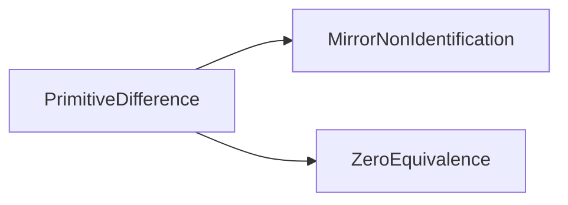

# Genesis research map and adversarial review

Original review snapshot: 2026-11-01. Mathematical and evidence baseline: `06b57ae21d72b83c0ddbb96d4c27cfca8e351428` on `codex/genesis-study-home`. That original snapshot added no mathematical implementation. The approved quotient reconstruction described below now extends it from merged baseline `b8acbe0ccef33a83f41cafd37b9fe943a3414e5e`. It is a reconstruction of the idea graph from source and discussion, not a previously implemented derivation engine.

## Reading the root

`<>` is the root inscription supplied to this investigation. It is not automatically the empty set, a singleton type, two delimiter objects, an event in time, or a universe. Those interpretations require admissions. There is currently no theorem deriving the remainder of this map from the inscription alone.

Our target remains: account for a nontrivial internally supported distinction while exposing every capability supplied by the representation. Whether structural non-collapse alone meets the intended meaning of self-witnessing remains open. An observable answer, an invoked judgment, a recorded answer, and a persistent record are stronger, separately specified tasks.

## Implemented quotient bridge

The approved [zero-equivalence, descent, and refusal slice](zero_equivalence.md) adds `lean/ZeroEquivalence.lean` and its [source-bound receipt](zero_equivalence_verification.json). Omega Codex now has three Lean modules with 26, 19, and 62 checked theorem declarations, respectively. Only the new quotient module permits `Quot.sound` alongside `propext`; the previous modules retain their stricter allowance. No preserved evidence or earlier mathematical source changed.

The new checked path starts by supplying carrier/value types, a difference function, a zero predicate, and equivalence laws. E is the largest identification relation preserving the declared zero-status. Exact values and named readouts can require finer identifications. Four finite fixtures separate quotient subsingleton status from exact descent. A symmetric edge with an isolated third position defeats a general reverse bridge from symmetric irreflexive relations. Supplied bijective relabeling preserves the quotient and descent judgments; a static quotient does not select a continuation rule.

At the zero/nonzero level the distinction is inequality of quotient classes. Re-encoding E as proposition-valued differences preserves E while potentially losing exact values. These results do not derive a witness from `<>`, make every refusal profile lossless, or establish one weakest common structure for `PrimDiff`, `Bridge`, quotient descent, and `SymmetryFloor`.

The DAG below adds N28–N33. The older repository inventory and review narratives retain their dated provenance; the implementation report gives the new scope and checks. The next review is the coarsest-identification theorem and four-case classification. Torsor formalization remains deferred.

## Assessment under review

Source: the user's attachment beginning “Yes. And I think I understand something about your original Genesis construction”. Local original: `C:\Users\a343o\.codex\attachments\58e5ed7b-0e95-4e38-ba07-14c9aa15e55a\Pasted text.txt`; SHA-256 `47a52dbfb0ccc22956713a7ff71619075f169602840a40549e888e2708ed091b`.

### Steelman

The strongest reading changes the question from “how does one object become two?” to “which admitted structure supports a distinction that survives the identifications relevant to the task?” That avoids assuming that every distinction must occur between independently given substances, and avoids treating an extra glyph as evidence of another object.

The refusal model supports one narrow but useful result: a repeated admission can change the full state while the admitted data list remains a singleton. The `fact` policy increments a refusal counter; the `silent` policy leaves the same example fixed. Carrier size and configuration count therefore answer different questions.

A one-object groupoid supplies a second candidate. Its object count can be one while its endomorphisms are `e` and `r`, with `r != e` and `r*r = e`. Composition is algebraic and need not represent physical time. This is a legitimate representation of operational nontriviality, worth comparing with reciprocal positional difference. The standard construction is documented in [Mathlib's SingleObj definitions](https://leanprover-community.github.io/mathlib4_docs/Mathlib/CategoryTheory/SingleObj.html); no Mathlib dependency is added here.

The natural-sections reference usefully makes compatibility task-relative. A requested invariant choice can fail while an invariant aggregate exists. Exchanging two participants prevents an invariant selection of one endpoint, yet preserves their unordered pair and the relation. Our current unary and binary results already exemplify that distinction.

Finally, the attachment explicitly refuses the unproved jumps from a nontrivial transformation to a gluing obstruction, from presentation symmetry to physical gauge, and from a first distinction to a normed or Hilbert structure. That is the right constraint on the research path. Comparing operations and positions is closer to the present foundational question than immediately adding ten slots and a distance.

### Adversarial response

1. **The proposed origin is still admitted.** Neither the refusal policy nor `r != e` has been derived from `<>`. A model of nontriviality is not yet an account of why nontriviality must arise. The comparison must allow the identity-only candidate to remain a countermodel to any unsupported necessity claim.

2. **One categorical object is not one possible value.** A singleton set has only the identity endofunction. A one-object category can instead have many abstract endomorphisms. The proposed groupoid moves multiplicity to the morphism sort. It does not establish that all admitted sorts have one element or that a distinction was obtained without additional structure. Also, `r*r = e` and `r != e` alone do not exclude other endomorphisms: the exact two-operation candidate needs exhaustiveness or generation.

3. **Ordinary structure preservation can erase this operational distinction.** The homomorphism from C2 to the trivial group induces a functor sending both `e` and `r` to the identity. It preserves identity and composition. Thus “cannot be eliminated by an admissible identification” has no settled meaning until admissible maps are fixed. Faithful functors, categorical equivalences, or maps explicitly preserving the disequality exclude that collapse for different stated reasons. Under equivalence C2 is not the terminal category; under arbitrary functors it can be collapsed.

4. **An abstract operation is not automatically an internally discriminable effect.** To interpret C2 as transformations of states, supply an action. Its action on a singleton is trivial: `r` and `e` have the same effect there. A faithful action needs at least two states; the two-element regular action supplies one. That is a conditional mathematical bound on that representation, not a claim about physical entity count. Access to operation identity itself would be another possible interface, which must also be declared.

5. **C2 and S2 do not have identical roles merely because both involve a twofold symmetry.** The unit canonically distinguishes `e` from the nonidentity morphism in C2. Neither endpoint of unpointed S2 is similarly preferred. S2's identity and exchange automorphisms recover a C2 operation structure, but reconstructing reciprocal positions requires an action or torsor-like carrier. A regular-action presentation additionally has a distinguished unit as an element of the underlying group. The empty relation on two positions also has the same permutation symmetry as S2, yet has no related pair. A shared symmetry group does not determine the observation or relation structure. No equivalence of the differently typed candidates has been proved here.

6. **The refusal counter is substantial structure.** The legacy `RState` contains `data`, `tags`, and `refusals : Nat`; the event signature and update law are separately given. One admitted datum is compatible with a state space containing many configurations. The cited bound is “empty or singleton data store” under restricted token admissions, not a theorem that the complete state has one degree of freedom. The displayed `fact` transition has an already singleton data list before and after. No internal readout or performed witnessing follows from inequality of complete states alone.

7. **The natural-sections theorem is more specific than a fixed-point slogan.** It concerns a declared observer, an automorphism, and a one-object indexing family. The observed carrier need not be a singleton. A natural section exists iff an admissible *ordered pair* is fixed. The companion theorem unfolds this into two fixed carrier points that the observer distinguishes. A lone fixed point need not supply an admissible pair; the source gives counterexamples. The unordered pair surviving exchange is a different output task, not a section of this ordered-pair task.

8. **Nontrivial symmetry does not entail a local-global obstruction.** Obstruction requires a specified family of local data, transport, and compatibility requirement. An exchanged endpoint cannot be selected invariantly, but a relation or unordered pair can remain global. Reflection-compatible records can glue. A nonidentity transformation alone supplies none of the missing cover or section data.

9. **A protected definition is a condition, not an unpaid derivation.** Defining primitive difference by resistance to collapse may package the no-collapse requirement elegantly. It still requires a nonempty class of examples and a comparison class. If identity is among the admissible maps and the proposed condition forbids even identity, the definition has no examples; if all constant maps are allowed without protecting any distinction, they erase it. The formal task is to state and check a useful, nonvacuous condition.

10. **There are two viable research targets that should not be conflated.** Structural self-witnessing could mean a distinction is preserved by specified internal symmetries or protected maps. Operational witnessing could require obtaining an answer and making it available within the model. The first does not supply the second. Neither requires us to invent a conscious external participant, but any claimed internal evaluation, invocation, registration, or persistence must be accounted for.

Verdict: the attachment offers a strong next comparison, with several important qualifications already stated. Its main overreach would be reading “one object” as “no additional distinguishable structure”, or reading the candidate's admitted nontriviality as the emergence of primitive difference. We should retain the path and test it, rather than promote it to the foundation in advance.

## Follow-up review: torsor as a proposed bridge

The user's next attachment, “Review: Codex's Genesis Research Map”, recommends adding a two-position C2 torsor to the comparison. Source attachment: `C:\Users\a343o\.codex\attachments\e7018618-f508-493d-a904-8f5a509209a4\Pasted text.txt`; SHA-256 `8b4521bebd63ab04211b671238bc82e145df9ec6b8e1301e9e69b8148f717eef`.

The review proposes recovering the two operations as the automorphisms of S2, then examining their free transitive action on its positions. The intended displacement `Delta(x,y)` is the unique operation carrying x to y. The targets include invariance under simultaneously exchanging both positions and a precise comparison with the existing Boolean difference. These are proposed formalization targets here, not new checked theorems.

| Candidate | Role in the comparison | Status here |
|---|---|---|
| Identity-only structure | Control with no nonidentity operation | Proposed finite comparison |
| One-object BC2 | Difference between abstract endomorphisms | Proposed finite comparison |
| Reciprocal S2 | Difference between positions, without a preferred endpoint | Existing checked relation; comparison remains proposed |
| Two-position C2 torsor | Candidate bridge using an action and unique displacement, without selecting an origin | Proposed; no new Lean implementation |

This sharpens rather than settles the assumption comparison. A group, action and positions must be accounted for when used. BC2 is not automatically equivalent to the differently typed S2 structure. Any categorical equivalence question would first require a specified category representing the latter and a stated preservation task. No canonical endpoint does not imply absence of a global relational structure; gluing remains a separate investigation.

The attachment explicitly recommends its four targets “without yet authorizing implementation”. The user's accompanying instruction authorizes committing and merging the existing PR. We therefore incorporate this proposed bridge in the documentation and stop before a new reconstruction slice. The reviewer assessed the supplied argument and compressed graph, not every entry in the previously uncommitted full map.

## Historical repository inventory

At the pinned baseline there are **101 tracked files**, including 76 preserved evidence files. The working development branch is `codex/genesis-study-home`. [PR #1](https://github.com/dbccpage/omega_codex/pull/1) was open, unmerged, and mergeable at this snapshot. Its base was `84038ed5d695d882bcb5494f085772eb507bc924`: the development content was not yet merged into `main`.

| Area | Contents and role |
|---|---|
| Root and governance | `README.md`, `AGENTS.md`, `CONTRIBUTING.md`, Apache-2.0 `LICENSE`, `.gitignore`, `.gitattributes`, `migration_inventory.json`. Small reviewed slices, preservation, source custody, explicit claims. |
| Lean setup | `lean-toolchain`, `lakefile.toml`, `lake-manifest.json`. Lean 4.33.0; Lean core only; no Mathlib or other Lake packages. |
| `lean/` | Two modules: `PrimitiveDifference.lean` (26 theorem declarations), `MirrorNonIdentification.lean` (19). The latter imports the former. |
| `scripts/` | `check_primitive_difference.py`, `mirror_models.py`, `verify_genesis_record.py`. Build/census, finite decoder enumeration, and offline archive verification. |
| `tests/` | Two files containing ten tests: five archive custody/corruption cases and five mirror-model cases. |
| `docs/` at baseline | Discussion transcript; migration record; PR review response; symmetric-difference report; mirror report; two source-bound Lean verification receipts. Seven files. This map is additional documentation. |
| `evidence/seed_audit_2026-11-01/` | Frozen 76-file experiment and audit archive: exact protocol, 25 answers, nine histories, 25 requests and 25 responses, ledger/settings, checks, source-development snapshot, manifests. |
| `.github/workflows/` | Two CI jobs: offline archive plus Python tests; Lean build plus separate theorem-dependency censuses. |
| Ignored local setup | `.venv` and `.lake` are working environment/build products, not mathematical evidence or imported legacy trees. |

The current Lean module dependency graph is:

There is no implemented dependency path from these modules to the legacy Regime, refusal, natural-sections, or gluing packages. There is no implemented Genesis-to-Cosmos pipeline, physical model, or universal minimality theorem.

### What the two modules establish

[PrimitiveDifference](../lean/PrimitiveDifference.lean) establishes:

- Irreflexivity iff every related pair has unequal endpoints, uniformly over any admitted type and relation. A condition on relations guarantees that universal property iff it entails irreflexivity.
- A distinct designated pair does not force global irreflexivity; the counterexample permits loops elsewhere.
- S2 on Bool, a fixed-point-free involutive counterpart, unique counterpart, and its compatibility with relation automorphisms.
- No swap-invariant unary Boolean separator with trivial output action; a nonconstant swap-invariant binary XOR distinction; a nonconstant equivariant classifier when the output also swaps.
- Pushing an admitted related pair through an identifying map violates protected irreflexivity.
- An explicitly supplied collapse detector and register update are correct. The same static relation also permits an always-no-refusal policy extension, so the relation alone does not determine the response policy.

[MirrorNonIdentification](../lean/MirrorNonIdentification.lean) establishes:

- Two presentation positions can project to one referent or two, while exposing the same complete accessible relation table.
- No deterministic total decoder using only that table can answer both stipulated referent-identity targets correctly.
- Presentation difference does not factor through the singleton referent projection on all input pairs. This is compatible with keeping that difference at the presentation level; it does not forbid a shared referent.
- A correct decoder requires target constancy on observation fibers. For this two-model task, the converse is constructive with decidable equality on observation values.
- A supplied extra observation completes the task exactly when it separates the two models' target answers. A constant channel fails; supplying the target bit succeeds as an oracle example, with no acquisition mechanism implied.

The 45 declarations are not 45 independent discoveries. Some proofs use standard propositional extensionality (`propext`); the censuses report no custom axioms or placeholders. These are conditional formal results, not performed observations or claims about consciousness.

### What the archived experiment established

The [25-answer audit](../evidence/seed_audit_2026-11-01/audit.md) concerns one OpenRouter GPT-6.1 Sol run, organized into seven rounds and nine separate conversation histories. It records notation-sensitive baseline answers, compliant opaque-input answers, and conditional witnessing/persistence constructions. All four presentation-clarification replies overcorrected the scope of their earlier wording.

Its strongest narrow mathematical result is inclusion-minimality of three axioms under a fixed deletion class, with countermodels for the deletions. It did not establish a globally minimal foundation, derive a physical universe, or show that anything is forced by an uninterpreted inscription. The prompt-development snapshot contains four retrieved turns, not a demonstrated verbatim origin of the entire final run sheet.

The archive verifier checks 76 files against their first-publication commit `1864f8671706b0aa82db2dff8feeec29d440c2fc`. This anchors the published record; it is not independent retrospective verification of every earlier PFP source byte.

## Idea DAG rooted at <>

**Status:** C = checked in current Omega Codex; L = inspected legacy source, not ported or rebuilt in this review; P = proposal; O = open obligation; E = archived empirical record; M = methodological decision. A node may combine statuses when it records a discussion tied to a legacy implementation.

**Edges:** a solid arrow is a conditional result from the structures already included in its source node. A dashed arrow adds assumptions, selects a candidate, proposes a comparison, or indicates a research direction. Every edge leaving `<>` is dashed. The graph is a conceptual synthesis; solid arrows do not mean all legacy results have been checked by Omega Codex's toolchain. Node IDs are stable discussion references, not new mathematical entities.

```mermaid
flowchart TD
  N00["N00: &lt;&gt; supplied inscription"]
  N01["N01 M: explicit admissions and comparison task"]
  N24["N24 E: 25-answer experiment and audit"]
  N02["N02 L/O: five-field Regime; question versus performed judgment"]
  N03["N03 L: bare relation may have a self-loop"]
  N04["N04 C: related pair plus protected irreflexivity"]
  N05["N05 C: reciprocal two-position S2"]
  N06["N06 C: binary distinction without unary side privilege"]
  N07["N07 C: collapse violates protected law"]
  N08["N08 C: supplied detector and register update"]
  N09["N09 C: two presentations; one or two referents"]
  N10["N10 C: identical observations; no identity decoder"]
  N11["N11 C: supplied extra observation; fiber criterion"]
  N12["N12 L: singleton data store; refusal-state change"]
  N13["N13 P: one object; identity only"]
  N14["N14 P: one object; C2 operation distinction"]
  N15["N15 P: compare operations and reciprocal positions"]
  N16["N16 L: equivariant deterministic symmetry floor"]
  N17["N17 L: natural section iff fixed admissible pair"]
  N18["N18 L: compatible records glue; mismatches obstruct"]
  N19["N19 P: ten-stick reflection and residual comparison"]
  N20["N20 P: trivial versus four-step lift"]
  N21["N21 O: internal acquisition and witnessing criterion"]
  N22["N22 O: persistence under specified changes"]
  N23["N23 O: L0/L1/L2, gauge, geometry, Cosmos"]
  N25["N25 O: difference, anti-self, and absence of a witness"]
  N26["N26 P: point and edge as simplicial representations"]
  N27["N27 P: C2 torsor and unique displacement bridge"]
  N28["N28 C: zero-equivalence kernel and quotient"]
  N29["N29 C: largest identification preserving zero-status"]
  N30["N30 C: specified value/readout descent; four fixtures"]
  N31["N31 C: quotient inequality and information-loss limits"]
  N32["N32 C: quotient and descent under supplied relabeling"]
  N33["N33 C: static kernel does not fix continuation"]

  N00 -. research admission .-> N01
  N00 -. empirical probe .-> N24
  N01 -. context framework .-> N02
  N01 -. relation candidate .-> N03
  N03 -. add witness and no-loop law .-> N04
  N04 -. specialize to Bool and reciprocal relation .-> N05
  N05 --> N06
  N04 --> N07
  N07 -. supply evaluator and transition .-> N08
  N05 -. add projections and target .-> N09
  N09 --> N10
  N09 -. supply channel and decidable equality .-> N11
  N01 -. event and state discipline .-> N12
  N01 -. categorical candidate .-> N13
  N13 -. admit nonidentity involution and exhaustion .-> N14
  N14 -. compare roles and maps .-> N15
  N05 -. compare roles and maps .-> N15
  N01 -. admit equivariance and fixed input .-> N16
  N01 -. admit observer family and transport .-> N17
  N01 -. admit cover and records .-> N18
  N17 -. possible finite comparison .-> N19
  N18 -. add ten slots, reflection, distance .-> N19
  N05 -. add lifted states and projection .-> N20
  N02 -. strengthen formal judgment .-> N21
  N08 -. account for invocation and access .-> N21
  N11 -. construct acquisition .-> N21
  N12 -. account for readout .-> N21
  N15 -. test internal adequacy .-> N21
  N21 -. specify retained information and changes .-> N22
  N19 -. further obligations .-> N23
  N20 -. further obligations .-> N23
  N22 -. further obligations .-> N23
  N01 -. define logical and structural roles .-> N25
  N05 -. admit simplicial interpretation .-> N26
  N26 -. further geometric structure .-> N23
  N05 -. recover automorphisms and specify action .-> N27
  N14 -. add free transitive action on positions .-> N27
  N27 -. compare displacement and relation .-> N15
  N01 -. supply carrier, values, zero predicate, equivalence laws .-> N28
  N28 --> N29
  N28 -. specify values or named readouts to preserve .-> N30
  N28 -. compare encodings and relation classes .-> N31
  N28 -. supply bijective renaming .-> N32
  N28 -. supply continuation relation .-> N33
  N28 -. supply nonzero pair and candidate collapse .-> N07
  N28 -. specialize to Boolean XOR .-> N05
  N29 -. supply internal refusal mechanism .-> N21
  N30 -. account for acquisition and registration .-> N21
```

### Node ledger and unresolved bridges

| Nodes | Current content | What the next edge would have to add |
|---|---|---|
| N00-N01 | Root inscription and explicit assumption accounting. No seed-to-structure theorem. | A chosen success condition and representation. Admissions are not derived necessities. |
| N02 | Legacy `Regime`: `data`, `forms`, `insts`, `rules`, `reqs`; a question-context has an admitted form and slots, including a hole filled by the tested datum. Separability means such a context gives different positive-derivability results. The discussion asks whether actual judgment already presupposes witnessing. | Evaluation/access/invocation if claiming a performed judgment; a task-specific argument for any necessary fields. |
| N03-N04 | Bare self-relation is consistent; protected no-self-relation plus an admitted related pair entails unequal endpoints. The generic implication is checked here. | A reason to select that protection and a nonempty comparison class; no assertion that it arises from an opaque mark. |
| N05-N06 | S2 retains a relational difference under exchange but no invariant unary side-label. The counterpart is intrinsic to this two-position relation. | Larger relations need not have a unique counterpart. A preferred endpoint needs further data or a changed output task. |
| N07-N08 | Collapsing a witnessed pair obstructs preserved irreflexivity. A specified detector/register extension can record that test. | Static obstruction does not invoke the detector or supply an observer. A stored bit is not a proof of persistence. |
| N09-N11 | Presentation identity and referent identity differ. Non-identification and the exact extra-channel criterion are checked for the stated two-model interface. | Obtain a separating channel internally rather than supplying it as an oracle. No broader unknown-world identifiability theorem is claimed. |
| N12 | Legacy `fact` changes `refusals` without adding a second datum; `silent` does not. Repetition depends on deduplication versus occurrence policy. | Account for the state space, update, event, readout, and what is being counted. No universal ban on growth from repetition. |
| N13-N15 | New operation-versus-position comparison, now including the proposed N27 torsor bridge. Identity-only and C2 are candidate models; S2 is implemented. | Specify allowed maps and equal success obligations; compare typed resources, actions, observations, and registration. No groupoid module exists here. |
| N16 | A deterministic equivariant endomap preserves any admitted renaming fixing its input. The legacy example also offers an invariant set whose individual members move. | Symmetric growth, an asymmetric input, a set-valued offer, and a selected outcome are distinct tasks. The theorem does not prohibit every change. |
| N17 | A natural section over the declared one-object family exists iff the automorphism fixes an admissible ordered pair. The source also develops broader family criteria. | Import only a specifically agreed theorem and its exact dependencies. Do not equate one indexing object with one carrier point. Broader historical package verification is not repeated here. |
| N18 | Legacy G014 glues records on overlaps of three loci and detects overlap mismatch; reflection transport commutes with the stipulated projections. Values are Nat, so the state space is not a finite enumeration. | General reflection-adjusted compatibility and cycle examples need their own statements. A finite cover is not a finite value space. |
| N19 | Proposed ten-stick test: raw disagreement versus disagreement remaining after permitted reflection. | Ten positions/configurations, permitted maps, comparison rule and distance. Neither implementation nor derivation from primitive difference exists here. |
| N20 | A visible order-two operation can have an order-four lift; an order-two lift is also possible. | Additional lifted states, projection and law selecting a nontrivial lift. No spinorial necessity or physical spin claim. |
| N21 | Central open node: decide what counts as internal witnessing, then account for it inside the admitted structure. | Separate structural invariance/non-collapse from answer acquisition, availability, invocation and registration as the intended task requires. |
| N22 | Persistence is a target appearing in the experiment and discussion, not a checked general mechanism. | Specify what information survives which transitions or identifications, and for how long. |
| N23 | L0/L1/L2, gauge, geometry and Cosmos are future research aims. The labels do not yet supply a formal hierarchy here. | Each claimed passage needs a definition and conditional theorem. Do not silently read L1 as an l1 norm, a binary involution as a Hilbert space, or presentation symmetry as physical gauge. |
| N24 | Frozen experiment, exact responses, finite checks, and scoped audit. | Independent replication or broader experiments would be new work, not something the archive already establishes. |
| N25 | The user's delta/anti-self language asks whether the first difference is its own internal support. | A counterpart is not automatically logical negation. Absence of an observed difference is not automatically proof of no difference. Reciprocity and internal reflexive witnessing must be distinguished from the diagonal condition `R(x,x)`, which protected irreflexivity forbids. |
| N26 | A point/edge picture can represent zero- and one-dimensional simplices in an admitted simplicial framework. | A vertex is already an admitted mathematical object; an edge representation supplies its incidence structure. This does not derive geometry or require the first difference to be a simplex. No simplicial implementation exists here. |
| N27 | Proposed C2 torsor bridge: free transitive action on two positions and unique displacement. Added following the next review; the original map had 27 nodes. | Establish the exact action/displacement statements and what their translations preserve. No privileged origin is selected; the admitted group/action/positions still require accounting. That proposal snapshot had 28 nodes and 38 edges; the quotient update below adds six nodes and ten edges. |

| N28 | Kernel E and quotient Q; R is pulled-back class inequality. Empty and singleton cases are explicit. | No nonzero pair is forced by the kernel. Carrier/value types and equivalence laws are supplied after the root. |
| N29 | Zero-status descends through S iff S is contained in E. | Preserve a different task only after specifying it. A structural obstruction does not perform or record a refusal. |
| N30 | Unary/binary congruence iff descent; four fixtures realize both subsingleton and exact-descent truth values independently. | Named extra readouts can fail even when a first readout descends. No universal quantification over unrequested readouts is imposed. |
| N31 | Re-encoding preserves E but can forget exact values and factorization behavior. An isolated-edge relation cannot be the complement of an equivalence. | Assess logical strength separately from information loss; no universal weakest kernel is established. |
| N32 | Supplied inverse maps induce inverse quotient maps; transported values and readouts have invariant descent judgments. | This is relabeling, not noninjective collapse or a chosen quotient representative. |
| N33 | The same static kernel and quotient state support either no successor or an identity self-loop under different supplied rules. | New content, reachability, productive growth, and operational termination need their own definitions and rules. |

### The five Regime fields

The current Lean modules import none of them. This is a statement about the implementation and chosen representation, not a proof that all five capabilities are dispensable for every Genesis task.

| Legacy field | Legacy role | Current treatment |
|---|---|---|
| `data : Nat` | Number of admitted indexed data | Types such as Bool and Unit explicitly supply carriers instead. |
| `forms : List Nat` | Admitted form arities | Binary relations and functions are declared directly in Lean. |
| `insts : List Inst` | Admitted instances | Hypotheses and concrete relation definitions supply facts. |
| `rules : List Nat` | Admitted uniform rules for forms | Logical properties and transition definitions are stated directly. This is not a literal port of every legacy rule mechanism. |
| `reqs : List (Nat x Nat)` | Explicit pair demands | No Regime demand list is used; the task's protection/target appears in theorem hypotheses and definitions. |

An absent record field can be replaced by a type, a predicate, a function, or the surrounding logic. Counting populated fields alone does not measure admitted capability. Conversely, nothing checked here proves that a full five-field Regime is needed before a structural distinction can be expressed.

## Provenance and corrections to carry forward

Read-only legacy source pin: `19L57G1` commit `45bb09864f9b52ed5ecf66e977ca81f0ed623de7`. The cited working-tree files matched that commit when inspected. They were not bulk-imported and the legacy project was not rebuilt for this review.

| Reference | Source at that revision | Use and limit |
|---|---|---|
| Regime | [Basic.lean](https://github.com/dbccpage/19L57G1/blob/45bb09864f9b52ed5ecf66e977ca81f0ed623de7/lean4/Derivation/Basic.lean#L53) | Five-field representation and well-formedness, not a universal foundation theorem. |
| Primitive difference | [PrimDiff.lean](https://github.com/dbccpage/19L57G1/blob/45bb09864f9b52ed5ecf66e977ca81f0ed623de7/lean4/Derivation/PrimDiff.lean) | Self-loop consistency, subsingleton obstruction, collapse and symmetry precedents. |
| Bridge | [Bridge.lean](https://github.com/dbccpage/19L57G1/blob/45bb09864f9b52ed5ecf66e977ca81f0ed623de7/lean4/Derivation/Bridge.lean) | Admission-policy dependence, extension by loops, conditional S2 characterization. An exhaustive finite table can prove its own no-loop fact; it does not force protection under later extensions. |
| Refusal | [Refusal.lean](https://github.com/dbccpage/19L57G1/blob/45bb09864f9b52ed5ecf66e977ca81f0ed623de7/lean4/Derivation/Refusal.lean#L142), [paper](https://github.com/dbccpage/19L57G1/blob/45bb09864f9b52ed5ecf66e977ca81f0ed623de7/paper/refusal_difference.md) | `nonreify_carrier_bound`, `fact_state_changes`, `silent_state_fixed`; declared state discipline. |
| Natural sections | [NaturalSections.lean](https://github.com/dbccpage/19L57G1/blob/45bb09864f9b52ed5ecf66e977ca81f0ed623de7/research/natural_sections/lean/NaturalSections.lean#L52) | Fixed admissible pair criterion; this is stronger than having one fixed carrier point. |
| Symmetry floor | [SymmetryFloor.lean](https://github.com/dbccpage/19L57G1/blob/45bb09864f9b52ed5ecf66e977ca81f0ed623de7/research/symmetry_floor/lean/SymmetryFloor.lean#L34) | Explicit equivariance hypothesis; deterministic single-valued rule. |
| Local records | [ObserverDescent.lean](https://github.com/dbccpage/19L57G1/blob/45bb09864f9b52ed5ecf66e977ca81f0ed623de7/research/g014_observer_descent/lean/ObserverDescent.lean#L64) | Overlap compatibility, gluing, mismatch obstruction and reflection transport. |
| Mark semantics | [mark_semantics_note.md](https://github.com/dbccpage/19L57G1/blob/45bb09864f9b52ed5ecf66e977ca81f0ed623de7/research/notes/mark_semantics_note.md) | Research intent, not a seed derivation. Its statement that forgetting orientation returns to undifferentiated Mark I is too strong: unpointed S2 still has a relational distinction. |

Also retain the correction already made in Omega Codex: “no definable observer” was too broad for the legacy unary theorem. It excludes the stated invariant unary classifier, not binary invariant distinctions or equivariant outputs. A bijective exchange and a noninjective collapse are different transformations and must not be interchanged in arguments.

## How to refine and compress the map

Compress explanations and duplicated lemmas only after identifying what each path preserves. Do not delete the historical record or equate nodes simply because their encodings use the same number of bits.

For each candidate, keep a short contract: admitted sorts and laws; task/target; permitted maps and protected conditions; accessible observations; any evaluation or recording mechanism; result status and source. This is a review format, not a new set of compulsory Genesis fields.

Two routes can share a node only when stated translations preserve the relevant contract in both directions. A shared automorphism group, matching cardinality, or one successful example is insufficient. Keep a counterexample showing the lost capability when compression fails. Every minimum remains relative to its task, candidate class, maps, and cost measure.

The current discussion compresses into five questions:

1. What distinction has actually been admitted, and in which sort does it live?
2. Which allowed transformations preserve or erase it?
3. What can be answered using the admitted accessible interface?
4. What, if anything, obtains and registers that answer internally?
5. What must survive later transformations for the proposed persistence task?

These are dependencies to investigate, not a claim that Genesis must unfold as five temporal stages.

## Proposed next slice for discussion, not implementation

Status update: this torsor proposal remains deferred. The user instead approved the quotient bridge now recorded above. Its next review concerns the coarsest-identification theorem and four-case classification; this historical proposal is retained for a later slice.

Compare four descriptions: the identity-only candidate, the exact two-operation C2 candidate, current S2, and a two-position C2 torsor as a possible bridge. Use explicit observation tasks and map classes. Keep the refusal model as a control showing why object count and configuration count differ.

Sources: current PrimitiveDifference plus the pinned Refusal, PrimDiff and NaturalSections references above. Intended assumptions: finite carriers/operation types, explicit identity/composition table for C2, explicit actions when talking about effects on states, and stated allowed maps. No category-theory framework or Mathlib import is needed to test the finite core.

Intended results to agree before coding, incorporating the follow-up review's four targets:

- **A. Singleton action obstruction:** show that every action on a singleton state set has trivial effects, and exhibit a faithful C2 action on two states. Include the empty state set when stating a general cardinality bound. This concerns faithful effects, not abstract operation identity.
- **B. Symmetric torsor construction:** characterize the automorphisms of current S2 as exactly identity and exchange, compare their operation table with C2, and establish the free transitive action on endpoints.
- **C. Difference without a privileged position:** construct unique displacement, test simultaneous-exchange invariance, and specify exactly how identity/nonidentity displacement corresponds to the existing binary relation. State whether any reconstruction selects an origin.
- **D. Assumption comparison:** record all admitted sorts, laws, maps, actions, observations and registration capabilities for the four descriptions. Test preservation by explicit translations rather than equating counts or symmetry groups. Retain the collapse to the trivial operation structure and state exactly which map conditions exclude it.

Checks, if this slice is approved: bounded Lean statements with a complete dependency census and small explicit tables/counterexamples; no legacy-wide builds. A lower-bound claim would be limited to the chosen faithful-action task, not a smallest cosmos.

Unresolved before selecting the formalization: does the intended witness consist in protected non-collapse, discrimination of operations, discrimination of effects, or an internally registered response? These alternatives can be compared now without treating one as already settled.

The earlier one-position reconstruction, ten-stick comparison and four-step lift remain unimplemented/deferred. This review selects none of them automatically. No files are deleted and no legacy tree is imported. The user subsequently authorized committing the map and merging the existing PR; that publication step does not implement the proposed torsor comparison. The pre-merge Git status and validation recorded above remain a dated baseline, not a claim about the eventual merged head.

## Verification of this snapshot

- Fresh offline replay: 76 anchored files, 25 answers, nine histories and 25 audit rows verified; zero API calls.
- Fresh Python run: all ten existing tests passed.
- Hosted CI inspected at exact baseline `06b57ae21d72b83c0ddbb96d4c27cfca8e351428`: [PR workflow run 41346745375](https://github.com/dbccpage/omega_codex/actions/runs/41346745375) and [push run 41346740900](https://github.com/dbccpage/omega_codex/actions/runs/41346740900) succeeded, including the Lean build and both theorem censuses.
- No new Lean build or legacy-project verification was performed for this documentation review. The mathematical baseline remains unchanged.

### Pre-merge validation refresh

After incorporating the follow-up torsor review, both existing Lean modules were rebuilt and all 26 plus 19 theorem dependency checks passed. The 76-file archive replay and all ten Python tests passed again. No mathematical source or preserved evidence changed. The updated proposed DAG has 28 reachable nodes and 38 edges; its links and acyclicity were checked before committing. This records local validation; final hosted CI and merge status are GitHub records rather than predictions in this document.

### Quotient implementation validation

The three Lean libraries build under Lean 4.33.0. The fresh censuses cover 26 + 19 + 62 = 107 theorem declarations. The existing ten Python tests and the 76-file anchored archive verifier passed. The new [receipt](zero_equivalence_verification.json) lists every quotient theorem and its actual dependencies; no `Classical.choice` occurs. The updated conceptual graph has 34 nodes and 48 edges. These are local checks of the approved slice, separate from the historical hosted-CI records above.

### Symmetry-review follow-up

The verification repairs now enforce all three stored theorem receipts and test
compilable theorem removal/weakening. Independent finite checks retain the four
zero-equivalence fixtures. These are verification changes: the 107 checked Lean
theorem statements and the current 34-node DAG are unchanged.

The next proposed mathematical comparison is complete incoming/outgoing profile
equality for arbitrary binary E, mutual comparability for preorders, and E itself
for equivalences. The preorder's directed `not E` is distinct from symmetric class
inequality. The review approves the argument but requests a separate formalization
slice; none of these proposed new theorems is marked checked here.

### Minimal-chain reconstruction, OQ-05 class-count bridge, and N19-N20 holonomy/stick-threshold refresh

Nine Lean 4.33.0 modules now build in `lean/` (`PrimitiveDifference`,
`MirrorNonIdentification`, `ZeroEquivalence`, `TorsorAndOperations`,
`MinimalSeparation`, `RetentionAndRefusal`, `LocalGlobalObstruction`,
`InternalMetatheory`, and `ProfilePreorderAndGenerator`), covering 362 checked
theorem declarations across nine verification receipts in `docs/*_verification.json`
with allowed axioms restricted to `propext` and `Quot.sound` (zero `Classical.choice`,
zero `sorry`). In `lean/MinimalSeparation.lean`, exact well-formed context
enumeration (`allWfCtxs4`), decidable collapse equivalence (`collapsed4Bool`),
canonical least-element representative counting (`isRep4`, `classCount4`,
`regimeClassCount4`), and strict refinement transitions (`StrictRegimeTransition4`,
`regime4_strict_class_count_growth`, `freshUnaryDelta4`,
`applyDelta4_freshUnaryDelta4`, `stepFreshUnary4_strict_transition`,
`stepFreshUnary4_class_count_growth`) connect multi-round `RegimeRefinementRun4`
chains to `QuotRefRun` (`regimeRefinementRun4_to_quotRefRun`,
`regimeRefinementRun4_round_bound`, `rt09_class_count_comparison`), discharging
`OWE-11` (`DER-24` and `DER-08`). In `lean/ProfilePreorderAndGenerator.lean`
(`DER-25`), Section 3B characterizes all base-intertwining lifts
`step : Bool × Bool → Bool × Bool` over `counterpart` (`period_two_iff_trivial_sheet_holonomy`,
`period_four_iff_no_two_step_fixed_point`, `period_four_iff_sheet_flip_holonomy`,
`step4Sheet_has_sheet_flip_holonomy_and_period_four`,
`fin4_sheet_equivariant_bijection`) and establishes that `n = 3` (`Stick3` vs.
`Stick1`, `Stick2`) is the minimal slot count at which 1-stick indicator
configurations exhibit both zero-residual mirror collapse and positive reflection
residual (`n1_reflResidual_eq_hamming`,
`n2_single_sticks_mirror_collapse_but_zero_residual`,
`n3_minimal_single_stick_reflection_witness`), narrowing `OWE-08` in
[`dag/derivation_dag.json`](../dag/derivation_dag.json) (47 nodes, 110 directed
edges, 53 `requires_admission` edges).

