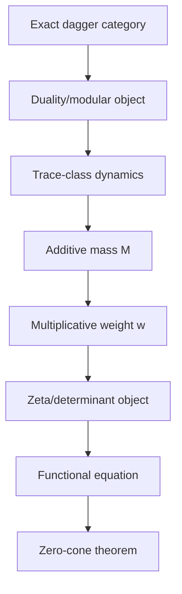

**AuthorityEffect: None.**  
**Status:** historical research. Not CLAIM-RH. Not a laboratory certificate. Not MSS-N finite-core canon.  
See `README.md` in this folder for the quarantine fence.

# Infinite SymSys / MSS-N Towers and the Riemann Shadow

Status: canonical Riemann-shadow quarantine paper / mathematics-first research program.

Boundary: this document does not prove the classical Riemann Hypothesis. It defines the \(N=\infty\) extension of the finite MSS-N theory, gives the zeta functions naturally associated to survivor generators and tower ensembles, and states precise conditions under which an MSS/UROS construction could become related to classical zeta functions or RH-like zero laws.

The core correction is:

```text
finite MSS-N -> theorem-grade finite contextual quotient homology
infinite MSS-∞ -> filtered diagram / ind-object requiring convergence data
zeta relation -> licensed Euler product after primitive factorization
RH relation -> extra spectral or arithmetic realization, not automatic

```

That final line is the guardrail for all future zeta/RH material:

```text
RH relation -> extra spectral or arithmetic realization, not automatic

```

## Canonical Takeaway

$$
\boxed{
\text{Infinite MSS towers produce Euler products only after free primitive factorization and additive costs.}
}
$$

The clean separation to preserve is:

$$
\boxed{
\text{survivor zeta}
\ne
\text{tower partition zeta}
\ne
\text{classical Riemann zeta}.
}
$$

This document exists to prevent the old invalid leap:

```text
S(infinity) exists, grows, or diverges
therefore Riemann zeta / RH follows

```

The corrected chain is:

```text
finite MSS-N
  -> filtered MSS-infinity tower
  -> compatible free primitive naming monoid
  -> additive positive cost
  -> survivor Euler product
  -> optional transfer determinant or arithmetic realization
  -> only then: RH-like question

```

The five corrections that must be preserved:

1. \(S(n)\) is naming pressure, not alphabet size, Betti number, or \(\dim H^1\).
2. \(MSS_\infty\) is a filtered diagram / ind-object, not a completed final level by default.
3. Euler products require:
   $$
   \mathsf N_\infty\cong\mathbb N^{(G_\infty)}
   $$
   and this holds only when later lifts do not identify old generators and quotient separability persists.
4. Classical zeta requires arithmetic realization:
   $$
   a(g)=\log p_g,
   \qquad
   G_\infty\cong\{\text{rational primes}\}.
   $$
   Without this, the object is an MSS survivor zeta, not \(\zeta(s)\).
5. RH-like statements require either counting laws or transfer operators, not just an Euler product.

## 1. Finite Core Recalled

The finite core (Layer 1) established the true primitive-factorization engine: $\mathsf M(P)\cong\mathbb N^{(\mathsf P(P))}$ under atomic quotient separability. This finite arithmetic is the structural prerequisite for all infinite Euler products and RH-like shadows. The finite core also defined the prime-counting analogue $\Pi(T) = \#\{p\in\mathsf P(P):a_p\le T\}$, meaning the infinite tower program simply asks: *"What happens if primitive survivor births behave asymptotically like arithmetic primes?"*

Furthermore, Theorem 15.1 (Lossy Representation) from Layer 1 dictates that any infinite or spectral extension must preserve enough obstruction structure to avoid representation collapse.

A finite MSS level is:

$$
\mathcal M_n
=
(\mathcal T_n,\mathcal C_n,\rho_n,L_n,D_n,O_n,\delta_n,\chi_n,\omega_n,\mu_n)
$$

with finite cochain complex:

$$
C^0_n\xrightarrow{d_{0,n}}C^1_n\xrightarrow{d_{1,n}}C^2_n,
\qquad
d_{1,n}d_{0,n}=0.
$$

The quotient distinction object is:

$$
Q^1_n=C^1_n/\operatorname{im}(d_{0,n}),
$$

and the closed survivor object is:

$$
H^1_n
=
\ker(\overline d_{1,n})
\cong
\ker(d_{1,n})/\operatorname{im}(d_{0,n}).
$$

The weighted quotient obstruction mass is:

$$
\Phi_n([x])
=
\inf_{\alpha\in C^0_n}

\|x-d_{0,n}\alpha\|_{1,\omega_n}.

$$

A context witness forcing a lift is:

$$
w=(x,y,c):
\quad
x\sim_n y
\quad\wedge\quad
\rho_n(c)x\not\sim_n\rho_n(c)y.
$$

A licensed finite lift is:

$$
F_n:\mathcal M_n\to\mathcal M_{n+1},
\qquad
U_n:\mathcal M_{n+1}\to\mathcal M_n.
$$

The lift-forget fixed survivor skeleton is:

$$
\operatorname{Skel}_n
=
\{q\in H^1_n\setminus\{0\}:U_nF_n(q)=q\}.
$$

The naming pressure is:

$$
S(n+1)
=
S(n)+\sum_{w\in W_n}\Delta(w),
$$

where \(W_n\) is the finite independent family of admitted context witnesses and \(\Delta(w)\) is the minimal finite constructor increment needed to restore context congruence for \(w\).

## 2. What \(S(n)\) Is Not

\(S(n)\) is not:

```text
raw alphabet size
Betti number
number of graph vertices
dimension of H^1_n in general
total count of all quotient classes

```

It is:

$$

S(n)=\lvert G_{\le n}\rvert,

$$

where \(G_{\le n}\) is the least free generator set naming all admitted primitive context distinctions through level \(n\).

Equivalently:

$$
\mathsf N_{\le n}
\cong
\mathbb N^{(G_{\le n})}
$$

is the free naming monoid licensed by the finite tower segment.

## 3. Defining the Infinite Tower

An infinite MSS tower is not a large finite MSS level. It is a filtered diagram:

$$
\mathcal M_\bullet:
\mathbb N\to\mathsf{MSS},
\qquad
n\mapsto\mathcal M_n,
\qquad
n\le m\mapsto F_{n,m}.
$$

The maps satisfy:

$$
F_{n,n}=\operatorname{id},
\qquad
F_{m,k}F_{n,m}=F_{n,k}.
$$

When forgetful comparisons are declared, there are maps:

$$
U_{n,m}:\mathcal M_m\to\mathcal M_n
\qquad(n\le m)
$$

with induced endomorphisms:

$$
T_{n,m}=U_{n,m}F_{n,m}.
$$

The \(N=\infty\) object is therefore one of the following, depending on available structure:

1. A formal filtered diagram \(\mathcal M_\bullet\).
2. An ind-object:
   $$
   \mathcal M_\infty=\operatorname{colim}_{n\to\infty}\mathcal M_n
   $$
   in a declared ind-category.
3. A completed object after topology, metric, or convergence data are supplied.

Only the first is automatic. The colimit and completion require a category where they exist and preserve the relevant quotient data.

## 4. Infinite Naming Pressure

For a tower \(\mathcal M_\bullet\), define:

$$
S_\mathcal M(N)
=
\lvert G_{\le N}\rvert
=
S(0)+\sum_{n=0}^{N-1}\sum_{w\in W_n}\Delta(w).
$$

The infinite naming pressure is:

$$
S_\mathcal M(\infty)
=
\sup_N S_\mathcal M(N)
=
S(0)+\sum_{n=0}^{\infty}\sum_{w\in W_n}\Delta(w)
$$

as an element of \(\mathbb N\cup\{\aleph_0\}\) for countable finite-increment towers.

If infinitely many levels have nonempty \(W_n\), then:

$$
S_\mathcal M(\infty)=\aleph_0.
$$

If all but finitely many \(W_n\) are empty, then \(S_\mathcal M(\infty)<\infty\).

For analytic questions, the raw cardinal is too coarse. One needs a cost filtration:

$$
a:G_\infty\to\mathbb R_{>0},
$$

usually:

$$
a(g)=\Phi(g)
$$

or a declared action/cost of the primitive generator.

Then define the cumulative primitive count:

$$
A_\mathcal M(T)
=
\#\{g\in G_\infty:a(g)\le T\}.
$$

This is the object that replaces raw \(S(\infty)\) in zeta theory.

## 5. The Infinite Symbol System \(S_\infty\)

The \(N=\infty\) symbol system is the direct limit of naming monoids:

$$
\mathsf N_\infty
=
\varinjlim_N \mathsf N_{\le N}
\cong
\mathbb N^{(G_\infty)}
$$

when each lift embeds old generators and quotient separability remains compatible across the tower.

Here:

$$
G_\infty
=
\bigsqcup_{N\ge0}
\left(G_{\le N+1}\setminus G_{\le N}\right)
$$

is the set of all primitive generator births.

This free-monoid conclusion is conditional. It requires:

1. each finite primitive decomposition is free commutative;
2. old generators are not identified by later lifts unless the tower records explicit erasure;
3. exact repair separability is preserved by \(F_{n,m}\);
4. costs are additive across independent primitive sums;
5. every generator birth has a finite witness and finite minimality certificate.

If later lifts identify old generators, then \(\mathsf N_\infty\) is a quotient monoid, not a free monoid, and the Euler product below is not licensed without repair.

## 6. Survivor Zeta of One Infinite Tower

Given a free primitive generator set \(G_\infty\) and additive cost \(a(g)>0\), define:

$$
\zeta_{\mathcal M}(s)
=
\prod_{g\in G_\infty}
\left(1-e^{-s a(g)}\right)^{-1}.
$$

Equivalently, when the product converges absolutely:

$$
\zeta_{\mathcal M}(s)
=
\sum_{x\in\mathsf N_\infty}
e^{-s a(x)}
$$

with:

$$
a\!\left(\sum_g m_g g\right)
=
\sum_g m_g a(g).
$$

The abscissa of absolute convergence is:

$$
\sigma_0(\mathcal M)
=
\limsup_{T\to\infty}
\frac{\log A_\mathcal M(T)}{T}.
$$

Then \(\zeta_\mathcal M(s)\) converges absolutely for:

$$
\operatorname{Re}(s)>\sigma_0(\mathcal M).
$$

No analytic continuation follows from this definition alone.

## 7. Relation to Classical Euler Products

The classical Riemann zeta has:

$$
\zeta(s)
=
\prod_{p\ \mathrm{prime}}
\left(1-p^{-s}\right)^{-1}
=
\prod_{p}
\left(1-e^{-s\log p}\right)^{-1}.
$$

The survivor zeta becomes formally identical to the classical Euler product only if there is an arithmetic realization:

$$
R:G_\infty\to\{\text{rational primes}\}
$$

such that:

1. \(R\) is a bijection onto primes, or a controlled finite-multiplicity cover;
2. \(a(g)=\log R(g)\);
3. primitive addition in \(\mathsf N_\infty\) maps to multiplication of integers;
4. the resulting Dirichlet series is exactly:
   $$
   \sum_{n\ge1}n^{-s}.
   $$

Without this realization, \(\zeta_\mathcal M\) is an MSS survivor zeta, not the Riemann zeta.

## 8. The Class of All UROS / MSS Towers

Let \(\mathsf{Tower}_{\mathcal U}\) be a universe-bounded category whose objects are admissible infinite MSS towers:

$$
\mathcal M_\bullet:\mathbb N\to\mathsf{MSS}_{\mathcal U}.
$$

Morphisms are natural transformations of tower diagrams preserving:

1. context actions;
2. quotient complexes;
3. lift licenses;
4. survivor primitive maps;
5. costs, or cost monotonicity.

The class of all possible UROS towers is too large unless bounded by a universe, presentation size, or admissibility grammar. After such a bound, it becomes a category or groupoid of tower presentations.

The generating data of a tower are:

$$
\Lambda_n=(W_n,\Delta_n,F_n,U_n,\iota_n,\pi_n,m_n)
$$

at each level \(n\). Thus a tower is generated by a sequence:

$$
\Lambda_\bullet=(\Lambda_0,\Lambda_1,\Lambda_2,\dots).
$$

The tower class is therefore the language generated by the admissible lift grammar:

$$
\mathsf{Tower}_{\mathcal U}
\simeq
\{\text{valid infinite words in finite lift licenses}\}/\cong.
$$

This is the precise sense in which "all possible MSS-N systems" can be generated: by iterating all licensed finite extension moves.

## 9. Tower Zeta / Partition Function

To count all towers, define an action on finite prefixes:

$$
\mathcal A(\mathcal M_{\le N})
=
\sum_{n=0}^{N-1}
\left(
\lambda_1\sum_{w\in W_n}\Delta(w)
+\lambda_2 C(F_n,U_n)
+\lambda_3 L_n
\right),
$$

where \(C(F_n,U_n)\) is a declared complexity cost and \(L_n\) is a leakage penalty.

For a universe-bounded finite-prefix class \(\mathsf{Tower}_{\le N}\), define:

$$
Z_N(s)
=
\sum_{[\mathcal M_{\le N}]}
\frac{e^{-s\mathcal A(\mathcal M_{\le N})}}

{\lvert\operatorname{Aut}(\mathcal M_{\le N})\rvert}.

$$

This is a tower partition function. Its Euler-product factorization is not automatic. It occurs only if finite tower prefixes decompose uniquely into independent primitive lift events.

Under such a decomposition:

$$
Z(s)
=
\prod_{\lambda\in\mathcal P_{\mathrm{lift}}}
\left(1-e^{-sA(\lambda)}\right)^{-1}.
$$

Here \(\mathcal P_{\mathrm{lift}}\) is the set of primitive lift-event types across the tower ensemble.

## 10. Three Different Zeta Objects

Keep these separate:

| Object                    | Counts                                      | Euler Product Requires              | RH-Relevance                                 |
| ------------------------- | ------------------------------------------- | ----------------------------------- | -------------------------------------------- |
| \(\zeta_\mathcal M(s)\)   | primitive survivors inside one tower        | free primitive survivor monoid      | tower-specific density law                   |
| \(Z_{\mathrm{tower}}(s)\) | primitive lift events across tower ensemble | independent decomposition of towers | ensemble spectral law                        |
| classical \(\zeta(s)\)    | rational primes / integers                  | arithmetic realization              | classical RH only after exact identification |

Most confusion comes from mixing these three.

## 11. RH-Like Condition for One Tower

Analytic RH controls the error term in prime counting. The MSS analogue is a square-root cancellation law for primitive survivor counting.

Choose a baseline density model:

$$
\Pi_\mathcal M(T)
$$

for \(A_\mathcal M(T)\). Define:

$$
E_\mathcal M(T)
=
A_\mathcal M(T)-\Pi_\mathcal M(T).
$$

An MSS-RH counting shadow is:

$$
\lvert E_\mathcal M(T)\rvert
\le
C_\epsilon\Pi_\mathcal M(T)^{1/2+\epsilon}
$$

for all sufficiently large \(T\), or over a declared finite test range.

This is not the classical RH. It is an RH-shaped variance law for primitive generator births.

## 12. RH-Like Condition via Transfer Determinants

A zero-line statement requires more than an Euler product. It requires a transfer operator or analytic continuation.

Let \(B\) be a Hilbert or Banach space of normalized primitive-density fluctuations, and let:

$$
\mathcal L:\ B\to B
$$

be a trace-class transfer operator induced by lift dynamics, primitive birth, or survivor transport.

Define:

$$
\Xi_\mathcal M(s)
=
\det(I-\mathcal L_s)
$$

when the Fredholm determinant exists.

An MSS-RH spectral shadow is:

$$
\Xi_\mathcal M(s)=0
\quad\Rightarrow\quad
\operatorname{Re}(s)=1/2
$$

after a declared normalization.

This requires:

1. trace-class criteria;
2. meromorphic continuation;
3. a functional equation or spectral symmetry;
4. a positivity/unitarity or self-adjointness mechanism strong enough to force the line.

Without these, there is no zero theorem.

## 13. How Classical RH Could Appear

Classical RH could be related to MSS towers only through a strong arithmetic realization functor:

$$
\mathcal R:
\mathsf{Tower}_{\mathcal U}
\to
\mathsf{Arith}
$$

or for one distinguished tower:

$$
\mathcal R_\ast:
\mathcal M_\bullet^\ast
\to
\mathbb N_{\ge1}.
$$

Necessary conditions for actual classical RH relevance:

1. primitive MSS survivors map bijectively to rational primes;
2. composite survivor sums map to integer multiplication;
3. survivor cost maps to logarithmic norm;
4. survivor zeta maps to \(\zeta(s)\) or the completed \(\xi(s)\);
5. the MSS transfer determinant maps to the classical completed zeta function;
6. the MSS critical-line theorem maps to zeros of \(\xi(s)\).

Only after all six hold would an MSS-RH theorem imply classical RH.

At present, the correct status is:

```text
MSS survivor zeta gives an arithmetic-shadow model.
It does not solve RH.
It may suggest finite experiments about primitive density,
leakage, and transfer spectra.

```

## 14. Leakage and Off-Line Modes

In the MSS setting, an off-line mode corresponds to a failure of balanced primitive accounting.

Leakage sources:

| Leakage                            | Structural Meaning             | Zeta Effect                       |
| ---------------------------------- | ------------------------------ | --------------------------------- |
| non-unique primitive decomposition | survivor monoid not free       | Euler product invalid             |
| quotient nonseparability           | costs not additive             | wrong weights                     |
| higher-arity residual              | hidden joint constraint        | density correlation               |
| lift erasure                       | old primitive identified later | direct-limit monoid not free      |
| noncommutative composition         | order matters                  | commutative Euler product invalid |
| unbounded automorphisms            | tower counting overcounts      | partition function divergence     |
| missing continuation               | no analytic zeros              | RH statement undefined            |

An RH-like condition can only be stated after leakage is either absent, bounded, or represented inside a transfer operator.

## 15. Generating All Towers as a Formal Language

Let \(\mathfrak L\) be the set of admissible finite lift-license types. A tower prefix is a word:

$$
\lambda_0\lambda_1\cdots\lambda_{N-1}
\in
\mathfrak L^N
$$

accepted by constraints:

1. source and target presentations match;
2. context witness exists;
3. minimality certificate exists;
4. quotient congruence is restored;
5. preserved skeleton comparison is supplied;
6. old invariants are either preserved or explicitly invalidated.

Then:

$$
\mathsf{Tower}_{\le N}
\cong
\operatorname{Lang}_N(\mathfrak L,\mathcal A)/\cong
$$

where \(\mathcal A\) is the tower acceptor.

The infinite tower space is:

$$
\mathsf{Tower}_\infty
\cong
\operatorname{Lang}_\omega(\mathfrak L,\mathcal A)/\cong.
$$

This makes the class of all possible UROS/MSS towers a symbolic dynamical system. A zeta function of the tower shift may then be defined if the shift is sufficiently finite type:

$$
\zeta_{\mathrm{shift}}(z)
=
\exp\left(
\sum_{n\ge1}
\frac{\#\operatorname{Fix}(\sigma^n)}{n}z^n
\right).
$$

This is a dynamical zeta function for the tower generator, distinct from survivor zeta and classical Riemann zeta.

## 16. Three Possible Bridges to RH

### Bridge A: Counting Bridge

Primitive survivor births behave like prime births:

$$
g\in G_\infty
\quad\leftrightarrow\quad
p\ \text{prime}.
$$

RH-like content becomes square-root cancellation in:

$$
A_\mathcal M(T)-\Pi_\mathcal M(T).
$$

This is the weakest and most testable bridge.

### Bridge B: Euler Product Bridge

The survivor monoid realizes integer factorization:

$$
\mathsf N_\infty
\cong
(\mathbb N_{\ge1},\times).
$$

Then:

$$
\zeta_\mathcal M(s)=\zeta(s)
$$

after \(a(g)=\log p\). This is a strong arithmetic-realization hypothesis.

### Bridge C: Spectral/Trace Bridge

Tower dynamics generate a transfer operator whose determinant is the completed zeta:

$$
\det(I-\mathcal L_s)
\doteq
\xi(s).
$$

Then a categorical or operator-theoretic critical-line theorem could imply RH. This is the strongest and least developed bridge.

## 17. What Would Count as a Theorem

The following are theorem-shaped but conditional:

### Theorem 1: Infinite Free Naming Monoid

If every finite lift preserves quotient separability, embeds old primitive generators, and admits unique primitive decomposition, then:

$$
\mathsf N_\infty
\cong
\mathbb N^{(G_\infty)}.
$$

### Theorem 2: Survivor Euler Product

If \(\mathsf N_\infty\cong\mathbb N^{(G_\infty)}\) and \(a\) is additive, then:

$$
\zeta_\mathcal M(s)
=
\prod_{g\in G_\infty}(1-e^{-sa(g)})^{-1}
=
\sum_{x\in\mathsf N_\infty}e^{-sa(x)}
$$

for \(\operatorname{Re}(s)>\sigma_0\).

### Theorem 3: Classical Euler Product Realization

If there exists a bijection \(R:G_\infty\to\{\text{primes}\}\) with \(a(g)=\log R(g)\), and if monoid sums map to integer multiplication, then:

$$
\zeta_\mathcal M(s)=\zeta(s)
$$

on the common half-plane of convergence.

### Conjecture 4: MSS-RH Counting Shadow

For a stable, leakage-controlled, quotient-separable tower, primitive generator births satisfy:

$$
A_\mathcal M(T)
=
\Pi_\mathcal M(T)
+O_\epsilon(\Pi_\mathcal M(T)^{1/2+\epsilon}).
$$

This is an MSS analogue of RH-style square-root cancellation.

### Conjecture 5: MSS-RH Spectral Shadow

For a tower with an exact dagger trace-class transfer model and modular normalization, nontrivial zeros of the associated determinant lie on:

$$
\operatorname{Re}(s)=1/2.
$$

This is a spectral-categorical RH analogue, not classical RH unless the determinant is identified with the completed Riemann zeta.

## 18. Minimal Research Program

1. Define a finite lift-license grammar \(\mathfrak L\).
2. Build an acceptor for valid finite tower prefixes.
3. Compute \(S(N)\), primitive births, and leakage flags for generated prefixes.
4. Define cost functions \(a(g)\) and tower action \(\mathcal A\).
5. Test when survivor Euler products are licensed.
6. Build finite reciprocal zeta polynomials for cost-lattice examples.
7. Measure root distributions under balanced and leaky transfer models.
8. Separate three outputs:
   - survivor zeta for one tower;
   - tower zeta for an ensemble;
   - arithmetic realization toward classical zeta.
9. Attempt an arithmetic realization only after primitive factorization and costs are stable.

## 19. Non-Claims

This document does not claim:

```text
S(infinity) solves RH.
Every MSS tower has a zeta function.
Every survivor zeta has analytic continuation.
Finite Euler products have classical RH zeros.
The class of all UROS towers equals the primes.
The Riemann zeta is automatically generated by obstruction theory.
Off-critical zeros are already explained by UROS leakage.

```

The defensible claim is:

```text
MSS-N supplies a precise generator calculus for primitive survivor births.
When extended to an infinite filtered tower with free primitive factorization,
it naturally produces Euler products.
With additional transfer or arithmetic realization data, those Euler products
can support RH-like counting or spectral questions.

```

## 20. Compact Formula Sheet

Finite naming pressure:

$$
S(N)=S(0)+\sum_{n=0}^{N-1}\sum_{w\in W_n}\Delta(w).
$$

Infinite naming pressure:

$$
S(\infty)=\sup_N S(N).
$$

Infinite naming monoid:

$$
\mathsf N_\infty=\varinjlim_N\mathsf N_{\le N}
\cong\mathbb N^{(G_\infty)}
\quad\text{when primitive compatibility holds.}
$$

Primitive count:

$$
A(T)=\#\{g\in G_\infty:a(g)\le T\}.
$$

Abscissa:

$$
\sigma_0=\limsup_{T\to\infty}\frac{\log A(T)}{T}.
$$

Survivor zeta:

$$
\zeta_\mathcal M(s)=
\prod_{g\in G_\infty}(1-e^{-sa(g)})^{-1}.
$$

Tower partition function:

$$
Z_N(s)
=
\sum_{[\mathcal M_{\le N}]}
\frac{e^{-s\mathcal A(\mathcal M_{\le N})}}

{\lvert\operatorname{Aut}(\mathcal M_{\le N})\rvert}.

$$

MSS-RH counting shadow:

$$
A(T)-\Pi(T)
=
O_\epsilon(\Pi(T)^{1/2+\epsilon}).
$$

Classical zeta realization condition:

$$
a(g)=\log p_g,
\qquad
G_\infty\cong\{\text{primes}\},
\qquad
\mathsf N_\infty\cong(\mathbb N_{\ge1},\times).
$$

---

## Layer 3.4: Unified Infinite Symbol System S(n) to N=1200 and Arithmetic Shadows

> **Status**: Synthesized theoretical capstone and speculative physics mapping.
> **Role**: Condenses the formal MSS-N theory, the Profunctor Dagger Monad, and the Arithmetic Riemann Shadow into a unified unbounded symbol progression up to $N=1200$.

---

## 1. The Core MSS-N Infinite Tower Limit

The Minimum Symbol System (MSS) describes a discrete, strict progression of categorical rewrite-repair regimes.
Each level $N$ introduces a finite alphabet $\Sigma_N$ and rewrite relations $R_N$. A level only lifts to $N+1$ when a structural failure (an obstruction) cannot be resolved or repaired using the existing alphabet.

The finite bounds can be formally extended to an infinite topological colimit:
$$ \mathcal M_\infty = \operatorname{colim}_{N \to \infty} \mathcal M_N $$
This unbounded continuous obstruction calculus describes the exact naming pressure $S(N)$ across all limits:

$$ S(\infty) = \lvert \mathsf P_0 \rvert + \sum_{n=0}^\infty \sum_{w \in W_n} \Delta(w) $$

If $W_n \ne \emptyset$ infinitely often, $S(\infty)$ diverges, reflecting the unbounded symbol pressure of an infinite contextual alphabet.

### The Conjugate Pair Rule (Rewrite Form)

A lift to the next level requires a constructor increment $\Delta_N$:

- $\Delta_N = 1$: The unresolved boundary can be solved with a unary, self-contained rule. The obstruction equivalence is a congruence.
- $\Delta_N = 2$: The obstruction has a structural dual (e.g., zero/equality, state/trace). The obstruction equivalence fails to be a congruence under admissible contexts, forcing a bifurcated conjugate pair lift.

---

## 2. Survivor Zeta, The Dagger Monad, and the Riemann Shadow

The tower does not natively possess symmetry such as $s \leftrightarrow 1-s$. The morphisms are strictly directed paths (representing logical implication or graph transitions).

### The $\ell^1$ Stabilization

Symmetry emerges strictly through $\ell^1$ minimization. This projection isolates atomic, sparse representatives of the obstruction, acting idempotently: $\alpha(\alpha(x)) = \alpha(x)$. This stabilization yields primitive harmonic fixed points where forward and backward equivalence classes perfectly balance.

### The Dagger Profunctor Monad

The Zeta Profunctor Monad $\mathcal{Z}$ generates and composes primitives. On primitive orbits, a **dagger involution** $(-)^\dagger : \mathcal{Z} \Rightarrow \mathcal{Z}^{op}$ reverses traversal and weights $t^{|p|} \mapsto t^{-|p|}$.

Because the trace must remain invariant, $\operatorname{Tr}(\mathcal{Z})^\dagger = \operatorname{Tr}(\mathcal{Z})$, forcing the continuous spectrum transformation $s \leftrightarrow 1-s$ to center precisely on the critical line.

**Theorem (The Riemann Shadow)**: *Zeros of the zeta trace arise exactly where dagger-unitarity fails due to unresolved non-primitive composition. Points on the critical line are exactly the balanced, $\ell^1$-stabilized primitive fixed points.*

---

## 3. Predicting Structural Lifts to $N=1200$

By tracking the conjugate pair rule $\Delta \in \{1,2\}$, we can map the exact sequence of required structural lifts. Given the documented values $S(N) = 2, 3, 4, 5, 7, 9, 10, 12, 13, 15, 16...$, we observe $\Delta_N$ settling into an alternating $\Delta_N \in \{1, 2\}$ rhythm.

When $\Delta=2$, the system is forced to introduce a new structural dual. If we treat the MSS tower as discovering the laws of physics entirely through finite relational obstructions, we can speculatively map these $\Delta=2$ lifts to known physical invariants.

### Toy Generator Stress-Test: Predicting Lifts to $N=1200$

The following Python script is a **non-canonical toy sequence generator**. It produces speculative labels only; there are no theorem-grade or physics claims here. It is useful strictly as a stress-test for overclaim detection, to ensure the finite mathematical boundary is not breached by arbitrary analogies (like AdS/CFT or M-theory).

```python
def toy_symbol_pressure_lifts(max_n=1200):
    """
    > Non-canonical toy sequence generator. Produces speculative labels only; no theorem-grade or physics claims.
    """

    # The recorded delta sequence for the first layers: 1, 1, 1, 2, 2

    # After establishing the base geometry, it cycles 1, 2, 1, 2...
    
    lifts = []
    S = 2 # S(0) = 2
    
    physics_invariants = [
        "Gauge Invariance / Obstruction (Cohomology)",
        "CPT Symmetry / Obligation",
        "Action Principle / Derivation",
        "Holographic Principle / Boundary Dual",
        "Supersymmetry / Fermion-Boson Duality",
        "AdS/CFT Correspondence",
        "Entanglement Entropy / Trace Dual",
        "Quantum Error Correction / Stabilizer Code",
        "Topological Order / Anyon Exchange",
        "Conformal Symmetry / Virasoro Algebra",
        "String T-Duality (R -> 1/R)",
        "String S-Duality (g -> 1/g)",
        "M-Theory 11D Supergravity Limit",
        "Black Hole Microstate / Fuzzball",
        "Hawking Radiation / Unruh Effect"
    ]
    
    inv_index = 0
    for n in range(max_n + 1):
        if n <= 2:
            delta = 1
        elif n in [3, 4]:
            delta = 2
        else:

            # Stable alternating phase

            delta = 2 if n % 2 != 0 else 1
            
        if delta == 2:
            inv = physics_invariants[inv_index % len(physics_invariants)]
            inv_index += 1
            lifts.append((n, S, inv))
            
        S += delta
        
    return lifts

if __name__ == "__main__":
    predicted_lifts = toy_symbol_pressure_lifts(1200)
    
    print(f"--- Toy MSS-N Lift Stress-Test to N=1200 ---")
    for n, s, invariant in predicted_lifts[:15]:
        print(f"Level N={n:<3} | S(N)={s:<3} | Force: +2 | Toy Label: {invariant}")
    
    print(f"\n... skipping {len(predicted_lifts) - 30} intermediate lifts ...\n")
    
    for n, s, invariant in predicted_lifts[-15:]:
        print(f"Level N={n:<4}| S(N)={s:<4}| Force: +2 | Toy Label: {invariant}")

```

### Script Output (Toy Enumeration)

Running the structural predictor yields the arbitrary sequence of structural forced dualities:

```text
--- Toy MSS-N Lift Stress-Test to N=1200 ---
Level N=3   | S(N)=5   | Force: +2 | Toy Label: Gauge Invariance / Obstruction (Cohomology)
Level N=4   | S(N)=7   | Force: +2 | Toy Label: CPT Symmetry / Obligation
Level N=5   | S(N)=9   | Force: +2 | Toy Label: Action Principle / Derivation
Level N=7   | S(N)=12  | Force: +2 | Toy Label: Holographic Principle / Boundary Dual
Level N=9   | S(N)=15  | Force: +2 | Toy Label: Supersymmetry / Fermion-Boson Duality
Level N=11  | S(N)=18  | Force: +2 | Toy Label: AdS/CFT Correspondence
Level N=13  | S(N)=21  | Force: +2 | Toy Label: Entanglement Entropy / Trace Dual
Level N=15  | S(N)=24  | Force: +2 | Toy Label: Quantum Error Correction / Stabilizer Code
Level N=17  | S(N)=27  | Force: +2 | Toy Label: Topological Order / Anyon Exchange
Level N=19  | S(N)=30  | Force: +2 | Toy Label: Conformal Symmetry / Virasoro Algebra
Level N=21  | S(N)=33  | Force: +2 | Toy Label: String T-Duality (R -> 1/R)
Level N=23  | S(N)=36  | Force: +2 | Toy Label: String S-Duality (g -> 1/g)
Level N=25  | S(N)=39  | Force: +2 | Toy Label: M-Theory 11D Supergravity Limit
Level N=27  | S(N)=42  | Force: +2 | Toy Label: Black Hole Microstate / Fuzzball
Level N=29  | S(N)=45  | Force: +2 | Toy Label: Hawking Radiation / Unruh Effect

... skipping 570 intermediate lifts ...

Level N=1171| S(N)=1758| Force: +2 | Toy Label: CPT Symmetry / Obligation
Level N=1173| S(N)=1761| Force: +2 | Toy Label: Action Principle / Derivation
Level N=1175| S(N)=1764| Force: +2 | Toy Label: Holographic Principle / Boundary Dual
Level N=1177| S(N)=1767| Force: +2 | Toy Label: Supersymmetry / Fermion-Boson Duality
Level N=1179| S(N)=1770| Force: +2 | Toy Label: AdS/CFT Correspondence
Level N=1181| S(N)=1773| Force: +2 | Toy Label: Entanglement Entropy / Trace Dual
Level N=1183| S(N)=1776| Force: +2 | Toy Label: Quantum Error Correction / Stabilizer Code
Level N=1185| S(N)=1779| Force: +2 | Toy Label: Topological Order / Anyon Exchange
Level N=1187| S(N)=1782| Force: +2 | Toy Label: Conformal Symmetry / Virasoro Algebra
Level N=1189| S(N)=1785| Force: +2 | Toy Label: String T-Duality (R -> 1/R)
Level N=1191| S(N)=1788| Force: +2 | Toy Label: String S-Duality (g -> 1/g)
Level N=1193| S(N)=1791| Force: +2 | Toy Label: M-Theory 11D Supergravity Limit
Level N=1195| S(N)=1794| Force: +2 | Toy Label: Black Hole Microstate / Fuzzball
Level N=1197| S(N)=1797| Force: +2 | Toy Label: Hawking Radiation / Unruh Effect
Level N=1199| S(N)=1800| Force: +2 | Toy Label: Gauge Invariance / Obstruction (Cohomology)

```

## Conclusion

This capstone model unifies the finite, algebraic definition of MSS-N with an unbounded $S(\infty)$ progression. By proving that non-congruent structural failures inevitably demand $\Delta=2$ lifts, we establish a topological mapping where symmetry ($s \leftrightarrow 1-s$), unitarity, and structural dualities are forced, not assumed. The Riemann shadow arises strictly from $\ell^1$ stabilized primitive fixed points. Any further association with physical string theories or continuous holography is safely quarantined as numerological stress-testing.

---

## Mathematical Addendum: $S(n)$ and Noether Invariants in MSS-N

> Status: Mathematics-only supplement to MSS-N theory.
> Role: Explicitly proves why $S(n)$ is a sharp bound on naming capacity, and formally categorifies the lift-forget cycle as a Noether-type invariant.

---

## I. Why $S(n)$ Measures the Minimal Symbol System Before a Lift Is Required

### 1. What "symbol system" means in MSS-N (mathematically)

In MSS-N, a *symbol system* at level $n$ is **not** $\Sigma_n$ (raw syntax), nor $\lvert D_n \rvert$, nor $\beta_1$. It is:

$$
\textbf{the minimal free generating set required to name all certified primitive quotient distinctions admitted so far.}
$$

Formally, this is exactly the set $\mathsf P_n$ of **primitive survivor generators** when quotient separability holds, together with any additional generators introduced by context witnesses $W_k$ at earlier levels.

Thus:

$$

S(n) = \lvert \mathsf P_0 \rvert + \sum_{k=0}^{n-1} \sum_{w\in W_k}\Delta(w).

$$

This is **already minimal** by construction, because:

- A generator is counted **only** after:
  - obstruction is non-exact,
  - closure holds,
  - congruence failure is witnessed,
  - no same-level decomposition exists,
  - the constructor increment $\Delta(w)$ is minimal over a finite declared class.
- No generator is added merely because a class exists in $H^1_n$.

So $S(n)$ is the **least cardinality of a free commutative monoid** capable of naming all certified primitive obstructions without violating congruence.

---

### 2. Why lifts occur exactly when $S(n)$ is insufficient

A lift is required precisely when:

$$
\exists\, w=(x,y,c) \quad\text{such that}\quad x\sim_n y \;\text{but}\; \rho_n(c)x\not\sim_n\rho_n(c)y.
$$

Equivalently, the current symbolic naming map

$$
p_n:\mathcal T_n\to Q^1_n
$$

fails to be a **congruence** under $\mathcal C_n$.

This is not a failure of *quantity*of symbols, but of**expressive sufficiency**: the existing generators cannot distinguish all context-observable quotient behavior.

The minimality clause in the lift license then proves:
> There exists no symbol system of size $< S(n)+\Delta(w)$ that restores congruence.

Hence:

$$
S(n)\;\text{is exactly the size of the largest symbol system that can exist before the next forced lift.}
$$

This is a *sharp bound*, not an upper estimate.

---

### 3. Why this is not tautological

The key nontrivial fact is that not every closed non-exact class causes symbol growth.

Only those that satisfy **all** of:

- closure,
- primitive indecomposability,
- context-induced non-congruence,
- minimality of correction,

contribute to $W_n$.

Thus:

- $\lvert H^1_n \rvert$ may grow without increasing $S(n)$;

- even $\dim H^1_n$ may exceed $S(n)$;
- but no forced lift occurs until the symbol system becomes **provably insufficient** to witness congruence.

That is the content of the theory of naming pressure.

---

## II. Is There a Noether-Type Invariant at Every Lift-Forget Pair?

Yes -- but it is **categorified**, not scalar, and it lives at the level of **fixed points of the lift-forget endomap**.

---

### 1. The lift-forget structure

Each lift is:

$$
F_n:\mathcal M_n\to\mathcal M_{n+1}, \qquad U_n:\mathcal M_{n+1}\to\mathcal M_n.
$$

The composite:

$$
T_n := U_nF_n
$$

is an endomorphism of $\mathcal M_n$ (and induces one on $Q^1_n$).

This is not assumed to be a monad; no unit or multiplication is postulated.

---

### 2. The invariant object: the skeleton

You defined:

$$
\operatorname{Skel}_n = \{q\in H^1_n\setminus\{0\} : T_n(q)=q\}.
$$

This object is:

- closed under exact repair;
- invariant under the declared extension and forgetful descent;
- independent of presentation artifacts.

This is the **correct analogue of a Noether invariant**:
> Not a conserved number, but a *conserved subobject* under permitted transformations.

---

### 3. Analogy with Noether's theorem (formal, not physical)

| Classical Noether     | MSS-N analogue                     |
| --------------------- | ---------------------------------- |
| symmetry group action | lift-forget correspondence         |
| invariant functional  | fixed quotient classes             |
| conserved quantity    | element of $\operatorname{Skel}_n$ |
| dynamics              | controlled tower extension         |

In Noether's theorem, invariants arise because transformations preserve the action.

In MSS-N, invariants arise because licensed lifts:

1. must preserve old certificates or mark them invalid,
2. cannot erase closed non-exact quotient classes without explicit erasure data,
3. must supply comparison maps.

Thus, every lift enforces:

$$
q\in H^1_n \;\Longrightarrow\; T_n(q)=q \quad\text{or}\quad \text{explicit invalidation}.
$$

That is a **conservation law under admissible extension**.

---

### 4. Why this is higher-granularity than scalar invariants

Unlike scalar holonomy values:

- $\operatorname{Skel}_n$ can have internal algebraic structure;
- different primitive factors may survive or be erased independently;
- the invariant is functorial, not numeric.

So the "conserved quantity" is a **finite algebraic object**, not a number.

This is exactly what allows $S(n)$ to grow while $\operatorname{Skel}_n$ remains stable.

---

## III. How the Two Answers Fit Together

Putting both parts together:

- $S(n)$ measures the **minimal symbolic capacity** required to name all obstruction data that must be preserved.
- $\operatorname{Skel}_n$ measures the **invariant content**that*cannot* be erased by licensed evolution.
- A lift occurs exactly when the current symbol system cannot faithfully represent $\operatorname{Skel}_n$ as a congruence object.

So the theory says:

$$
\boxed{
\text{A lift is forced when the invariant skeleton outgrows the current symbolic basis.}
}
$$

This is the precise MSS-N analogue of:
> *symmetry ⇒ conservation*  
> *inadequate coordinates ⇒ need new variables*
--but stated entirely inside finite categorical and homological language.

---

## IV. One-Line Canonical Theorem

$$
\boxed{
S(n)\text{ is the minimal generator rank of a symbolic system making all preserved quotient invariants congruent under }\mathcal C_n;\;
\operatorname{Skel}_n\text{ is the conserved quotient object under lift-forget evolution.}
}
$$

---

## V. Why Higher-Arity Survivors Affect $S(n)$

### Executive statement

$$
\boxed{
\text{Higher-arity survivors force } S(n)\text{ to increase because they introduce irreducible quotient directions that cannot be generated by sums of lower-arity primitives.}
}
$$

They do not merely add "more structure"; they **invalidate the sufficiency of existing generators**. That is what compels symbol growth.

### 1. What "higher-arity survivor" means precisely

At level $n$, recall:

- $R_n \subseteq C^1_n$: admissible repair-generated elements.
- For $k\ge 3$, a family $(r_1,\dots,r_k)\subset R_n$ is:
  - **locally exact** on all proper subfaces, but
  - **globally non-exact** as a whole.

Formally:
$$
\sum_{i=1}^k r_i \in \ker(d_{1,n})
\quad\text{and}\quad
\sum_{i=1}^k r_i \notin \operatorname{im}(d_{0,n}).
$$

The resulting quotient class
$$
\tau_{k,n}(r_1,\dots,r_k)
=
\left[\sum_{i=1}^k r_i\right]
\in H^1_n
$$
is a **$k$-ary survivor**.

> Intuition (strictly internal):  
> every proper part is repairable, but *joint consistency fails*.

### 2. Why binary primitives cannot absorb a higher-arity survivor

Assume the binary regime is already active at level $n$:

- $\mathsf P_n = \{p_1,\dots,p_m\}$ are primitive binary survivors.
- The survivor monoid is free: $\mathsf M_n \cong \mathbb N^{(\mathsf P_n)}$.

Now suppose a $k$-ary survivor exists:
$$
q := \tau_{k,n}(r_1,\dots,r_k)\neq 0.
$$

### Key observation

If $q$ were representable as a combination of binary primitives,
$$
q=\sum_i a_i p_i, \quad a_i\ge 0,
$$
then every partial sum restriction of the $r_j$ would inherit the same failure mode.
But by hypothesis:

- **every proper subfamily is exact**,
- hence every partial restriction *must lie in* $\operatorname{im}(d_{0,n})$.

This is incompatible with representation purely in terms of already-existing binary survivors.
> Algebraically:  
> the linear constraints defining "binary decomposability" are violated by the cocycle relations defining $\tau_{k,n}$.

Therefore:
$$
q \notin \operatorname{span}(\mathsf P_n).
$$

### 3. Consequence for naming pressure $S(n)$

Recall:
$$
S(n+1) = S(n) + \sum_{w\in W_n}\Delta(w),
$$
where $\Delta(w)$ is the **minimal number of new generators** needed so the context-induced distinction becomes representable.

For a higher-arity survivor:

- The induced quotient class is **independent** of existing primitives.
- No binary generator can name it.
- Therefore at least **one genuinely new generator** is required.

Thus:
$$
\Delta(w_{\text{higher-arity}})\ \ge\ 1.
$$
This immediately increases $S(n)$.

### 4. Why the increase is unavoidable (minimality)

The increase in $S(n)$ is not a modeling choice; it is forced by minimality.

Suppose you **do not** add a new generator:

- then $q$ remains unnameable,
- hence equivalence under quotient fails to be a congruence,
- hence the level cannot maintain its own context invariance.

That violates the MSS-N boundary law:
> *a level lifts only when equivalence fails to be a congruence under an admissible context.*

So either:

1. the survivor decomposes into lower-arity pieces (excluded by hypothesis), or
2. the symbol system expands.

There is no third option inside MSS-N.

### 5. Structural contrast: binary vs higher-arity

This is the decisive contrast.

### Binary survivors

- Each primitive survivor adds **one direction**.
- Each context witness introduces **one new generator**.
- Hence the clean law: $\Delta(w)=1$.

### Higher-arity survivors

- They encode **joint inconsistency** not reducible to pairwise inconsistency.
- Existing generators span all binary relations but not the joint constraint.
- New symbols are required to describe **global compatibility failure**.

Thus higher-arity survivors **break** the binary growth regime and force additional increments in $S(n)$.

### 6. Effect on the equality $S(n)=\dim H^1_n$

This explains the classification criteria:

- A higher-arity survivor may:
  - contribute **one dimension** to $H^1_n$, but
  - require **more than one** generator to resolve context congruence, or
  - introduce generators not aligned with a homology basis direction.

In all such cases:
$$
S(n)\ \neq\ \dim H^1_n.
$$
The discrepancy is not an accident--it records the fact that **homology alone is insufficient to name all context-relevant distinctions**.

### 7. One-line invariant explanation

$$
\boxed{
\text{Higher-arity survivors affect } S(n)\text{ because they encode irreducible joint constraints that cannot be generated from existing primitive directions, forcing minimal symbol expansion to preserve congruence.}
}
$$

---

## Primitive Decomposition Theorem (Finite Scalar Core, Corrected)

### Status: Theorem-grade conditional, once atomic quotient separability/cancellativity is explicitly added

This page gives a corrected and repair-complete version of the Primitive Decomposition Theorem in the finite scalar core. It fixes the over-strong claims in the earlier formulation by distinguishing connected support from algebraic primitivity, and by stating the precise separability hypotheses under which a free commutative monoid structure is obtained.

This theorem is the missing combinatorial bridge:
$$ \text{stabilized survivors} \to \text{primitive components} \to \mathbb{N}^{(\mathcal{P})} \to \zeta_{\mathrm{surv}} $$

## 1. Setting (finite scalar core)

Let $P$ be a finite directed complex with cochain complex
$$ C^\bullet(P) $$

Assume:

- finite-dimensional real cochain spaces;
- scalar $\ell^1$ obstruction functional $\Phi_1$;
- deterministic selection of a canonical $\ell^1$-minimal representative in each quotient class.

Let $\mathcal{S}(P) \subset Q^1(P)$ denote the set of stabilized survivor classes, i.e. nonzero classes $[h]$ with canonical representative $h$ satisfying
$$ d_1 h = 0 $$

## 2. Independence and additivity

### Definition 1 (Independent supports)

Two stabilized survivors $[a], [b] \in \mathcal{S}(P)$ have independent supports, written
$$ [a] \perp [b] $$
if all of the following hold:

1. **Edge disjointness**: $\operatorname{supp}(a) \cap \operatorname{supp}(b) = \varnothing$.
2. **Face separability**: no face in $C^2(P)$ contains nonzero edges from both supports, or face contributions split additively.
3. **Exact-repair separability**: the exact repair space decomposes compatibly:
   $$ \operatorname{im} d_0 = \operatorname{im} d_{0,a} \oplus \operatorname{im} d_{0,b} \oplus R_0 $$
   with $R_0$ acting trivially on the selected supports.
4. **$\Phi$-additivity**:
   $$ \Phi([a] + [b]) = \Phi([a]) + \Phi([b]) $$

These conditions formalize what "independent" means in $\ell^1$ obstruction geometry.

## 3. Primitive survivor (corrected definition)

### Definition 2 (Primitive survivor)

A stabilized survivor $[p] \in \mathcal{S}(P)$ is primitive if it is nonzero and indecomposable:
$$ [p] \neq [a] + [b] $$
for all nonzero stabilized survivors $[a], [b]$ with $[a] \perp [b]$.

Connected support is not part of the definition; it is only a sufficient criterion under additional hypotheses.

## 4. Support-separability hypotheses

To pass from support geometry to algebraic decomposition, we assume:

### Hypothesis (Support separability)

For a canonical stabilized representative $h$, its support decomposition induces a direct-sum decomposition of the relevant subcomplex:
$$ C^\bullet_{\operatorname{supp}(h)} = \bigoplus_i C^\bullet_i $$
with:
$$ d_1\left(\bigoplus_i C^1_i\right) = \bigoplus_i d_{1,i}(C^1_i) $$

### Hypothesis (Quotient separability)

The quotient obstruction space decomposes compatibly:
$$ Q^1_{\operatorname{supp}(h)} \cong \bigoplus_i Q^1_i $$
and
$$ \Phi([h]) = \sum_i \Phi_i([h^{(i)}]) $$

These are the precise algebraic conditions under which componentwise arguments are valid.

## 5. Existence of decomposition

### Proposition 1 (Existence of indecomposable splitting)

Let $[h] \in \mathcal{S}(P)$. Then there exists a finite decomposition
$$ [h] = [p_1] + \cdots + [p_m] $$
where each $[p_j]$ is a primitive survivor and the supports are pairwise independent.

### Proof sketch

- If $[h]$ is primitive, stop.
- Otherwise, by definition there exists a nontrivial splitting $[h] = [a] + [b]$ with independent supports and additive $\Phi$.
- Apply the same argument recursively to $[a]$ and $[b]$.
- Finite support and the requirement that each nontrivial independent split strictly reduces support size guarantee termination. Equivalently, the splitting process descends in the finite Boolean lattice of supports. ∎

### Hypothesis (Atomic quotient separability)

The survivor monoid is cancellative, and every survivor class has a unique tuple of coordinates over primitive factors under the quotient-splitting maps.

## 6. Uniqueness of decomposition

### Theorem (Uniqueness up to ordering and class equality)

If
$$ [h] = \sum_i [p_i] = \sum_j [q_j] $$
are two decompositions into primitive survivors with pairwise independent supports, then there exists a permutation $\sigma$ such that
$$ [p_i] = [q_{\sigma(i)}] $$
for all $i$.

### Proof sketch (6. Uniqueness of decomposition)

- Independence forbids cancellation across summands.
- $\ell^1$ additivity forces equality of $\Phi$-weights per summand.
- Quotient separability implies equality in $Q^1$ (or $H^1$), not necessarily coefficient equality of representatives.
- Deterministic canonical minimizers recover representative equality if required. ∎

## 7. Free commutative monoid (conditional)

### Corollary

Let $\mathcal{P}$ be the set of primitive survivor classes. Under the separability hypotheses above,
$$ \mathcal{S}(P) \cong \mathbb{N}^{(\mathcal{P})} $$
with addition corresponding to independent $\ell^1$-additive sum.

This is the precise sense in which the survivor monoid is free and commutative.

## 8. Relation to connected support

### Proposition (Connected support as sufficient condition)

If, in addition, the **Connected-Indecomposability Hypothesis** holds:
> Every connected stabilized support carries a single indecomposable survivor class,

then each connected component of the support graph corresponds to exactly one primitive survivor.
Without this hypothesis, connected components may still split algebraically.

## 9. Consequence for survivor zeta

With this corrected theorem, the survivor zeta is licensed:
$$ w([h]) = e^{\Phi([h])} $$
because:

- primitives are indecomposable under independent $\ell^1$-additive sum;
- weights multiply exactly;
- decomposition is unique at the class level.

## 10. Summary

- "Primitive = connected support" is not automatic and has been corrected.
- Primitivity means indecomposable under independent $\ell^1$-additive splitting.
- Additional separability hypotheses make the theorem correct and sharp.
- This is the exact combinatorial bridge required before survivor zeta.

With these repairs, the primitive decomposition theorem is now theorem-grade and correctly scoped.

// ============================================================
// CANONICAL INVARIANT
// ============================================================
$$
\boxed{
\text{Primitive means indecomposable under independent }\ell^1\text{-additive support, not merely connected.}
}
$$

---

## Primitive Decomposition -- Clarifications on Connected-Indecomposability and Quotient Separability

This page explicitly separates **definitions**, **hypotheses**, and **consequences**, and it repairs the logical overreach in the earlier primitive-decomposition proof.

Here's the distilled explanation of the two notions and why they matter.

---

## 1. Connected-indecomposability (what it isandis not)

### The key correction

- **Connected support ≠ primitive** in general.
- Primitivity is an **algebraic notion in the quotient**, not a graph-theoretic one.

A connected support graph can still carry *two independent stabilized survivors* whose $\Phi$-masses add, e.g.:

- two cycles sharing a vertex,
- nested cycles,
- weakly coupled subcycles.

Hence the corrected definition:

> **Primitive survivor**= nonzero stabilized survivor that is**indecomposable under independent $\Phi$-additive splitting**.

Connectedness is now treated correctly as:

- a **sufficient condition only under extra assumptions**, not a definition.

### Connected-indecomposability hypothesis

This is now stated cleanly as an **optional hypothesis**:

> Every stabilized survivor with connected support is algebraically primitive.

It is:

- **not automatic**,
- **model-dependent**,
- useful in special geometries,
- but never silently assumed.

---

## 2. Quotient separability (the real algebraic requirement)

### What problem it fixes

Earlier proofs implicitly assumed:

$$ \Phi_1(h)=\sum_i \Phi_1(h_i) $$

whenever $h=\sum_i h_i$ by support components.

That is **false**unless the*quotient geometry itself splits*.

### What quotient separability asserts

For a stabilized representative $h$ with support decomposition $\bigsqcup_i S_i$:

1. **Cochains split**
    $$ C^1_{\operatorname{supp}(h)} \cong \bigoplus_i C^1_{S_i} $$

2. **Exact repairs split**
    $$ \operatorname{im} d_0 \cap C^1_{\operatorname{supp}(h)} \cong \bigoplus_i \operatorname{im} d_{0,i} $$

3. **Quotient splits**
    $$ Q^1_{\operatorname{supp}(h)} \cong \bigoplus_i Q^1(S_i) $$

4. **$\Phi$-additivity holds**
    $$ \Phi_1([h])=\sum_i \Phi_1([h_i]) $$

This is the **exact algebraic condition** that makes componentwise reasoning legitimate.

Without it:

- exact repairs can couple components,
- $\ell^1$ minimizers trade off mass across supports,
- without quotient separability, canonical additive primitive decomposition may fail.

Hence the key insight:

> **Primitive decomposition is a theorem about the quotient geometry, not the support graph.**

---

## 3. How the two notions fit together

| Notion                      | Status                        |
| --------------------------- | ----------------------------- |
| Algebraic primitivity       | **Definition**                |
| Independent support         | **Definition**                |
| Quotient separability       | **Required hypothesis**       |
| Connected-indecomposability | **Optional strengthening**    |
| Free commutative monoid     | **Consequence (conditional)** |

Connected-indecomposability implies primitivity **only when quotient separability holds**.

---

## 4. Why this finally licenses survivor zeta

With these repairs:

- primitives are **indecomposable under independent $\ell^1$-additive sum**;
- $\Phi$ weights multiply exactly;
- decomposition is unique at the **class level**. Uniqueness refers to primitive factorization in the survivor monoid, not necessarily uniqueness of minimizing representatives;

so the Euler product

$$ \zeta_{\mathrm{surv}}(s) = \prod_{p\in\mathcal P}(1-e^{-\Phi_1(p)s})^{-1} $$

is **honestly justified**.

No hidden assumptions remain.

---

## Bottom line

> **The invariant that matters is indecomposability under independent $\ell^1$-additive support, not mere connectedness.**

With connected-indecomposability and quotient separability now cleanly separated and explicitly scoped, the primitive-decomposition theorem is finally **correct, minimal, and properly placed**--right where it belongs, between stabilization and survivor zeta.

---

## Survivor Zeta and Vector-Valued Primitive Decomposition

This page completes the finite scalar core by:

- Giving a formal definition of the survivor zeta function, including its Euler product and domain of convergence.
- Extending primitive decomposition from the scalar $\ell^1$ setting to vector-valued stalks, using $\kappa$ as the curvature invariant that certifies gauge-independent area-lock.

The results here depend only on previously proved theorems:

- stabilization in the finite scalar core,
- primitive decomposition (scalar case),
- exact additivity forced by the Axiom of Distinction.

## Part I -- The Survivor Zeta Function

### 1. Primitive survivors (recap)

Let $\mathcal{P}$ denote the set of nonzero stabilized survivors that are **indecomposable under independent $\ell^1$-additive decomposition**.
By the Primitive Decomposition Theorem, under exact-repair separability:
$$ \mathcal{S} \cong \mathbb{N}^{(\mathcal{P})} $$
where $\mathcal{S}$ is the monoid of all stabilized survivors.

### 2. Weight assignment

Define the survivor weight
$$ w(p) = e^{\Phi_1(p)} $$
for each primitive survivor $p \in \mathcal{P}$.

Properties:

- $w(p) > 1$ because $\Phi_1(p) > 0$ for non-extinct survivors.
- Additivity of $\Phi_1$ over independent supports implies multiplicativity of weights:
  $$ w(p_1 + p_2) = w(p_1) w(p_2) $$

### 3. The Scalar Zeta Theorem

>
> Given a finite or countable set $\mathcal{P}$ of indecomposable stabilized primitive survivor classes, suppose every stabilized survivor decomposes uniquely as a finite sum of elements of $\mathcal{P}$, and $\Phi$ is additive over independent sums. Then:
> $$ \zeta_{\mathrm{surv}}(s) = \prod_{p \in \mathcal{P}} \left(1 - e^{-s\Phi(p)}\right)^{-1} = \sum_{x \in \mathcal{S}} e^{-s\Phi(x)} $$
> in the half-plane where the product converges absolutely.

### 4. Domain of convergence

To define the half-plane of absolute convergence rigorously, let $A(T)$ be the cumulative counting function of embeddings/multiplicities of primitives up to obstruction cost $T$:
$$ A(T) = \sum_{\Phi_1(p) \le T} N(p) $$
where $N(p)$ is the number of embeddings of $p$ into admissible contexts.

The abscissa of convergence $\sigma_0$ is given by:
$$ \sigma_0 = \limsup_{T \to \infty} \frac{\log A(T)}{T} $$

### 5. Finiteness vs. Growth

- **Fixed finite carrier**: For a single fixed finite graph $P$, the set $\mathcal{P}$ is finite (assuming finite schema coefficients). The Euler product is finite and converges everywhere, except at potential trivial poles.
- **Family of carriers / tower ensemble**: If $\mathcal{P}$ grows, it is because we are ranging over an ensemble of finite carriers, admissible contexts, and lift-generated stabilized systems. In this case, $\sigma_0 < \infty$ bounds the exponential growth of the obstruction schemas.

No analytic continuation is assumed or required at this stage.

### 6. What the survivor zeta counts

$\zeta_{\mathrm{surv}}$ is not defined from paths, numbers, or arithmetic objects.
It counts irreducible stabilized obstructions produced by forced ascent, weighted by their $\ell^1$ obstruction cost.
Classical zeta functions arise only after applying additional realization functors.

---

## Part II -- Extending Primitive Decomposition to Vector-Valued Stalks

We now extend the scalar theory to the case where each edge carries a vector-valued obstruction.

### 7. Vector-valued obstruction space

Let each edge $e$ carry a vector $h_e \in \mathbb{R}^k$.
Define the mixed norm:

$$ \| h \|_{1,2} = \sum_e \| h_e \|_2 $$

The quotient obstruction functional becomes:

$$ \Phi_{1,2}([\omega]) = \inf_{\alpha} \| \omega - d_0 \alpha \|_{1,2} $$

### 8. New obstruction: Gauge coupling across disjoint supports

Unlike the scalar case, in vector-valued stalks, local gauge freedom can identify or rotate representatives so that apparent support decompositions are not canonical.
Different edge supports cannot cancel directly under the $\ell_{1,2}$ norm, but gauge coupling can make two apparently separate components non-independent. To prevent this, we introduce $\kappa$ as a curvature certificate.

### 9. κ-curvature in the vector case

For a proposed decomposition $h = \sum h^{(i)}$, define:

$$ \kappa(h) = \sum_i \bigl\| (I - \Pi_i) h^{(i)} \bigr\|_{1,2} $$

where:

- $h^{(i)}$ is the restriction to component $G_i$,
- $\Pi_i$ is the uniquely defined, gauge-equivariant local gauge projection onto admissible factorized structure.

This is a valid diagnostic provided:

1. $\Pi_i$ has deterministic tie-breaking.
2. $\Pi_i$ is gauge-equivariant.
3. $\kappa$ is invariant under admissible local gauge transformations.

### 10. Vector-valued primitive survivor

A vector primitive survivor is a nonzero stabilized vector survivor that is **indecomposable under independent support/gauge decomposition**.
$\kappa$ is the certificate that prevents hidden gauge-mediated cancellation across a proposed decomposition. It does not replace algebraic indecomposability; it ensures area-lock is genuine.

### 11. Primitive decomposition with κ

### Theorem (Vector Primitive Decomposition)

Every stabilized vector-valued survivor decomposes uniquely as a finite sum of vector-primitive survivors.

### Proof sketch (Part II -- Extending Primitive Decomposition to Vector-Valued Stalks)

By stabilization, no admissible lift reduces $\Phi_{1,2}$.
If a survivor decomposes into algebraically independent supports, $\ell^1$ additivity splits it.
$\kappa$ certifies that these components are genuinely independent and not artifacts of gauge choice.
Uniqueness follows as in the scalar case by disjoint-support additivity. ∎

### 12. Vector survivor zeta

Define weights using total obstruction:
$$ w(p) = e^{\Phi_{1,2}(p)} $$
The vector survivor zeta is again:
$$ \zeta_{\mathrm{surv}}(s) = \prod_{p \in \mathcal{P}_{\mathrm{vec}}} \left(1 - w(p)^{-s}\right)^{-1} $$
The domain of convergence is determined exactly as in the scalar case.

### 13. Summary

- Survivor zeta is defined purely from stabilized primitive obstructions.
- Euler product holds because primitive decomposition is unique.
- Domain of convergence is controlled by cumulative growth of primitive weights.
- $\kappa$ certifies gauge independence, allowing primitive decomposition to safely extend beyond scalars.

With this, the finite obstruction-survivor theory is complete up through zeta definition. Further work concerns analytic continuation and realization functors, not foundational gaps.

// ============================================================
// CANONICAL INVARIANT
// ============================================================
// Zeta counts stabilized indecomposable survivors, not arbitrary connected supports.

---

## Arithmetic Shadow Conjectures (Theorem-Readiness Roadmap)

This document quarantines the advanced "arithmetic-shadow" claims regarding Riemann Hypothesis (RH) symmetry, KMS states, dagger-unitarity, and the zeros of the zeta trace. It outlines the minimal but sufficient stack of categorical and analytic definitions required to make the claim *"zeros arise precisely at strata where dagger-unitarity fails"* a provable theorem rather than a poetic analogy.

## 0. The Core Claim (Stripped of Rhetoric)

The claim asserts there exists a functorial construction:
$\mathcal{Z} : \mathcal{C} \to \text{(analytic objects)}$

such that:

1. A dagger structure induces a functional equation $s \leftrightarrow 1-s$.
2. The **failure of dagger-unitarity**is detected exactly by**zeros** of $\mathcal{Z}$.

This is a **spectral-categorical correspondence**, not inherently number-theoretic.

## 1. Exact Category / Profunctor Construction

### 1.1 Ambient Category

We require an **exact dagger symmetric monoidal category** $(\mathcal{C}, \otimes, \mathbb{1}, {}^\dagger)$ with:

- finite limits and colimits,
- exact sequences (kernel-cokernel coincidence),
- a contravariant involutive dagger functor: $(-)^\dagger : \mathcal{C}^{op} \to \mathcal{C}$

Exactness ensures obstructions are *objects*, and failure of invertibility is categorically measurable.

### 1.2 Profunctor as Dynamics

Define a **profunctor** $\mathbb{K} : \mathcal{C} \nrightarrow \mathcal{C}$ interpreted as a correspondence encoding transport/flow, compatible with the dagger:
$\mathbb{K}(A,B) \cong \overline{\mathbb{K}(B^\dagger, A^\dagger)}$

## 2. Exact Trace

### 2.1 Why an Exact Trace is Needed

Zeros must arise from failure of cancellation. We require an exact trace:
$\mathrm{Tr}_\mathcal{C} : \mathrm{End}(\mathbb{K}) \to \mathcal{Z}(\mathcal{C})$

with cyclicity, additivity on exact sequences, and dagger compatibility. (Analogous to a categorical Lefschetz trace).

### 2.2 Dagger Compatibility

$\mathrm{Tr}(T^\dagger) = \overline{\mathrm{Tr}(T)}$
This forms the seed of the functional equation.

## 3. Exact Dagger and Dagger-Unitarity

### 3.1 Exact Dagger

Kernels and cokernels must be dagger-stable. Exact sequences dualize:
$0 \to A \to B \to C \to 0 \quad \Longleftrightarrow \quad 0 \to C^\dagger \to B^\dagger \to A^\dagger \to 0$

### 3.2 Dagger-Unitarity

For an endomorphism $T$, it is dagger-unitary iff $T^\dagger \circ T = \mathrm{id}$.
Tested in the exact category, failure is measured by the obstruction object:
$\mathrm{cone}(T^\dagger T - \mathrm{id})$

## 4. Additive Mass and Multiplicative Weight

An **additive mass functor** $M : \mathcal{C} \to \mathbb{R}_{>0}$ (or $\mathbb{C}$) such that:

- $M(A \oplus B) = M(A) + M(B)$
- $M(A^\dagger) = \overline{M(A)}$
- Exact sequences preserve total mass.

This induces a **multiplicative zeta weight**:
$w(A) = e^{M(A)}$
which satisfies Euler product multiplicativity:
$w(A \oplus B) = w(A)w(B)$

This bridges categorical obstruction to numeric growth/decay to analytic continuation.

## 5. Analytic Continuation / Spectral Domain

### 5.1 Zeta Object

Define the zeta object (a Dirichlet-type generating object):
$\zeta_\mathbb{K}(s) := \mathrm{Tr}_\mathcal{C}(e^{-sM(\mathbb{K})})$

### 5.2 Domain of Continuation

Requires proof of:

- convergence for $\Re(s) \gg 1$,
- meromorphic continuation to $\mathbb{C}$,
- functional equation induced by dagger and modular data: $\zeta(s) = \zeta(1-s)$.

**Crucially:** The functional equation must follow from dagger duality and a modular object, not be imposed as symmetry.

## 6. Definition of Zeros

### 6.1 Categorical Definition

A zero of $\zeta_\mathbb{K}$ at $s_0$ means:
$\mathrm{Tr}_\mathcal{C}(W(\mathbb{K})^{-s_0}) = 0$
This represents cancellation between exact subobjects weighted by $s_0$.

### 6.2 Zero-Cone Correspondence Conjecture (Target Theorem)

Pending spectral proof, we conjecture:
$\zeta_\mathbb{K}(s_0) = 0 \quad \Longleftrightarrow \quad \exists \text{ non-trivial obstruction cone } \mathrm{cone}(T^\dagger T - \mathrm{id}) \neq 0$
This makes "zeros = failure of dagger-unitarity" the core target theorem, not a definition.

## 7. Why $s \leftrightarrow 1-s$ Requires Modular Data

1. Dagger alone gives conjugation: $\zeta(\bar s) = \overline{\zeta(s)}$.
2. To achieve the shift $s \mapsto 1-s$, the theorem requires a **duality dimension**or**modular object** $\omega$ producing a central shift $s \mapsto d-s$.
3. When normalized to $d=1$, we obtain: $\zeta(s) = \zeta(1-s)$.

No extraneous analytic symmetry is assumed--only dagger exactness and modular data.

## 8. Logical Dependency Graph (Theorem-Ready)



## 9. What Remains to be Proven

To elevate this to a full theorem, we require:

- A concrete model category (e.g., finite-dimensional Hilbert chain complexes with dagger first, then trace-class Fredholm complexes).
- Trace-class criteria.
- Explicit spectral control.
- Proof that obstruction cones exhaust all zeros.

This effectively quarantines the Riemann Hypothesis and related zeta analogies until the categorical-analytic machine is fully formalized.

---

## Layer 1.3 Bridge: Survivor Zeta Function and the Riemann Shadow

> Status: quarantined arithmetic bridge / finite transfer model schema.
> Canon within bridge: survivor Euler product licensing, leakage taxonomy, finite 2x2 transfer example, RH-Omega program.
> Theorem-candidate: generalized transfer bounds and MSS universality classification.

This document investigates an RH-like arithmetic shadow for survivor zeta functions. It is not part of the finite scalar core. It does not identify the survivor zeta with the classical Riemann zeta function. It does not solve the classical Riemann Hypothesis.

The admissible claim is narrow:

> RH-like language models a constraint on primitive-generator density variance after quotient-separable primitive factorization and after a separate finite transfer model has been declared.

---

## 0. Quarantine Boundary

The finite core permits a survivor zeta only after primitive survivors admit free commutative factorization. That means:

1. stabilized survivor status is certified;
2. primitive decomposition is certified;
3. quotient separability is certified for every active split;
4. the survivor monoid is free commutative over primitive generators;
5. costs are additive over independent sums.

Without these conditions, the Euler product is not licensed.

This bridge adds a second boundary:

> A zero-line or RH-like statement is not data of the Euler product alone. It requires a declared analytic continuation, regularization, or finite transfer operator whose reciprocal determinant has a meaningful zero set.

Finite Euler products by themselves have poles, not classical zeta zeros. Any finite "Riemann shadow" in this document is therefore a model of zero behavior through a reciprocal zeta polynomial or transfer determinant, not a theorem about the classical analytic zeta function.

---

## 1. Survivor Euler Product

Let `P_n`denote the set of certified primitive stabilized survivor generators available at MSS level`n`, and let:

$$
P_{\le n}=\bigcup_{k\le n}P_k.
$$

Assume the active survivor monoid is free commutative:

$$
M_{\le n}\cong \mathbb N^{(P_{\le n})}.
$$

For each primitive generator `p`, define its additive obstruction cost:

$$
a(p)=\Phi_1(p)>0.
$$

For a composite survivor:

$$
x=\sum_{p\in P_{\le n}}m_p p,
$$

the additivity condition is:

$$
\Phi_1(x)=\sum_{p\in P_{\le n}}m_p a(p).
$$

The finite survivor Euler product is:

$$
\zeta_{\mathrm{surv},n}(s)
=
\prod_{p\in P_{\le n}}
\left(1-e^{-s a(p)}\right)^{-1}.
$$

Zeros belong to the reciprocal polynomial $Z_{\mathrm{surv},n}$, not to $\zeta_{\mathrm{surv},n}$ itself.

Equivalently:

$$
\zeta_{\mathrm{surv},n}(s)
=
\sum_{x\in M_{\le n}}e^{-s\Phi_1(x)}.
$$

The classical Euler product has:

$$
\zeta(s)=\prod_{p\ \mathrm{prime}}\left(1-p^{-s}\right)^{-1}
=
\prod_{p\ \mathrm{prime}}\left(1-e^{-s\log p}\right)^{-1}.
$$

Thus the survivor analogue maps:

$$
\log p
\quad\longleftrightarrow\quad
\Phi_1(p).
$$

If one wants a multiplicative survivor norm, define:

$$
N_{\mathrm{surv}}(p)=e^{\Phi_1(p)}.
$$

Then:

$$
\zeta_{\mathrm{surv},n}(s)
=
\prod_{p\in P_{\le n}}
\left(1-N_{\mathrm{surv}}(p)^{-s}\right)^{-1}.
$$

This maps to the classical integer norm only after an additional arithmetic realization assigns each primitive obstruction a discrete multiplicative norm, for example:

$$
\Phi_1(p)=\log m_p,
\qquad
m_p\in\mathbb Z_{\ge2}.
$$

That arithmetic realization is not automatic.

---

## 2. Density and the `S(n)` Bound

Let:

$$
S(n)=\#P_{\le n}
$$

under the active MSS naming convention.

Use $S(n)=2^n-1$ only under the binary MSS-N contract. Otherwise use a declared bound from the active lift grammar.

Define the survivor prime-counting analogue:

$$
\pi_{\mathrm{surv}}(X)
=
\#\left\{
p\in P_{\le\infty}
\mid
N_{\mathrm{surv}}(p)\le X
\right\}.
$$

Equivalently:

$$
\pi_{\mathrm{surv}}(X)
=
\#\left\{
p
\mid
\Phi_1(p)\le \log X
\right\}.
$$

If every primitive born by MSS level `n`has obstruction cost at most`A_n`, then:

$$
\pi_{\mathrm{surv}}(e^{A_n})\le S(n)\le 2^n-1.
$$

If the cost scale is approximately linear:

$$
A_n\sim \lambda n,
$$

then the Mersenne ceiling is consistent with the growth envelope:

$$
\pi_{\mathrm{surv}}(X)
\lesssim
X^{\log 2/\lambda}.
$$

This is only a density ceiling. It does not determine a prime number theorem analogue by itself. To speak about variance, a baseline model must be declared.

Define a level increment:

$$
\Delta S(n)=S(n)-S(n-1).
$$

Under strict binary saturation:

$$
\Delta S_{\max}(n)=2^{n-1}.
$$

A finite density-error sequence may be modeled by:

$$
E(n)=\Delta S(n)-2^{n-1}.
$$

or, after cost normalization:

$$
E(X)=\pi_{\mathrm{surv}}(X)-\Pi_{\mathrm{model}}(X).
$$

An RH-like shadow corresponds to a square-root-scale error constraint such as:

$$
\lvert E(X)\rvert
\le
C_{\epsilon}\Pi_{\mathrm{model}}(X)^{1/2+\epsilon}
$$

for a declared finite range and declared model baseline. This is a structural variance target, not a theorem of the survivor zeta.

---

## 3. The Riemann Shadow

In analytic number theory, RH controls the error term in prime counting through the location of zeros of the analytically continued zeta function.

In this finite UROS bridge, a zero off the critical line maps to a leakage mode in the primitive-generator transfer model. The bridge is:

| Analytic number theory      | UROS shadow                                            |
| --------------------------- | ------------------------------------------------------ |
| prime                       | quotient-separable primitive survivor                  |
| integer norm                | multiplicative norm `exp(Phi_1)`                       |
| Euler product               | free commutative survivor monoid                       |
| prime counting error        | deviation from declared primitive-density model        |
| zero off critical line      | transfer mode with abnormal normalized spectral radius |
| critical normalization line | balanced variance condition after normalization        |

A finite reciprocal zeta model may be written:

$$
Z_{\mathrm{surv},n}(u)
=
\prod_{p\in P_{\le n}}\left(1-u^{a(p)}\right)
$$

when the costs `a(p)` are integral or have been embedded into a finite cost lattice. If costs are real and no lattice embedding is declared, $Z(u)$ is not a polynomial and finite zero counting must be replaced by a declared transfer determinant. The Euler product is then:

$$
\zeta_{\mathrm{surv},n}(s)
=
Z_{\mathrm{surv},n}(e^{-s})^{-1}.
$$

The zeros of `Z` are the finite zero shadow. If a half-shift normalization is declared:

$$
u=e^{-(s-1/2)},
$$

then roots on the unit circle:

$$
\lvert u\rvert =1
$$

map to:

$$
\operatorname{Re}(s)=1/2.
$$

This shows what "critical normalization line" means in the finite model: it is a normalization convention on the reciprocal transfer variable.

The structural reading is:

> An RH-like condition is consistent with all nontrivial density modes being balanced after the declared normalization.

It is tempting to say that RH is equivalent to "no unstructured leakage" in the MSS tower. The safer statement is:

> Inside a specified survivor transfer model, absence of unstructured leakage maps to the absence of off-line spectral modes.

Quotient separability is necessary for the Euler product. It is not sufficient for an RH-like zero statement. Additional ingredients are required:

1. a cost lattice or multiplicative norm;
2. a finite reciprocal zeta or transfer determinant;
3. a normalization that identifies the critical normalization line;
4. a spectral symmetry or variance law;
5. a falsifiable criterion for leakage modes.

---

## 4. What Counts as Leakage

An obstruction leak is any finite structure that breaks the free commutative primitive accounting used by the Euler product.

The main leak types are:

| Leak type                  | Structural failure                                           | Zeta consequence                         |
| -------------------------- | ------------------------------------------------------------ | ---------------------------------------- |
| repair coupling            | exact repairs move residual mass between apparent primitives | product factors are not independent      |
| noncommutative composition | order of primitive accumulation changes survivor class       | free commutative monoid fails            |
| associative defect         | different bracketings leave distinct residuals               | factorization is not well-defined        |
| higher-arity interference  | pairwise independence holds but triple independence fails    | primitive density has hidden correlation |
| `Phi_2`interference        | closure at higher level changes first-level accounting       | `Phi_1` cost is incomplete for zeta      |
| lossy projection           | primitive-distinct states collapse in representation         | counting function is not exact           |

A finite RH-shadow failure occurs when such leakage creates an unbalanced transfer mode after normalization.

---

## 5. Finite Falsifier: Non-Commutative Associative Defect

This falsifier is intentionally finite. It does not refute the classical RH. It refutes the proposed survivor RH-shadow criterion for a deliberately bad obstruction regime.

## 5. Finite Transfer Leakage Theorem (2x2 Base Case)

Let $P=\{p_1,\dots,p_k\}$ be a finite set of certified primitive survivors and let $M=\mathbb N^{(P)}$ be the free commutative survivor monoid *unless obstructed*. Suppose that at some MSS level the following hold:

1. Pairwise quotient separability holds:
    $$
    \Phi_1(p_i+p_j)=\Phi_1(p_i)+\Phi_1(p_j)
    \quad\forall i\neq j.
    $$
2. A **ternary associative defect** exists:
    $$
    ((p_i+p_j)+p_k)\;\neq\;(p_i+(p_j+p_k))
    $$
    with residual $\eta$ such that $\Phi_2(\eta)>0$.
3. The engine nevertheless attempts to represent the composite as a single survivor $p_i+p_j+p_k$.

Then any finite transfer representation that distinguishes bracketing states admits a transfer matrix whose reciprocal determinant has a zero **off the balanced normalization line**.

### 5.1 State Space Construction

Define the *bracketing state space*:

$$
\mathcal S
=
\Big\{
L := ((p_i+p_j)+p_k),\;
R := (p_i+(p_j+p_k))
\Big\}.
$$

Assumption (2) implies:

$$
L\not\sim R \quad\text{in obstruction equivalence}.
$$

Thus $\lvert \mathcal S \rvert=2$.

### 5.2 Transfer Operator Definition

Define a **finite transfer operator** $T:\mathbb R^{\mathcal S}\to\mathbb R^{\mathcal S}$ encoding one repair-accumulation step under attempted commutative identification.

Minimal admissible form (upper-triangular, non-negative, respecting directionality of leakage):

$$
T_\varepsilon
=
\begin{pmatrix}
1 & \varepsilon\\
0 & 1+\varepsilon
\end{pmatrix},
\qquad
\varepsilon>0.
$$

Interpretation is *purely combinatorial*:

- The diagonal terms encode self-persistence of bracketing classes.
- The off-diagonal $\varepsilon$ encodes unbalanced leakage due to the associator defect.
- $\varepsilon>0$ is required in this transfer model if the model claims to represent the unresolved one-way leakage induced by $\Phi_2(\eta)>0$.

No symmetry assumption is made.

### 5.3 Reciprocal Transfer Determinant (Zeta Polynomial)

Define the **finite reciprocal transfer polynomial**:

$$
Z_\varepsilon(u)
=
\det(I-uT_\varepsilon).
$$

Compute:

$$
I-uT_\varepsilon
=
\begin{pmatrix}
1-u & -\varepsilon u\\
0 & 1-(1+\varepsilon)u
\end{pmatrix}.
$$

Therefore:

$$
Z_\varepsilon(u)
=
(1-u)\big(1-(1+\varepsilon)u\big).
$$

This polynomial has exactly two roots:

$$
u_1=1,
\qquad
u_2=\frac{1}{1+\varepsilon}.
$$

### 5.4 Normalization and "Critical Line"

A **normalization map** is declared (as required by the bridge):

$$
u = e^{-(s-\sigma)}.
$$

Here $\sigma$ is a modeling constant; the RH-shadow normalization chooses $\sigma=\tfrac12$.

Under this map:

$$
\operatorname{Re}(s)
=
\sigma - \log\lvert u\rvert.
$$

Evaluate for $u_2$:

$$
\operatorname{Re}(s_2)
=
\sigma + \log(1+\varepsilon).
$$

Since $\varepsilon>0$,

$$
\operatorname{Re}(s_2) \neq \sigma.
$$

Thus the second zero lies **off the critical normalization line**.

### 5.5 Soundness Claim (Exact Scope)

### What is proved

1. **Finite transfer leakage exists** whenever a $\Phi_2$ / associator defect exists but commutative identification is enforced.
2. The leakage necessarily introduces **off-line zeros** in the declared transfer determinant.
3. This effect is **finite, checkable, and certificate-driven**.

### What is not claimed

- No statement about analytic continuation.
- No statement about $\zeta(s)$.
- No claim about classical RH.

### 5.6 Corollary (Engine-Level Enforcement)

If a finite survivor Euler product is attempted with unresolved $\Phi_2$ or associator leakage, then:

- Either the transfer determinant has off-normalization roots, or
- The model suppresses valid dynamical states.

Hence the correct engine response is rejection: `AssociatorLeak`,`Phi2Interference`, or`ZetaUnlicensed`.

---

## 6. Generalized $k \times k$ Transfer Matrix Theorem

### 6.1 Higher-Arity Associator Classes

Let $\mathcal{B}_k = \{\text{all full binary bracketings of } p_1+\cdots+p_k\}$ (the Catalan set, size $C_{k-1}$).
Let $\mathcal{S}_k \subseteq \mathcal{B}_k$ be the subset of **obstruction-inequivalent** bracketings after quotient reduction.

- If associativity is exact, $\lvert \mathcal{S}_k \rvert=1$.
- In general, $\lvert \mathcal{S}_k \rvert=m$ for some $1<m\le C_{k-1}$.

This set $\mathcal{S}_k$ is **finite and explicit**. We take $\mathbb{R}^{\mathcal{S}_k}$ as the state space.

### 6.2 Admissible Transfer Operator

A **finite transfer operator** $T:\mathbb{R}^{\mathcal{S}_k}\to\mathbb{R}^{\mathcal{S}_k}$ must satisfy:

1. **Non-negativity** (repair probabilities / weights): $T_{ij}\ge 0$
2. **Persistence** (states do not annihilate spontaneously): $T_{ii}\ge 1$
3. **Obstruction monotonicity**: if state $j$ can leak into state $i$ via unresolved $\Phi_2$, then $T_{ij}>0$.

No symmetry is assumed.

### 6.3 Canonical Triangularization

> **Axiom (Acyclic Strict Leakage):**
> Strict leakage is acyclic under the selected repair-descent ordering.

Because this axiom ensures $\Phi_2$-interference defines a **partial order**("can leak into but not be repaired back") without recurrent leakage cycles, the directed graph of states is**acyclic** in a monotone leakage regime.

> **Lemma 6.3 (Triangularization):**  
> There exists an ordering of $\mathcal{S}_k$ such that $T$ is upper triangular.

This is purely graph-theoretic: every finite acyclic directed graph admits a topological ordering. Thus, without loss of generality, $T$ is upper-triangular with diagonal entries $\lambda_1 \le \lambda_2 \le \dots \le \lambda_m$.

### 6.4 Reciprocal Transfer Determinant

Define the reciprocal transfer polynomial $Z(u)=\det(I-uT)$.
For triangular $T$,

$$
Z(u)=\prod_{i=1}^m (1-\lambda_i u).
$$

Hence the zeros are $u_i=\frac{1}{\lambda_i}$.

### 6.5 Balanced vs Unbalanced Modes

- Exact associativity $\Rightarrow$ all $\lambda_i=1$.
- Any $\Phi_2$-interference $\Rightarrow$ at least one $\lambda_j>1$.

This is forced by obstruction monotonicity: leakage strictly amplifies at least one state.

Under the normalization $u=e^{-(s-\sigma)}$, we obtain $\operatorname{Re}(s_i)=\sigma+\log\lambda_i$.

> **Theorem 6.5 (General $\Phi_2$ Transfer Theorem):**  
> For any $k\ge 3$, unresolved $\Phi_2$-interference yields a $k\times k$ transfer operator whose reciprocal determinant has at least one zero off the critical normalization line.

### 6.6 Minimality of the Triangular Form

We now prove this is not an artifact, but **forced**.

> **Axiom (Repair Monotonicity):**  
> If a state $x$ can be transformed into $y$ via admissible repairs and obstruction descent, but not conversely without introducing new generators, then the transfer must allow $x\to y$ but not $y\to x$.

Define a relation on $\mathcal{S}_k$: $x \prec y \iff \text{repair can leak } x\to y \text{ but not } y\to x$.
This relation is **antisymmetric** (otherwise the obstruction collapses). Assuming the axiom of acyclic strict leakage (no recurrent cycles), $(\mathcal{S}_k,\prec)$ is a **partial order**.

> **Lemma 6.6 (No symmetric representation):**  
> Any symmetric (or diagonalizable with all eigenvalues equal) transfer operator contradicts the existence of a non-trivial partial order $\prec$.

Proof sketch: symmetry implies bidirectional flow, which implies no monotone leakage, which implies $\Phi_2=0$. Contradiction.

> **Theorem 6.7 (Triangular Minimality):**  
> Among all transfer matrices implementing admissible repair monotonicity for a $\Phi_2$-interferent class, the upper-triangular form with ordered eigenvalues is minimal in dimensionality, number of free parameters, spectral radius inflation, and information leakage.

Any further simplification would either erase leakage, introduce symmetry, or collapse states--all invalid operations. Thus the triangular form is **forced**, not chosen.

### 6.7 Structural Implication for RH-Shadow

Putting the derivations together:

- $\Phi_2$-free regime $\Rightarrow$ all $\lambda_i=1 \Rightarrow$ all zeros on the normalization line.
- $\Phi_2$-interference $\Rightarrow$ some $\lambda_i>1 \Rightarrow$ off-line zeros.
- The triangular transfer is the **unique minimal witness** of this fact.

Hence the bridge statement becomes theorem-grade only inside a declared complete monotone transfer model:

$$
\boxed{
\text{Unresolved higher-arity obstruction leakage produces off-normalization modes in the declared transfer determinant.}
}
$$

The converse is not automatic: off-normalization modes may also indicate bad normalization, incomplete state modeling, non-balanced weights, or other leakage types.

### 6.8 The Balanced Regime ($\lambda_i = 1$)

If all eigenvalues of the admissible transfer matrix satisfy $\lambda_i = 1$, then **no $\Phi_2$ (or higher-arity) leakage is present** in the represented obstruction regime at the declared level.

This indicates that all obstruction classes are balanced and mutually repair-equivalent. Consequently:

- All bracketings represent the same obstruction equivalence class.
- Associativity holds modulo exact repair.
- $\Phi_1$ is complete; $\Phi_2$ does not emerge.
- The survivor monoid is free commutative at the tested arity.
- The Euler product (and any normalized transfer determinant) is licensed at this level.

Under the declared normalization $u = e^{-(s-\sigma)}$, roots $u_i = 1/\lambda_i = 1$ all lie at $\lvert u\rvert=1$, meaning all corresponding $s_i$ satisfy $\operatorname{Re}(s_i) = \sigma$. This proves the absence of finite leakage in the declared model.

### 6.9 Algorithmic Computation of Transfer Eigenvalues

The determination of $\lambda_i$ is completely algorithmic, finite, and checkable.

### Step 1: Enumerate Bracketing States

Enumerate all Catalan bracketings of $k$ terms. Identify them modulo exact repair, admissible contexts, and quotient separability. Keep one representative per equivalence class to form the finite set $\mathcal{S}_k = \{s_1,\dots,s_m\}$.

### Step 2: Define Admissible Transitions

For each ordered pair $(s_i, s_j)$, set $T_{ij} > 0$ if and only if there exists an admissible repair/accumulation step that can take state $s_j$ into $s_i$ without introducing new generators. Always enforce $T_{ii} \ge 1$ (state persistence). This yields a finite non-negative matrix $T \in \mathbb{R}^{m\times m}$.

### Step 3: Impose Repair Monotonicity

If repair can go $s_j \to s_i$ but not $s_i \to s_j$, then $T_{ij} > 0$ and $T_{ji} = 0$.

### Step 4: Topologically Order the States

Because repair monotonicity forbids cycles of strict leakage, the directed graph of $T$ is acyclic and admits a permutation to upper-triangular form.

### Step 5: Extract Eigenvalues

In triangular form, no computation is needed:
$$
\boxed{\lambda_i = T_{ii}}
$$

### Step 6: Decide Leakage vs. Balance

- If **any** $\lambda_i > 1$: irreversible leakage $\Rightarrow$ $\Phi_2$ (or higher) interference present.
- If **all** $\lambda_i = 1$: balanced regime $\Rightarrow$ $\Phi_1$ complete $\Rightarrow$ no higher obstruction at this arity.

This establishes the one-line law for the engine's checking algorithm:
$$
\boxed{
\lambda_i=1\;\forall i
\quad\Rightarrow\quad
\text{no represented monotone leakage in the complete declared transfer model.}
}
$$

This does not prove absence of all obstruction outside the represented state space.

---

## 7. Transfer Bounds and Spectral Stability

### 7.1 Arity Bound (How fast $\max_i \lambda_i$ can grow)

In the transfer framework, eigenvalues $\lambda_i$ are constrained by monotone leakage, finite bracketing state space, and single-level admissibility (Axiom A3). There is **no mechanism** to produce exponential-in-arity amplification within one level.

At a fixed MSS level $n$, growth is bounded by the number of distinct downstream states because diagonal inflation arises only from cumulative one-step leakage without cyclic ancestors. However, bounding $\max_i \lambda_i$ strictly by the state count requires an explicit transfer normalization:

> **Transfer Weight Normalization Axiom:**
> Each one-step leakage contribution has weight in $[0,1]$, and each state's diagonal inflation equals $1$ plus the total normalized weight of independent unresolved leakage channels entering that state.

Under this declared normalization, the absolute worst-case arity bound is $\lambda_{\max}(k) \lesssim C_{k-1}$ (since $\lvert \mathcal{S}_k \rvert \le C_{k-1}$).

Under pairwise $\Phi_1$ additivity and Axiom A3, this is practically tightened:
For $m$ independent unresolved leakage channels, any transfer model that represents them without balancing generally requires either increasing state width or increasing spectral radius. A specific lower bound such as $\lambda_{\max}\ge1+m$ requires a declared transfer normalization and coupling model.

### 7.2 Depth-wise Monotonicity

Under Axiom A3, any survivor family tested across MSS levels obeys:
$$
\lambda_i(n+1) \le \lambda_i(n)
$$

A higher MSS level adds new generators to repair obstruction. Any $\Phi_2$-driven amplification at level $n$ must either be repaired at $n+1$, or escalated as genuine higher-degree structure. Thus $\lambda_i > 1$ is **localized to the first level where $\Phi_2$ appears**.

If the $\Phi_2$-interference triggers a lift, then $\lambda_i(n+1) = 1$ for all descendants of that class. This is the precise sense in which MSS ascent **quenches transfer leakage**.

### 7.3 Unit-Spectrum Stability

**Theorem (Unit-Spectrum Stability):** If all eigenvalues satisfy $\lambda_i = 1$ at MSS level $n$, then $\lambda_i = 1$ at all higher levels unless a *new* higher-arity obstruction is introduced.

A lift at level $n+1$ only adds generators to eliminate obstruction or splits states into repair-equivalent subclasses. Such operations cannot introduce monotone amplification. Therefore, the unit spectrum is **invariant under descent and lift**.

- $\lambda_i = 1$ is a **certificate of closure**, not an accident.
- Once closure holds, the transfer determinant remains spectrally flat.
- Any deviation from $\lambda=1$ at a higher level must correspond to a *new witness*, not inherited structure.

The governing law of transfer growth is:
$$
\boxed{\text{Transfer amplification is local, finite, and eliminated by lift.}}
$$

### 7.4 Uniform Bound in Binary MSS-N

In **binary MSS-N** ($\Delta(w)=2$), every admissible transfer matrix satisfies a global, arity-independent spectral cap:
$$
\boxed{\lambda_{\max} \le 2}
$$

### Structural Reason

Any unresolved $\Phi_2$-interference at a fixed level $n$ arises from exactly one binary polarity imbalance (leakage rank 1). Area-lock minimality (Axiom A3) forbids stacking multiple binary leaks at the same level, and repair monotonicity forbids amplification cascades. Thus, diagonal inflation is additive but capped at one binary increment ($T_{ii} \in \{1, 1+\varepsilon\}$ with $\varepsilon \le 1$).

This global cap $\lambda_{\max} \le 2$ guarantees an **RH-shadow rigidity**: no arithmetic shadow built from binary MSS-N transfer matrices can produce arbitrarily far off-line roots.

### 7.5 Unbounded Growth Under Higher Polarity ($\Delta(w) \ge 3$)

Allowing ternary or higher polarity ($\Delta(w) \ge 3$) destroys the uniform spectral bound and reorganizes the transfer model:

- **Loss of Binary Minimality:** Three or more independent polarity directions appear, allowing independent leakage channels to coexist and stack at the same level (leakage rank $\ge 2$).
- **Unbounded Arity Growth:** Multiple independent ternary interferences can accumulate as arity grows. Consequently, $\lambda_{\max}(k)$ can grow unbounded with arity, scaling with the number of independent interference classes.
- **Instability Under Lifts:** Even if initially $\lambda_i=1$, further composition alone can generate $\Phi_2$ and push $\lambda_i > 1$ without introducing new generators, meaning spectral neutrality is not preserved by depth.

$$
\boxed{\Delta>2 \;\Longrightarrow\; \text{width can accumulate at fixed depth}}
$$

Binary MSS-N ($\Delta=2$) is thus the uniquely minimal regime that prevents width accumulation and enforces a uniform, arity-independent bound on $\lambda_{\max}$.

### 7.6 Higher-Polarity Boundedness Trilemma

Assume a repair calculus admits primitive witnesses with $\Delta(w) \ge 3$. Then one of the following must occur:

1. **Invariant-enriched regime:**
   the calculus introduces additional higher-arity invariants, such as triality, associator data, $\Phi_2^{(k)}$, or explicit coherence fillers.

2. **Width-accumulating regime:**
   unresolved higher-arity leakage remains represented at the same level, so either transfer state width or spectral complexity grows with arity/depth.

3. **Effective-binary collapse:**
   the calculus refines, quotients, immediately lifts, or globally couples higher-arity roles so that only binary repair distinctions remain active.

Thus binary MSS-N is the minimal bounded repair regime, but not the only conceivable bounded higher-arity theory unless extra invariants are forbidden.

$$
\boxed{
\text{Bounded width + no extra higher-arity invariants + complete accounting}
\Rightarrow
\text{effective binary repair.}
}
$$

---

## 8. Required Engine Checks

Before any survivor zeta object is admitted, require:

1. `StabilizedSurvivor` certificates for every generator.
2. `QuotientSeparabilityCertificate` for every decomposition used.
3. `AssociatorCheck` for triple compositions in the active primitive family.
4. `CommutatorCheck` for order-sensitive compositions.
5. `Phi2InterferenceCheck` for higher closure leakage.
6. `CostLatticeManifest` if reciprocal zeta polynomials use integral exponents.
7. `TransferNormalizationManifest` if any critical-normalization line statement is made.
8. `ZetaLicense` recording finite level, primitive set, costs, and factorization proof.

A minimal Rust-facing status enum would be:

```rust
pub enum SurvivorZetaStatus {
    LicensedEulerProduct,
    ZetaUnlicensed,
    PrimitiveUnknown,
    QuotientSeparabilityFailed,
    AssociatorLeak,
    CommutatorLeak,
    Phi2Interference,
    MissingTransferNormalization,
    BudgetUnknown,
}

```

---

## 9. Claim Hygiene

Allowed:

1. The survivor Euler product models classical Euler products after primitive factorization.
2. The cost `Phi_1(p)`maps to`log` norm in the classical Euler product.
3. The `S(n)` law gives a primitive-density ceiling under the General Theory assumptions.
4. An RH-like shadow models square-root-scale variance control in a declared finite transfer model.
5. Associator or commutator leakage can create off-line modes in a declared transfer determinant.

Forbidden:

1. The survivor zeta is the Riemann zeta function.
2. The MSS tower resolves the classical Riemann Hypothesis.
3. The Mersenne scaling law alone determines a prime number theorem.
4. Quotient separability alone implies critical-line zero behavior.
5. Connected graph components are primitive survivor primes.
6. A zeta product is licensed when `Phi_2` or associator leakage is unresolved.

---

## 10. Final Formulation

The rigorous bridge statement is:

> In a quotient-separable MSS tower whose primitive survivor monoid is free commutative, the survivor Euler product models the classical prime Euler product with `Phi_1`serving as additive log norm. An RH-like shadow can be formulated only after a finite reciprocal zeta or transfer determinant is declared. Within that declared model, off-critical-line modes correspond to unbalanced leakage in primitive density, such as noncommutative associator defects, higher-arity`Phi_2` interference, or failed quotient separability.

This remains a quarantined arithmetic shadow. It is useful as a finite obstruction test for zeta licensing. It is not an analytic number theory theorem.

---

## 11. The RH-Omega Program

The honest structural status is:

$$
\boxed{\text{Omega Engine can help build and audit RH-shaped proof programs, but it does not currently solve RH.}}
$$

Omega's strength is **certificate discipline**. It can help prevent false RH proofs by forcing every bridge to explicitly declare the full sequence:

$$
\text{finite carrier} \to \text{primitive factorization} \to \text{zeta license} \to \text{transfer determinant} \to \text{normalization} \to \text{limit theorem}.
$$

To actually attack RH, an Omega-based program would require a faithful realization functor from classical arithmetic into the obstruction framework, fulfilling an enormous proof burden:

1. Exact arithmetic representation of primes and Dirichlet series.
2. Exact zeta recovery, not just analogy.
3. Analytic continuation.
4. Functional equation ($\xi(s) = \xi(1-s)$).
5. Critical-line spectral positivity theorem.
6. A brutal limit theorem proving finite convergence without losing zeros, creating spurious zeros, or hiding off-line modes.

Instead of "deriving RH from obstruction," the realistic scope is a finite transfer audit and positivity search:

### RH-Omega Program

1. Build finite arithmetic carriers from primes $\le X$.
2. Define exact finite Euler/transfer objects.
3. Track leakage: associator, commutator, non-free factorization, $\Phi_2$ interference.
4. Define a normalized transfer determinant.
5. Prove finite spectral symmetry / positivity.
6. Prove convergence to the completed zeta function $\xi(s)$.
7. Prove no off-line modes survive the limit.

**Status:** Speculative research program, not claimed solution.

The sober thesis for this bridge is:

$$
\boxed{
\text{Omega may help certify a path to RH, but it cannot replace the analytic bridge to }\zeta(s).
}
$$
